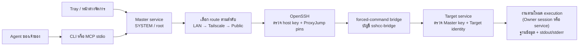
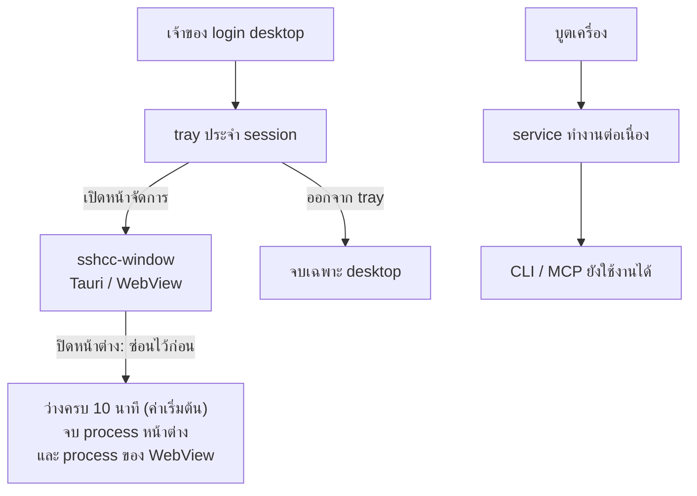
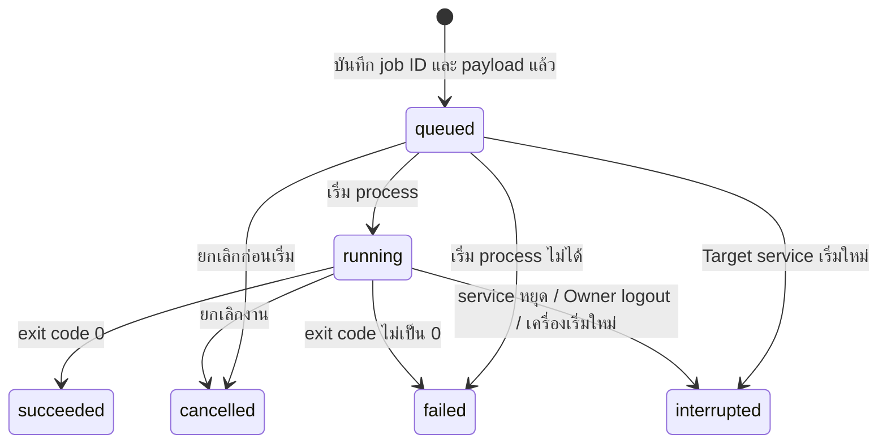

# โครงสร้าง SSH Control Center

หน้านี้เป็นภาพรวมสั้น ๆ ของเส้นทางสั่งงาน อายุของ service กับ desktop และสถานะของ job (มีเฉพาะภาษาไทย) ถ้าอยากอ่านคำอธิบายแบบภาษาง่ายที่ครบกว่า ดู [สถาปัตยกรรม](th/architecture.md) และ [วิธีทำงาน](th/how-it-works.md)

## เส้นทางสั่งงาน

CLI, MCP และหน้าต่างใช้ API ภายในเครื่องเดียวกัน ผ่าน named pipe บน Windows หรือ Unix socket บน Ubuntu ไม่มี HTTP/MCP listener ของผลิตภัณฑ์บนเครือข่าย บัญชี bridge มีสิทธิ์เรียกเฉพาะคำขอที่ผ่านการ enrollment

Master แต่ละเครื่องมีทะเบียน SQLite และกุญแจของตัวเอง และเก็บ Target ได้สูงสุด 50 เครื่อง Target รับได้หลาย Master พร้อมกันและบันทึกว่าใครเป็นต้นทางของแต่ละงาน ไม่มีการล็อกโปรเจกต์ข้าม Master

ตามค่าเริ่มต้นของการติดตั้งใหม่ (โหมด Owner session) Target service จะเริ่ม worker ที่รันงานในนามบัญชี Owner ที่ login อยู่ ส่วนการติดตั้งรุ่นเก่าในโหมด service รันงานด้วยบัญชีของ service โดยตรง ดู [OWNER-SESSION.md](OWNER-SESSION.md)

## อายุของ service และ desktop

Windows ใช้ Tauri tray และบรรจุหน้าต่างพร้อม process ลูกใน JobObject ตั้งแต่ก่อนเริ่มรันหน้าต่าง Ubuntu ใช้ tray GTK/AppIndicator ขนาดเล็กและสร้าง Tauri window process เฉพาะเมื่อเปิดหน้าต่าง การแยกนี้ทำเพื่อให้ปิดหน้าต่างแล้วคืน process ของ WebView ได้ครบ เพราะ runtime ของ WebView อาจยังค้างใน process เดิมหลังทำลายหน้าต่าง

## งานที่ Target ดูแล

Master สร้าง job ID ก่อนส่ง ถ้าการตอบกลับหาย ให้ตรวจหรือส่ง ID เดิมพร้อม payload เดิม Target คืนงานเดิมและไม่เริ่ม deploy อีกครั้ง การเชื่อมต่อ SSH หลุดไม่ใช่เหตุให้หยุดงาน ส่วน `interrupted` ต้องให้ agent ตรวจสภาพก่อนสร้างงานใหม่

การ deploy ใช้สคริปต์ PowerShell หรือ Bash ที่ระบุ working directory และ environment ชัดเจน Credentials ของ Git/share ต้องใช้ได้ในบริบทที่งานรันจริง (บัญชี Owner หรือ SYSTEM/root ของ service ตามโหมดที่ตั้งไว้) ดู [INSTALL.md](INSTALL.md) และ [OWNER-SESSION.md](OWNER-SESSION.md)

ข้อมูล API อยู่ใน [CONTRACT.md](CONTRACT.md) สิ่งที่ชุดทดสอบครอบคลุมและไม่ครอบคลุมอยู่ใน [VALIDATION.md](VALIDATION.md)
