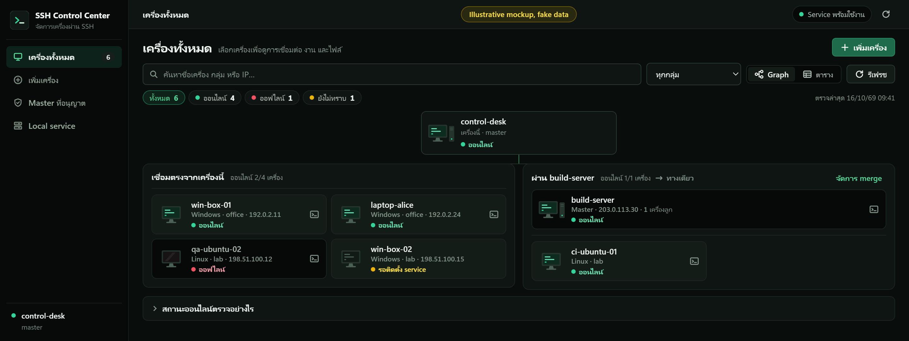

# เพิ่มเครื่องใหม่แบบง่าย

เริ่มจากเครื่องหลักที่เปิด SSH Control Center ได้อยู่แล้ว ถ้าเป็นเครื่องหลักใหม่ ให้เปิดชุดติดตั้งทั่วไป เลือก “ใช้เครื่องนี้เป็นเครื่องหลัก” และอนุญาตสิทธิ์ติดตั้ง ระบบตั้ง service และเชื่อม Codex ให้เมื่อพบการติดตั้ง Codex จากนั้นเปิด session ใหม่ของ Codex

## 1. ตั้งค่าที่เครื่องหลัก

เปิดแอปจาก tray แล้วกด **เพิ่มเครื่อง** กรอกชื่อเครื่อง กลุ่ม ระบบปฏิบัติการ และ **IP หรือชื่อเครื่องที่เข้าถึงได้** แล้วกด **สร้างชุดติดตั้งสำหรับเครื่องนี้** และ **บันทึกชุดติดตั้งไฟล์เดียว…**

ส่งไฟล์ที่ได้ไปเครื่องใหม่: Windows เป็น `.exe`; Ubuntu เป็น `.deb` ข้อมูล SSH key และบัญชีเชื่อมต่อระบบจัดการให้ ไม่ต้องส่ง private key หรือแก้ JSON

## 2. Approve ที่เครื่องใหม่

**Windows:** คัดลอกไฟล์ `.exe` ไว้บนเครื่องใหม่แล้วเปิด ตรวจชื่อเครื่องหลักและชื่อเครื่องใหม่ แล้วกด **Approve** จากนั้นอนุญาต UAC ตามขั้นตอน

**Ubuntu Desktop:** ติดตั้งไฟล์ `.deb` ด้วยตัวจัดการแพ็กเกจ แล้วเปิด **SSH Control Center Setup** จากรายการแอป ตรวจชื่อเครื่องหลัก แล้วกด **Approve** ตัวช่วยจะขอสิทธิ์ administrator เพื่อทำขั้นตอนจริง

Approve หมายถึงอนุญาตให้ agent ของเครื่องหลักสั่งงานและจัดการไฟล์บนเครื่องนี้ ด้วยสิทธิ์ของ Owner ที่ติดตั้ง (Windows ใช้ token แบบผู้ดูแลระบบ; Ubuntu ใช้ UID ของ Owner และใช้ root เมื่อร้องขอ `asAdmin`) ส่วนเครื่องที่ยังอยู่ในโหมด service จะใช้ SYSTEM/root ถ้าไม่อนุมัติ จะไม่เพิ่มสิทธิ์ SSH ของเครื่องหลัก

รอจนตัวช่วยตรวจ prerequisites, ติดตั้ง service, ตั้ง SSH และตรวจผลครบ ถ้าเกิดปัญหา หน้าจอจะแจ้งรายละเอียดและให้ลองใหม่

## 3. คัดลอกรหัสกลับมา

เมื่อสำเร็จ กด **คัดลอกรหัสจับคู่** (Ubuntu: **คัดลอกรหัส**) ส่งข้อความทั้งหมดกลับมายังเครื่องหลัก รหัสขึ้นต้นด้วย `SSHCC1.` เป็นข้อความยาวสำหรับคัดลอกวาง ไม่ต้องพิมพ์เอง

เปิดชุดติดตั้งเดิมอีกครั้งเพื่อดูรหัสที่เก็บไว้ได้ ระบบตรวจความถูกต้องก่อนใช้ผลเดิม

## 4. วางที่เครื่องหลัก

กลับมาหน้า **เพิ่มเครื่อง** วางข้อความในช่อง **รหัสจับคู่** แล้วกด **ยืนยันและตรวจการเชื่อมต่อ**

- **พร้อมใช้งาน:** ตรวจตัวตนเครื่อง, SSH host key และสิทธิ์ service ผ่านแล้ว agent สั่งงานได้
- **ติดตั้งแล้ว — รอตรวจการเชื่อมต่อ:** ไม่ต้องติดตั้งใหม่ ตรวจ IP/ชื่อเครื่อง, เครือข่าย, Tailscale หรือ firewall แล้วกด **ตรวจอีกครั้ง**
- **กุญแจยืนยันเครื่องไม่ตรง:** ตรวจว่าเป็นเครื่องเดิมจริงก่อน ระบบจะไม่แทนกุญแจเดิมอัตโนมัติ

คำขอค้างอยู่ใน service ปิดหน้าต่างหรือรีสตาร์ตเครื่องหลักแล้วเลือก **ทำต่อจากคำขอเดิม** ได้

## เครื่องที่ไม่มี desktop

Ubuntu Server ติดตั้งตัวช่วยโดยไม่ดึงส่วน GUI:

~~~bash
sudo apt install --no-install-recommends ./sshcc-client-ชื่อเครื่อง.deb
sshcc-setup --terminal
~~~

ตัวช่วยถามชื่อเครื่องหลักและขอให้พิมพ์ `APPROVE` ใน terminal แบบโต้ตอบ แล้วขอ sudo และแสดงรหัสให้คัดลอก ป้อนรหัสผ่านใน terminal เท่านั้น

Windows Server ที่ไม่มี desktop ใช้โหมด console ของชุดติดตั้ง ดูคำสั่งที่ตรงกับแพ็กเกจใน [คู่มือติดตั้ง](INSTALL.md)

## Merge Master อื่น

ถ้าเครื่องที่เชื่อมต่ออยู่แล้วเป็นเครื่องหลักด้วย ให้ merge เพื่อสั่งเครื่องลูกของเครื่องนั้นได้จากเครื่องนี้ ไม่ต้องติดตั้งอะไรบนเครื่องลูก

1. เปิดหน้า **Master ที่อนุญาต** แล้วกด **ค้นหา Master**
2. กด **Merge** ที่เครื่องที่ต้องการ สถานะจะเปลี่ยนเป็น **Merged · N เครื่อง**
3. เครื่องลูกจะอยู่ในหน้า **เครื่องทั้งหมด** พร้อมป้าย **ผ่าน ชื่อเครื่องหลัก** ID ของเครื่องลูกจะเป็นแบบ `เครื่องหลัก/เครื่องลูก` เช่น `build-server/dev-01` ใช้ได้กับ Shell, งาน, ไฟล์ และ agent

คำสั่งจะส่งผ่านเครื่องหลักนั้นและใช้สิทธิ์ของเครื่องนั้น ถ้าเครื่องหลักนั้นปิดอยู่ จะสั่งเครื่องลูกไม่ได้ กด **Sync** เมื่อเครื่องหลักนั้นเพิ่มหรือลบเครื่องลูก ถ้าสถานะเป็น **ต้องอัปเกรด Master ปลายทาง** ให้ติดตั้งเวอร์ชันเดียวกันบนเครื่องนั้นก่อน

เครื่องหลักที่ถูก merge จะเห็นรายชื่อในส่วน **Master ที่ merge เครื่องนี้** และกด **ปิดการ merge** ได้ทุกเมื่อ การปิดจะมีผลจนกว่าจะกด **อนุญาตอีกครั้ง**

### เปิดสองทาง

ปกติ merge เป็นทางเดียว เครื่องนี้สั่งเครื่องลูกของเครื่องนั้นได้ ถ้าต้องการให้เครื่องนั้นสั่งเครื่องลูกของเครื่องนี้ได้ด้วย ให้กด **เปิดสองทาง** ในตาราง Merge Master อื่น (เครื่องหลักที่เป็น Windows)

ระบบจะลงทะเบียนเครื่องนี้เป็น Target ของเครื่องนั้นด้วยขั้นตอนจับคู่ปกติ และ Windows จะขอสิทธิ์ admin หนึ่งครั้งเพื่อติดตั้ง OpenSSH Server, บัญชี `sshcc-bridge` และกุญแจของเครื่องนั้น Firewall คงตามเดิม เครื่องนั้นต้องเข้าพอร์ต 22 ของเครื่องนี้ได้ เมื่อเสร็จ ช่อง **ทิศทาง** จะเป็น **สองทาง** ถ้าไม่สำเร็จจะแสดงสาเหตุพร้อมปุ่ม **ลองอีกครั้ง** ซึ่งไม่ติดตั้งซ้ำถ้าลงทะเบียนไว้แล้ว

แต่ละฝั่งปิดทิศทางของตัวเองได้ด้วย **ปิดการ merge** โดยไม่กระทบอีกฝั่ง

### มุมมอง Graph

หน้า **เครื่องทั้งหมด** เปิดเป็นผังเครือข่าย: เครื่องนี้อยู่ด้านบนสุด โยงลงไปยังกลุ่มเครื่องที่เชื่อมตรง และกลุ่มเครื่องลูกของแต่ละ Master ที่ merge ไว้ เครื่องที่เชื่อมตรงอยู่แล้วจะมีป้าย **เชื่อมตรงด้วย** ในกลุ่มของ Master นั้น พร้อมตัวกรองสถานะด่วน (**ทั้งหมด / ออนไลน์ / ออฟไลน์ / ยังไม่ทราบ**)

- จอ PC ติดสีเขียวพร้อมเคอร์เซอร์กะพริบ = ออนไลน์ · จอดับ = ออฟไลน์ · จอเหลือง = กำลังตรวจ · จอมืด = ไม่ทราบสถานะ (เช่น Master ที่พาไปติดต่อไม่ได้)
- เช็กพอร์ต SSH ทุก 1 นาทีขณะใช้หน้าต่างนี้ (ไม่ login) กด **รีเฟรช** เพื่อตรวจผ่าน SSH เต็มรูปแบบทันที
- กดที่เครื่องเพื่อดูการเชื่อมต่อ งาน และไฟล์ (ข้อมูลเทคนิค การแก้ไข และการนำเครื่องออกพับอยู่ในหัวข้อรายละเอียด) หรือกดปุ่ม Shell ที่โหนดเพื่อเปิด Terminal ทันที
- กด **ตาราง** เพื่อสลับไปมุมมองตาราง ระบบจำมุมมองที่เลือกไว้
- คลิกขวาไอคอน tray เพื่อเลือก **เปิด SSH Control Center** หรือ **ปิดไอคอน Tray (Service ยังทำงานต่อ)**

## สิ่งที่ควรรู้

- Service ทำงานแยกจาก tray ปิดหน้าต่างหรือ tray แล้วงานยังดำเนินต่อ
- ถ้าใช้ Tailscale ต้องลงชื่อเข้าใช้ตามขั้นตอนปกติก่อน Public IP ต้องมี SSH/firewall/NAT ที่เข้าถึงได้อยู่แล้ว
- เพิ่มเครื่องหลักอีกเครื่องด้วยชุดติดตั้งจากเครื่องหลักนั้น สิทธิ์เดิมยังอยู่
- รหัสมีข้อมูลสาธารณะสำหรับจับคู่ checksum ตรวจการคัดลอกเสียหาย การส่งรหัสต้องใช้ช่องทางที่ไว้ใจ
- ปิดหน้าจอหรือเลิกทำคำขอไม่ได้ถอนสิทธิ์ที่เครื่องใหม่ Approve ไปแล้ว ให้ถอนสิทธิ์ผ่านหน้าจัดการ Masters เมื่อจำเป็น
- Git และ network-share credentials ต้องใช้ได้ในบัญชีที่งานรันจริง (Owner หรือบัญชี service ตามโหมดของเครื่อง) ทดสอบด้วยงานจริงก่อนใช้ ดู [คู่มือติดตั้ง](INSTALL.md)
- ตัวเลือกขั้นสูงยังรองรับพอร์ต, เส้นทางสำรอง, ProxyJump และการนำเข้าด้วยไฟล์ (advanced file flow)

[คู่มือ agent](AGENT.md) · [การทดสอบและข้อจำกัด](VALIDATION.md) · [คู่มือติดตั้ง](INSTALL.md)
