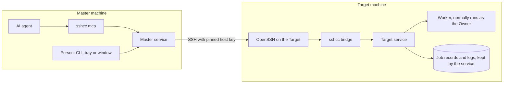

# Architecture: the pieces

> SSH Control Center lets you, or your AI agent, run commands, edit files and open terminals on all your Windows and Ubuntu machines over SSH, from one place.

This page is a map. It names each piece, says what it does in plain words, and shows where it lives in the repository. It describes version 0.4.0 of this source tree.

- For the story of one command from start to finish, read [How it works](how-it-works.md).
- For how a new machine is added, read [Pairing](pairing.md).
- For the safety rules and the known risks, read [Security model](security-model.md).
- Thai version of this page: [th/architecture.md](th/architecture.md).

## 1. The idea in one paragraph

Picture a company with a **reception desk** at head office and several **branch offices** far away. You never visit a branch yourself. You hand a request to the desk: "run this script in the north branch", "fix that file in the east branch". The desk keeps the list of branches and holds the only keys. It phones a branch on a private line. Before it speaks, it checks that the voice on the line really is that branch, not an impostor. Each branch has one door and one guard. The guard lets in only the desk's own key, and only passes on the request. The branch manager checks again that the desk is on the approved list, then a clerk does the work using the account of the person who owns that branch. The clerk hands the result to the manager, and the manager writes it in the branch logbook. If the phone line drops, the work carries on, and the desk can read the logbook later.

In real terms:

| In the story | In SSH Control Center |
|---|---|
| Reception desk | the **Master** (the machine you give orders from) |
| Branch office | a **Target** (a machine that receives orders) |
| Private phone line | **SSH** (the standard encrypted way to log in to another computer) |
| Checking the voice | a **pinned host key** (the branch's SSH host key, its public identity, saved ahead of time) |
| Guard at the door | `sshcc bridge` |
| Branch manager | the **Target service** |
| Clerk | the **worker** |
| Logbook | job records and logs, written by the Target service and stored on the Target |

### Words you will meet

- **Service**: a program that runs in the background all the time, with no window.
- **OpenSSH**: the common free program that does SSH. SSH Control Center uses the OpenSSH that comes with the operating system (the installer adds it from the operating system's own source if it is missing). It does not ship its own SSH.
- **MCP** (Model Context Protocol): a common plug that lets an AI assistant use tools.
- **Local channel**: a private connection between two programs on the same computer. Windows calls it a named pipe. Linux uses a Unix socket. The network cannot reach it.
- **Owner**: the person account that ran the installer on a machine. On a Target, new work normally runs as this account.
- **Job**: a script started in the background. It has an ID, so you can look it up later.

## 2. The pieces

| Piece | What it does, in plain words | Where in the repo |
|---|---|---|
| **CLI** (`sshcc`) | One small program with many modes. Typing `sshcc targets` or `sshcc exec` asks the local service to do something. The same program also acts as the service, the MCP server, the bridge and the worker, depending on the word you give it. | `crates/cli/src/main.rs`, `crates/cli/src/shell.rs` (the `sshcc shell` terminal) |
| **Core service** (`sshcc service run`) | The always-on program, and the heart of the product. On a Master it keeps the list of Targets and the SSH keys, and starts the outgoing SSH calls. On a Target it runs jobs, files and terminals. It listens only on the local channel. | `crates/core/src/service.rs`, `ipc.rs`, `fleet.rs` (with `fleet_ssh.rs`, `fleet_merge.rs`), `jobs.rs`, `files.rs`, `terminal.rs`, `config.rs` |
| **MCP server mode** (`sshcc mcp`) | Lets an AI assistant use the tools. It reads and writes MCP messages on stdin and stdout. Each tool call is passed on to the local service. It holds no SSH keys. | `crates/core/src/mcp.rs`, `agent_tools.rs`; `client_links.rs` adds the `ssh_control_center` entry to Cursor, Claude Code or Codex |
| **Desktop tray and window** | A small tray icon stays in the corner. The management window (its screens are in Thai) is a separate program that opens on demand and talks to the service the same way the CLI does. Closing the window hides it, and it exits after 10 idle minutes by default. Quitting the tray leaves the service running. | `desktop/src-tauri/src/` (tray and window), `desktop/ui/` (the screens) |
| **Installers** | Put the pieces on a machine. They install the service, create a restricted `sshcc-bridge` account, add the Master's key with a forced command, and ask a person to approve on the Target. Windows uses one `.exe`. Ubuntu uses a `.deb` plus a setup helper. | `installers/windows/`, `installers/ubuntu/`; `crates/core/src/setup_package.rs` builds the per-machine installer, `pairing.rs` handles the approval data |
| **Target-side bridge** (`sshcc bridge`) | The guard. The Target's SSH server starts it when the Master connects. It reads one request, adds the Master ID and key fingerprint that SSH fixed in the key line, hands the request to the local service, and prints the reply. | `crates/cli/src/main.rs` (the `bridge` mode), `crates/core/src/stream.rs` (live terminals) |
| **Target-side worker** (hidden `sshcc worker` mode) | The clerk. A short-lived helper process. Normally it takes on the Owner's identity (root, if the caller asks for administrator rights on Ubuntu) and then runs the job, the file operation or the terminal. It reports output back to the Target service, which keeps the logs. | `crates/core/src/worker.rs`, `executor.rs` with `executor_windows.rs` and `executor_linux.rs` |
| **OpenSSH** (not part of this repo) | The Master calls the machine's own `ssh` and `ssh-keygen`. The Target answers with the machine's own SSH server. | Called from `crates/core/src/fleet_ssh.rs` and `fleet.rs`; server settings written by the installers |

> **For developers.** The workspace (`Cargo.toml`) has three crates. `crates/core` is the library `sshcc-core`. `crates/cli` builds the `sshcc` binary on top of it. `desktop/src-tauri` is `sshcc-desktop`, which is left out of the default workspace members (see `desktop/README.md` for its extra prerequisites). The window and the CLI share the same client code, `crates/core/src/client.rs`, so the desktop has no private path to the service. The window calls the service through a generic `rpc` command in `desktop/src-tauri/src/tauri_app.rs`.
>
> On Windows the tray (`sshcc-desktop`) starts the window program (`sshcc-window`) inside a private Job Object (`windows_window.rs`). On Ubuntu the tray is a small GTK and AppIndicator program (`linux_tray.rs`) that starts `sshcc-window` when needed. The idle time can be changed with `SSHCC_WINDOW_IDLE_SECS`.

## 3. Two roles: Master and Target

A machine has one or both roles. The role is chosen at install time (`sshcc init --role master|target|both`) and stored in the machine's `config.json`.

| | **Master** (reception desk) | **Target** (branch office) |
|---|---|---|
| Plain words | The machine you give orders from. | A machine that receives orders. |
| Keeps | The list of Targets (at most 50), an SSH key pair for each group of machines, and the pinned host keys. | Its own identity, the list of Masters it accepts, job records and logs, and terminal details. |
| Starts SSH connections | Yes, outgoing only. | No. It only answers. |
| Does the work | No. It forwards the request. | Yes: jobs, files and terminals. |
| Service account | SYSTEM on Windows, root on Ubuntu | SYSTEM on Windows, root on Ubuntu |

Three things to know:

- **One machine can be both.** Think of a laptop that you work from (a desk) and that another Master can also reach (a branch). It has both roles in one service.
- **Masters are independent.** Each Master has its own list and its own keys. They do not copy keys or registrations to each other. One Target can accept several Masters at once, and it records which Master started each job.
- **A Master can relay through another Master.** If a Target is itself a Master, you can "merge" it. Your requests then travel one hop through it to reach its own Targets. It is one hop only: merges of merges are not shared. See `docs/AGENT.md`, section "Merged Masters".

> **For developers.** The service enforces roles in `crates/core/src/service.rs`. Without the `target` role it refuses bridge requests (`E_ROLE`). Without the `master` role it refuses `targets.*`, `jobs.*`, `files.*`, `terminal.*`, `pairing.*` and `enrollment.export`. The default work account depends on the config: a fresh install (config schema 2) runs new work as the Owner (`owner-session`), while an older install (schema 1) keeps running work directly as the service account, with no worker, until the installer switches it. See [OWNER-SESSION.md](OWNER-SESSION.md) and `crates/core/src/config.rs`.

## 4. How the pieces connect



*A request goes from the AI agent or a person, through the Master service and one SSH hop, to the Target service, which has a worker do the work. The Target service keeps the records and logs, so the results stay on the Target.*

Follow the arrows:

1. An AI agent talks to `sshcc mcp`. A person uses the CLI, the tray or the window. All of them reach the same place, the Master service, through the local channel.
2. The Master service finds the Target in its list and tries the routes saved for that machine, in order (for example LAN, then Tailscale, then Public, and optionally through a jump host called ProxyJump). It starts OpenSSH with a temporary, strict config that it writes itself.
3. OpenSSH on the Target accepts only the Master's key. That key is tied to a fixed forced command that can only start `sshcc bridge` (on Windows, through a fixed `powershell.exe -EncodedCommand` wrapper).
4. The bridge passes the request to the Target service on the local channel.
5. The Target service checks the request. Then a worker does the work. It normally runs as the Owner (as root if the caller asks for `asAdmin` on Ubuntu). Older schema-1 installs run work as the service account, with no worker.
6. The worker reports its output to the Target service, which keeps the results on the Target. The Master asks for them when it needs them, even after a dropped connection.

> **For developers.** The Target service accepts only a fixed list of bridge methods (`runner.*`, `fs.*`, `pty.*` and `system.status`, plus the `relay.*` calls used by merged Masters) and refuses the rest with `E_PERMISSION`. It also checks that the Master is enrolled and not revoked, that the key fingerprint matches, and that the Target ID in the request is its own (`bridge_master` in `crates/core/src/service.rs`). A normal call uses one SSH connection per request; an interactive terminal keeps one connection open (`crates/core/src/fleet_ssh.rs`). A host-key mismatch stops the route fallback instead of trying the next route.

## 5. Where things live

In the repository:

```text
crates/
  cli/src/main.rs        the `sshcc` command, every mode (service, mcp, bridge, shell, pairing, ...)
  cli/src/shell.rs       `sshcc shell`, the interactive terminal client
  core/src/
    service.rs           the always-on service: receives requests, checks roles and callers
    ipc.rs               the local channel (named pipe or Unix socket) and caller identity check
    protocol.rs          the message format: one JSON message per line, at most 8 MiB
    client.rs            how the CLI, MCP and window talk to the service
    mcp.rs               MCP server mode and the tool list
    agent_tools.rs       text-first tools for AI agents (run a command, edit a file, search)
    client_links.rs      adds the MCP entry to Cursor, Claude Code or Codex
    fleet.rs             Master: Target list, keys, outgoing SSH
      fleet_ssh.rs         the strict OpenSSH call and route fallback
      fleet_merge.rs       merged Masters, relays and health checks
    pairing.rs           the guided "add a machine" flow
    setup_package.rs     builds the per-machine installer from a template
    jobs.rs              Target: durable background jobs
    files.rs, search.rs  Target: file read and write, file search
    terminal.rs          Target: interactive terminals; stream.rs carries them live
    executor*.rs         Target: pick the Owner session and start workers
    worker.rs            Target: the hidden worker mode
    config.rs, security.rs  settings, state folder, file permissions
    windows_service.rs   Windows service wrapper
desktop/
  src-tauri/             tray and window programs (Tauri 2, Rust)
  ui/                    the window screens: plain HTML, CSS and JavaScript (Thai)
installers/
  windows/               Setup.ps1, PairingBootstrap.ps1, sshcc.nsi, Uninstall.ps1, Configure-Codex.ps1
  ubuntu/                setup.sh, setup-helper.py, sshcc.service (systemd), package scripts
scripts/                 build, smoke and benchmark helpers
tests/                   end-to-end, lifecycle and benchmark tests
docs/                    documentation
```

On a machine where it is installed (not in the repository). Main items only:

```text
Windows   C:\ProgramData\SSHControlCenter
Ubuntu    /var/lib/sshcc
  config.json         roles, Owner, work mode
  fleet.sqlite        Master: Targets, per-group public keys, pairing requests, merges, health,
                      and a copy of each job request (script, folder, environment) for retries.
                      Target: accepted Masters
  keys/               Master: SSH key pairs, owned by the service
  jobs.sqlite         Target: job records
  jobs/               Target: job stdout and stderr log files (one folder per job)
  terminals.sqlite    Target: terminal details only (not the text)
```

> **For developers.** The state folder can be moved with the `SSHCC_DATA_DIR` environment variable, and the local channel with `SSHCC_SOCKET` (`crates/core/src/config.rs`). Set both together for an isolated test. On Ubuntu the socket is `/run/sshcc/control.sock` and the service is the systemd unit `sshcc`. On Windows the pipe name is built from a hash of the state folder path, and the service is `SSHControlCenter`, which runs as LocalSystem.

## 6. What it deliberately does not do

Each point below can be checked in this tree. The file in brackets is where to look.

- **It has no network listener of its own.** The service listens only on the local channel. On Windows the pipe refuses remote clients. On Ubuntu the kernel tells the service which user is calling, and the service checks that user before it reads the request. MCP mode uses stdin and stdout only. Remote access happens only through the machine's own SSH server. (`crates/core/src/ipc.rs`, `service.rs`, `docs/AGENT.md`)
- **It does not use your personal SSH setup on the Master.** Every call writes its own temporary config and pin file, then deletes them. It does not read your SSH config, your SSH agent or your known-hosts file. On the Target, the installer adds only its own marked block and key line, and leaves other lines alone. (`crates/core/src/fleet_ssh.rs`, `docs/CONTRACT.md`)
- **It does not trust a machine just because it answers.** Host keys are pinned during pairing. Work, file and terminal calls check them strictly, and a mismatch stops the call, with no fallback to the next route. The routine online/offline indicator only reads the SSH banner, so treat it as reachability, not identity. (`crates/core/src/fleet_ssh.rs`, `fleet_merge.rs`, `docs/AGENT.md`)
- **It does not use passwords, an SSH agent or forwarding.** The Master's SSH call turns them off. The Target's bridge account is set up with no password login, no port or agent forwarding, no X11 and no terminal at the SSH level. Interactive terminals are created by the Target service instead. (`crates/core/src/fleet_ssh.rs`, `installers/ubuntu/setup.sh`, `installers/windows/Setup.ps1`)
- **It does not give the SSH key a shell.** The only commands that run are the fixed bridge and the listed methods. An enrolled Master can still start jobs and write files, which is the product's purpose; see the [Security model](security-model.md). (`crates/core/src/service.rs`, `installers/ubuntu/setup.sh`, `installers/windows/Setup.ps1`)
- **It does not replay jobs.** If the Target service restarts, jobs that were queued or running are marked `interrupted` and are not run again. The same job ID with the same content returns the existing job. (`crates/core/src/jobs.rs`, `docs/OWNER-SESSION.md`)
- **It does not save what you type into a terminal.** Terminal input is never written to disk, and output is kept in a memory buffer of 4 MiB. Only the terminal's details are saved. (`crates/core/src/terminal.rs`, `docs/OWNER-SESSION.md`)
- **It does not copy private keys.** Pairing carries only public data. The Master's private keys are created and stay in its own `keys/` folder. (`crates/core/src/pairing.rs`, `docs/CONTRACT.md`)
- **It does not lock projects, synchronize folders or merge edits.** Two Masters can work on one Target at once. For files you can send the hash you last saw (`expectedSha256`), and the write is refused if the file has changed. Masters do not copy keys or registrations to each other. A merge only stores the merged Master's Target names, IDs and basic details (public metadata) so they can be listed. (`crates/core/src/mcp.rs`, `crates/core/src/fleet_merge.rs`, `docs/AGENT.md`)
- **It does not delete whole folders.** The remove tool deletes one file or one empty folder. (`crates/core/src/mcp.rs`, `docs/AGENT.md`)
- **It does not manage your network.** A Tailscale address is just one more kind of route. The product does not sign in to Tailscale or set firewall rules for you. (`docs/INSTALL.md`, `crates/core/src/pairing.rs`)
- **It has no macOS support.** Installers exist only for Windows and Ubuntu 24.04 x64. (`installers/`, `docs/INSTALL.md`)

This page lists design choices, not every risk. The known limits, such as what a prompt-injected AI agent could do, are in the [Security model](security-model.md).

## Read next

- [How it works](how-it-works.md): one command, step by step.
- [Pairing](pairing.md): adding a machine.
- [Security model](security-model.md): the rules and the known risks.
- [FAQ](faq.md): short answers.
- Reference: [INSTALL.md](INSTALL.md), [CONTRACT.md](CONTRACT.md), [AGENT.md](AGENT.md), [OWNER-SESSION.md](OWNER-SESSION.md).
- Back to the [README](../README.md).
