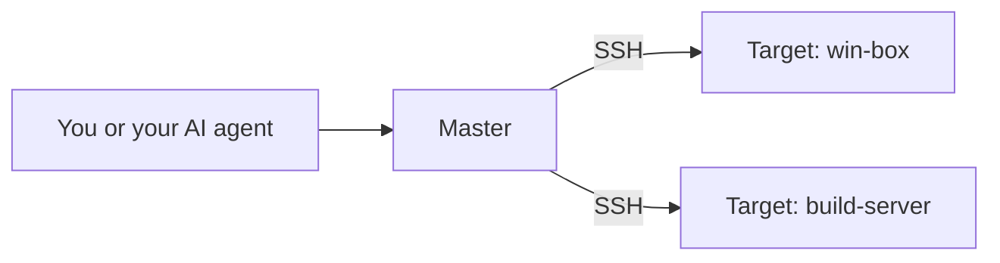
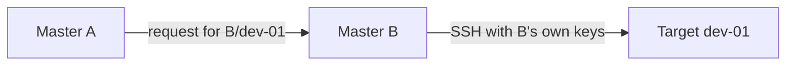

# Frequently asked questions

Short answers about SSH Control Center, version 0.4.0 (the `version` in the root [`Cargo.toml`](../Cargo.toml)). Thai version: [th/faq.md](th/faq.md).

Each answer starts in plain words. Blocks marked **For developers** name the files in this repository that back the claims, so you can check them yourself.

1. [What is SSH Control Center?](#1-what-is-ssh-control-center)
2. [Who is it for?](#2-who-is-it-for)
3. [Which operating systems does it support?](#3-which-operating-systems-does-it-support)
4. [Do I need an AI agent to use it?](#4-do-i-need-an-ai-agent-to-use-it)
5. [Which AI apps can it connect to?](#5-which-ai-apps-can-it-connect-to)
6. [Does it open network ports?](#6-does-it-open-network-ports)
7. [Where are the keys and data stored?](#7-where-are-the-keys-and-data-stored)
8. [What is a Master and what is a Target?](#8-what-is-a-master-and-what-is-a-target)
9. [Can two Masters share the same Targets?](#9-can-two-masters-share-the-same-targets)
10. [Is it safe to let an AI agent drive it?](#10-is-it-safe-to-let-an-ai-agent-drive-it)
11. [How do I uninstall it?](#11-how-do-i-uninstall-it)
12. [Why is the desktop app in Thai?](#12-why-is-the-desktop-app-in-thai)
13. [Is it production ready?](#13-is-it-production-ready)
14. [How do I give feedback?](#14-how-do-i-give-feedback)
15. [What is the license?](#15-what-is-the-license)

## 1. What is SSH Control Center?

SSH Control Center lets you, or your AI agent, run commands, edit files and open terminals on all your Windows and Ubuntu machines over SSH, from one place.

Two quick definitions. **SSH** is the standard, encrypted way to log in to another computer. An **AI agent** is an AI assistant that can use tools (here: run commands and edit files), not just chat.

It has four parts: a small background **service** on each machine, a command-line program called `sshcc`, an MCP server mode (`sshcc mcp`) that lets AI apps call it through **MCP** (a common plug-in format for AI apps, see question 5), and an optional tray icon with a management window.

> **For developers.** Rust workspace: `crates/core` (service, jobs, files, terminals, pairing), `crates/cli` (the `sshcc` binary), `desktop/` (a tray plus a Tauri 2 management window with a plain HTML/CSS/JS UI; the Ubuntu tray is GTK/AppIndicator). See [architecture.md](architecture.md).

## 2. Who is it for?

People who look after a small group of their own Windows or Ubuntu machines and want to drive them from one place, by hand or through an AI agent. One Master can store up to 50 Targets (both words are explained in question 8).

It is a personal showcase project (question 13), so it suits trying out, learning from and reading the code more than running anything critical.

Not a fit today: Mac machines (question 3), or anyone who needs a signed, independently audited product (question 13).

> **For developers.** The limit is `MAX_TARGETS = 50` in `crates/core/src/fleet.rs`.

## 3. Which operating systems does it support?

Windows and Ubuntu, 64-bit (x64) only, for both Masters and Targets.

- Intended Target baseline (the wording [INSTALL.md](INSTALL.md) uses): Windows 10 or 11 (Windows 10 needs the OpenSSH optional feature), Windows Server 2019, 2022 or 2025, and Ubuntu 24.04.
- The installers check the basics for every role: the Ubuntu setup scripts stop on anything other than Ubuntu 24.04 on x86_64, and the Windows setup script needs 64-bit Windows. Other Linux distributions are not supported by the installer. For a Master, no version list beyond that is documented.
- macOS is not supported. Nothing in this repository targets it.
- The automated tests do not cover every Windows edition listed above. [INSTALL.md](INSTALL.md) says so too.

> **For developers.** `crates/core/src/fleet.rs` rejects any OS other than `windows` or `linux`. `installers/ubuntu/setup.sh` and `installers/ubuntu/setup-worker.sh` check `/etc/os-release` for Ubuntu 24.04 and `uname -m` for `x86_64`. `installers/windows/Setup.ps1` requires 64-bit Windows. Intended Target baseline list: [INSTALL.md](INSTALL.md#packages-and-roles). What is tested: [VALIDATION.md](VALIDATION.md).

## 4. Do I need an AI agent to use it?

No. An AI agent is optional. You can use it yourself in two ways:

- the tray icon and management window: see your machines, start and read jobs, edit files, and press **Open shell** (the button is labelled in Thai, see question 12) to open a terminal;
- the `sshcc` command in a terminal, for example `sshcc doctor <Target>` to check a machine, `sshcc exec` to run a script, or `sshcc shell <Target>` for an interactive terminal.

The window, the command line and the MCP mode all talk to the same local service, so they see the same machines and jobs.

> **For developers.** Commands: [AGENT.md](AGENT.md) and [OWNER-SESSION.md](OWNER-SESSION.md#shell). Window: `desktop/README.md`.

## 5. Which AI apps can it connect to?

It speaks **MCP** (Model Context Protocol, a common way for AI apps to plug in tools) over standard input and output. The AI app starts `sshcc mcp` as a small helper program and talks to it. So any AI app that can start a local MCP server this way should be able to use it.

Three apps get built-in help: **Cursor**, **Claude Code** and **Codex**.

- The desktop app has a connect button for each of them. It writes an entry named `ssh_control_center` into that app's own config file. If that entry already exists, the button leaves it alone; a separate "update path" button changes the stored command path when you ask.
- The Master installers also wire up Codex automatically when they find it.
- For any other app, add the entry yourself using the snippet below.

Honest limit: the automated tests check that these config files are written correctly and that the MCP handshake works with a test script. They do not run a live session with each AI app.

> **For developers.** Registration code and tests: `crates/core/src/client_links.rs`. Config files it manages: `~/.cursor/mcp.json`, `~/.claude.json`, `~/.codex/config.toml`. Why connect never overwrites: [ADR 0001](adr/0001-mcp-registration-no-overwrite.md). The server reports MCP protocol version `2025-06-18` and answers `initialize`, `tools/list` and `tools/call` (`crates/core/src/mcp.rs`).
>
> Snippet for JSON-based apps such as Cursor and Claude Code (on Ubuntu use `/usr/bin/sshcc`):
>
> ```json
> {
>   "mcpServers": {
>     "ssh_control_center": {
>       "command": "C:\\Program Files\\SSH Control Center\\sshcc.exe",
>       "args": ["mcp"]
>     }
>   }
> }
> ```
>
> Codex uses TOML:
>
> ```toml
> [mcp_servers.ssh_control_center]
> command = 'C:\Program Files\SSH Control Center\sshcc.exe'
> args = ["mcp"]
> enabled = true
> ```

## 6. Does it open network ports?

The product itself does not listen on the network. Its service listens only on a same-machine channel: a Windows named pipe that refuses remote clients, or a Unix socket file (`/run/sshcc/control.sock`) on Ubuntu. There is no HTTP or MCP server on the network, and the desktop window loads its own local files.

But the machines it controls must be reachable over SSH:

- Each Target needs its SSH port reachable from the Master. That is normally port 22. An advanced option lets a route use another port.
- The installer scripts set up OpenSSH on the Target (on Windows they may install the OpenSSH Server feature). They do not add or edit firewall, NAT or Tailscale settings, so you do that. Installing the Windows OpenSSH Server feature may add Windows' own default firewall rule, so check your firewall.
- The Master also makes short outgoing connections to read each Target's SSH greeting for health checks. This does not log in.

> **For developers.** Listeners: `crates/core/src/ipc.rs` (`PIPE_REJECT_REMOTE_CLIENTS` on Windows; on Unix the socket mode is 0666 and each caller is identified with the kernel's peer credentials, as the comment there says). The only outgoing `TcpStream` in `crates/core/src` is the banner check in `fleet_merge.rs`. [AGENT.md](AGENT.md) says "There is no network HTTP/MCP listener", and [architecture.md](architecture.md) makes the same point. Installers leave firewall policy alone: `installers/windows/Setup.ps1` and `installers/ubuntu/setup.sh` print that it stays operator-managed.

## 7. Where are the keys and data stored?

On each machine, in one data folder:

- Windows: `C:\ProgramData\SSHControlCenter`
- Ubuntu: `/var/lib/sshcc`

Inside it:

- **Master private key:** `keys/<tenant>.ed25519`, one per tenant (the group name you choose when you add a machine). It is made with `ssh-keygen` as an Ed25519 key with no passphrase, so its protection is file permissions. A Target only ever gets the public half.
- **List of machines** (including their pinned SSH host keys): `fleet.sqlite`. On a Master it also keeps a copy of each job request (script, working folder, environment values), so that an identical retry can be recognised. The same no-secrets rule applies.
- **Jobs:** `jobs.sqlite` plus a `jobs/<id>` folder with stdout and stderr. These live on the Target that ran the job.
- **Terminals:** `terminals.sqlite` holds the terminal records. Terminal output is kept in memory (a 4 MiB ring), and what you type is never written to disk.
- **This machine's identity and settings:** `config.json`.

On a Target, the public keys of approved Masters are in `C:\ProgramData\ssh\sshcc` (Windows) or `/etc/ssh/sshcc` (Ubuntu). The product also changes the SSH server config in one clearly marked way: a marked block in `sshd_config` on Windows, and a marked drop-in file, `/etc/ssh/sshd_config.d/90-sshcc.conf`, on Ubuntu.

Jobs keep their script and output, so do not put passwords in scripts or environment values.

> **For developers.** Paths: `data_dir()` in `crates/core/src/config.rs` (override with the `SSHCC_DATA_DIR` environment variable, used by tests). Key generation: `master_key()` in `crates/core/src/fleet.rs`. Files and SSH server config locations: [INSTALL.md](INSTALL.md#packages-and-roles). Terminal ring and input rule: [OWNER-SESSION.md](OWNER-SESSION.md#mcp--api). Password warning: [INSTALL.md](INSTALL.md#service-environment-and-credentials).

## 8. What is a Master and what is a Target?

Think of a building manager with a ring of keys. The **Master** is the manager: it holds the keys, keeps the list of rooms and does the walking. A **Target** is a room, meaning a machine the Master controls. The room's owner has to open the door and hand over a key (the **Approve** step) before the manager can ever go in.



You talk to one Master. The Master reaches each Target over SSH.

- A Master stores the list of Targets (up to 50), owns the private keys and starts the SSH connections.
- A Target accepts only Masters it has approved. It runs the work and keeps the results itself, so a job keeps going if the SSH connection drops.
- One machine can be a Master, a Target, or both.
- How a machine becomes a Target (pairing) is explained in [pairing.md](pairing.md).

> **For developers.** Roles `master`, `target`, `both`: `init()` in `crates/core/src/config.rs`. Where jobs run (a Target set up by the current installer runs them as the logged-in Owner account; older installs stay on SYSTEM/root): [OWNER-SESSION.md](OWNER-SESSION.md).

## 9. Can two Masters share the same Targets?

Yes, in two ways.

**1. Enroll the Target with both Masters.** Each Master has its own keys and its own list, and the Target approves each one separately. The two Masters do not sync with each other. The Target records which Master started each job. Nothing locks a project across Masters, so if both deploy to the same place, coordinate in your scripts.

**2. Merge one Master into another.** If Master B is also a Target of Master A, A can merge B. A then reaches B's Targets by asking B to act for it. They appear as `B/dev-01` style IDs.



Master A never receives Master B's keys. It only asks B to act.

- A merge reaches one hop only: B's own merges are not passed on.
- B can switch A off at any time and A stays blocked until B allows it again.
- If B is offline, its Targets cannot be reached through A.
- Every approved Master has administrative power over its Targets, so merge only Masters you trust.

> **For developers.** `crates/core/src/fleet_merge.rs` (relay, grants, health), the list of relayable methods `RELAY_METHODS` in the same file, and [AGENT.md](AGENT.md#merged-masters). Two-Master and relay behaviour is exercised by `crates/core/tests/fleet.rs` and the container harness described in [VALIDATION.md](VALIDATION.md).

## 10. Is it safe to let an AI agent drive it?

It is powerful on purpose, so treat it that way. The honest picture:

- **Approving is a big step.** When you approve a Master on a Target, you let agents of that Master run commands and access files on it. Every approved Master has administrative power over its Targets.
- **Which account runs the work.** On new installs (owner-session mode): on Windows the Owner account must already be an administrator and work runs with its elevated token; on Ubuntu, work runs as the Owner's user, and as root only when the caller asks for `asAdmin`. Installs kept from earlier builds run work as SYSTEM (Windows) or root (Ubuntu) until the installer switches them to owner-session mode.
- **Access is by account, not by app.** Anything running as the Owner account on a Master can use the same local service, not only your AI app.
- **An AI can be tricked by text it reads.** Logs, source files or web pages can contain hidden instructions. The docs tell you to treat logs and source files as untrusted data, and the tool itself cannot tell your instruction from text hidden in those files. Keep a human in the loop for anything destructive.
- **Start small.** Try it on disposable virtual machines first, as [INSTALL.md](INSTALL.md) advises.

To take access away, revoke the Master on the Target: from the "Master ที่อนุญาต" page of the desktop app (the Thai label for the allowed-Masters page), or with `masters.revoke`. Abandoning a pairing request does not revoke access that was already approved.

Read more: [security-model.md](security-model.md) and [SECURITY.md](../SECURITY.md).

> **For developers.** Approval wording and the pairing-code caveat (its checksum catches copy errors, it is not a signature): [INSTALL.md](INSTALL.md#normal-installation-and-pairing). Authority and tenant limits: [AGENT.md](AGENT.md#concurrency-and-registry-import). Untrusted logs: [AGENT.md](AGENT.md). Windows and Ubuntu identities: [OWNER-SESSION.md](OWNER-SESSION.md#accounts). Pipe access list built from owner plus allowed accounts: `Listener::bind` in `crates/core/src/ipc.rs`.

## 11. How do I uninstall it?

Run the uninstall script on that machine as an administrator. Finish or cancel running jobs and close terminals first, because the script stops the service and that interrupts anything still running. The Ubuntu package scripts refuse removal while work is running, but only when the package is removed directly with `apt` or `dpkg`; `uninstall.sh` stops the service first. The Windows script has no such check.

Windows, in an elevated PowerShell:

```powershell
powershell.exe -NoProfile -ExecutionPolicy Bypass -File 'C:\Program Files\SSH Control Center\Uninstall.ps1'
```

Ubuntu:

```bash
sudo /usr/lib/sshcc/uninstall.sh
```

What it removes: the service, the program executables (`sshcc.exe` and the desktop executables on Windows, the packages on Ubuntu), the owner's tray shortcut or autostart entry, and what it added to the SSH server config: the marked block in `sshd_config` on Windows, the marked drop-in file on Ubuntu (it checks the config is still valid afterwards). On Windows the helper scripts and the install folder stay in place.

What it leaves on purpose, so you can reinstall or roll back: the data folder (keys, job history, logs), the `sshcc-bridge` account, the public key files and prerequisites such as OpenSSH. To remove those too, delete them yourself. It does not delete or change keys, services or Tailscale settings that it did not create, with one exception: when it removes its SSH config, it restarts the SSH server on Windows (or reloads it on Ubuntu) so the change takes effect. A Windows restart may disconnect active SSH sessions.

Honest limit: no automated test in this repository runs `Uninstall.ps1` (see [VALIDATION.md](VALIDATION.md#not-covered-by-anything-in-this-tree)), so try it in a virtual machine first.

> **For developers.** `installers/windows/Uninstall.ps1`, `installers/ubuntu/uninstall.sh`, and the package scripts `installers/ubuntu/prerm` (refuses direct `apt` or `dpkg` removal or upgrade while jobs or terminals run; `uninstall.sh` runs `systemctl stop sshcc` first, and the service shutdown marks running jobs and terminals interrupted) and `installers/ubuntu/postrm` (keeps state even on purge). Details: [INSTALL.md](INSTALL.md#upgrade-uninstall-and-rollback).

## 12. Why is the desktop app in Thai?

Because its text is written directly in Thai, for Thai-speaking users. The window, the tray menu and many installer messages are in Thai, with English technical terms mixed in. There is no language switch or translation file in this repository, so an English interface is not available today.


*Illustrative mockup with fake data. The real app UI is in Thai.*

What is not Thai: most `sshcc` commands print JSON (the interactive `sshcc shell` is a normal terminal session), the MCP tools and the API use English names, and most documentation is in English. A few older guides are Thai only, such as [QUICKSTART.th.md](QUICKSTART.th.md). If you want an English interface, say so in an issue (question 14). Nothing is promised.

> **For developers.** `desktop/ui/index.html` (`lang="th"`), `desktop/ui/app.js` (Thai strings, `th-TH` date format), `desktop/README.md` ("Thai guidance and English technical terms").

## 13. Is it production ready?

No. It is a showcase project at version 0.4.0, which is before 1.0. Please do not point it at machines you cannot afford to lose.

- **No third-party security audit.** None is included or claimed in this repository.
- **Not code-signed.** The installers and programs are unsigned. The checksum files only check that a download is intact.
- **Tested in part.** There are unit tests, a local smoke test, and a Docker test with real OpenSSH (two Masters, five Targets). No test installs or uninstalls it on a real Windows machine, reboots a machine, routes over the public internet, or checks Git and network-share logins.
- **No CI yet.** This repository has no continuous-integration configuration, so tests run only when you run them (see the quick start in [VALIDATION.md](VALIDATION.md#quick-start)).
- **Known gaps.** No macOS (question 3), a Thai-only interface (question 12), and the risks in question 10.

[VALIDATION.md](VALIDATION.md) lists every check and what it does not cover. [INSTALL.md](INSTALL.md) tells you to install into a disposable virtual machine first.

> **For developers.** Version: `[workspace.package]` in `Cargo.toml`. Unsigned and tests not covered: [INSTALL.md](INSTALL.md#build-packages) and [VALIDATION.md](VALIDATION.md#not-covered-by-anything-in-this-tree).

## 14. How do I give feedback?

Open an issue on GitHub: <https://github.com/VK-butter/SSH-control-center/issues>. It helps to include the version, your OS, what you expected and what happened. Use fake hostnames and addresses, and never paste keys, tokens or pairing codes.

This is a personal project. There is no promise of a reply, a fix or a timeline.

For a security problem, read [SECURITY.md](../SECURITY.md) first.

## 15. What is the license?

MIT, copyright 2026 VK-butter. In plain words: you may use, copy, change, share and even sell it, as long as you keep the copyright and license notice. It comes with no warranty. The libraries it depends on (listed in `Cargo.lock`) keep their own licenses. This is a plain-words summary, not legal advice.

> **For developers.** Full text: [LICENSE](../LICENSE). Declared in `Cargo.toml` as `license = "MIT"`.
