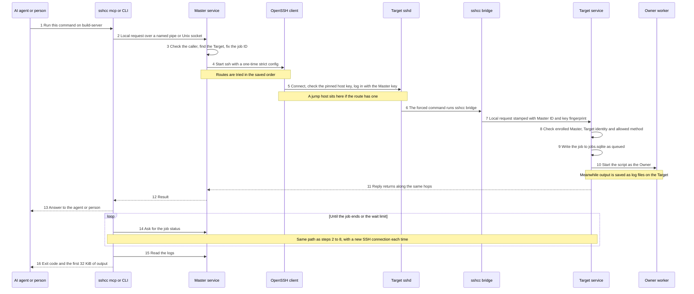
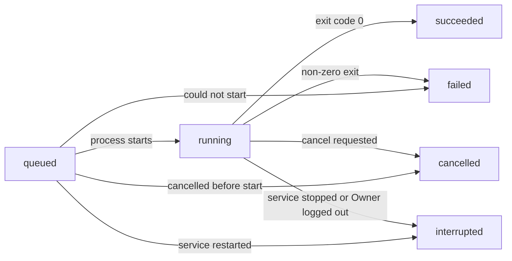

# How it works

SSH Control Center lets you, or your AI agent, run commands, edit files and open terminals on all your Windows and Ubuntu machines over SSH, from one place.

This page follows **one request** from "please run this command" to "here is the result". Then it looks closer at the three things people do most: running commands, editing files and using terminals.

Thai version: [th/how-it-works.md](th/how-it-works.md) · Back to the [README](../README.md)

- **What:** one instruction ("run this", "edit that", "open a terminal") is carried out on another machine.
- **Why it is built this way:** connections drop. So the machine doing the work, not the connection, keeps the record of the work.
- **How:** over SSH, using the standard OpenSSH program, with a small service on each end that checks identities and remembers the work.

## The idea, in everyday terms

Think of a **head office** and several **branch offices**.

The head office never walks into a branch. It sends a sealed **work order** by a **locked courier**. The branch checks the courier's badge, writes the order in its own **logbook** under a **ticket number**, and does the work with its own staff. The paperwork stays at the branch. If the courier gets lost, the work carries on, and you can phone later and ask about the same ticket number.

That is this tool. The head office is the **Master**, a branch is a **Target**, the courier is **SSH**, and the ticket number is the **job ID**.

## Words used on this page

| Word | Plain meaning |
|---|---|
| Master | The machine you control things from. It keeps the keys and the list of Targets. |
| Target | A machine you control (Windows or Ubuntu). |
| Owner | The person's own login account on a Target. In the default mode for new installs, work runs as this account. |
| SSH / OpenSSH | The standard, encrypted way to connect to a remote machine. The tool starts the normal `ssh` program. |
| MCP | A standard way for AI assistants to call tools. `sshcc mcp` is the small program that offers these tools to an AI agent. |
| Job | A command (script) started on a Target and tracked there. |
| Host key | A Target's SSH "fingerprint". The Master saves it when the machine is paired ("pinned") and refuses any machine that shows a different one. |
| Forced command | An SSH setting that says "this key may run exactly one program, and nothing else". |
| Hash (SHA-256) | A short fingerprint of a file's content. Change one byte and the hash changes. |

## One request, end to end

Example: an AI agent asks `build-server` (an Ubuntu Target) to run `make test` in `/home/alice/projects/app`.

*In plain words: the request goes through a local door, then one locked SSH connection, then two checkpoints on the Target before anything runs. The work is owned by the Target, not by the connection.*

### The steps

- **1. Ask.** The agent calls the MCP tool `exec_run`. A person would type `sshcc exec`. Both use the small `sshcc` program.
- **2. Hand over to the local service.** `sshcc` does not touch SSH itself. It talks to the Master service on the same machine through a private local channel: a named pipe on Windows, a Unix socket on Ubuntu. The product opens no network port for this.
- **3. Check, look up, number.** The Master service checks who is asking: only the Owner (or the system account) may use it. It finds `build-server` in its registry and makes sure the request has a job ID (a random one if the caller gave none). It remembers "this ID means this command for this Target" and refuses a different command under the same ID.
- **4. Open the courier.** For each request the service writes a temporary, private SSH config and runs the normal `ssh` program with it. The config switches off the convenient but risky things: password login, agent forwarding, port forwarding and trusting a new host key on first sight. It trusts only the host keys saved for this Target and uses a key file from the service's own private key folder.
- **5. Pick a route and connect.** A Target can have several **routes**: LAN (same office network), Tailscale (a private mesh network) or Public (the internet). A route may also name a jump host. The Master tries the routes in the order saved for that Target. Setup normally saves one route (its type is guessed from the address). You can add fallback routes, for example LAN then Tailscale then Public, in the Advanced options. If a connection fails or times out, it tries the next route. If the host key is wrong, or the Target answers with a real error, it stops and does not try any other route.
- **6. The Target checks the badge.** The Target's `sshd` accepts the Master's key for a dedicated account made by the installer (`sshcc-bridge` in the setup docs). That key is locked to one program, `sshcc bridge`, and the Target's own SSH setup supplies the Master ID and key fingerprint.
- **7. The bridge passes it on.** `sshcc bridge` reads one request, stamps it with the Master ID and fingerprint it was given, and hands it to the Target service through a local channel of the same kind as step 2. The Target service accepts the local call from the Owner or the system account (which can send any request), or from an account that setup explicitly allowed (which can send only bridge requests, or bridge streams for terminals).
- **8. The Target checks again.** Is this Master enrolled and not revoked? Does its key fingerprint match? Is the request meant for *this* machine? Is the action on the allowed list?
- **9. Write it down.** The Target service records the job as `queued` in its database before running anything.
- **10. Do the work.** In the default mode for new installs, the Target starts an isolated worker as the logged-in Owner, and the worker runs the script. Output flows back to the service, which saves it as log files on the Target. (In the older service mode, the service runs the script itself.)
- **11 to 13. Reply.** The reply travels back along the same hops. On a first start it is the job record, still marked `queued`.
- **14 to 16. Wait and read (MCP `exec_run` only).** `exec_run` asks for the status again after 0.25 seconds, then waits a little longer each time, up to 2 seconds between asks. It stops when the job has finished or when the wait limit passes (30 seconds by default, 120 at most). Then it reads the first 32 KiB of each log. Each ask is a new SSH connection. The CLI command `sshcc exec` stops after step 13. Check later with `sshcc job`.

### What if something goes wrong?

| What happens | Result |
|---|---|
| The SSH connection drops after the job started | The job keeps running on the Target. Ask again with the same job ID. |
| The reply is lost or times out | Send the same command with the same ID again. The Target recognises the ticket and returns the existing job. It does not start a second one. The Master does the same when it moves on to the next route. |
| A different command arrives with an ID already used | Refused with an error (`JOB_ID_CONFLICT` on the Master, `E_CONFLICT` on the Target). |
| The Target's host key is not the pinned one | Stop. No fallback to another route, no "continue anyway" prompt. |
| The Target was only imported from an earlier-format registry and has no installed runner | Refused with `RUNNER_NOT_INSTALLED`. |
| Every route fails to connect | The error `ALL_ROUTES_FAILED` lists what each route said. |

### A Target reached through another Master (merge)

A Target that is also a Master can be **merged**. Its own Targets then appear in your list with IDs like `build-server/dev-01`. A request for such a Target goes one extra hop: your Master sends `relay.request` to `build-server`, and that Master repeats the request to `dev-01` with its own keys. This allows up to 100 seconds, because it includes the second SSH call. It is one hop only, and a merged Master's own merges are not shared. See [AGENT.md](AGENT.md#merged-masters).

## Running commands as jobs

**What.** A job is a command started on a Target and tracked there. The Target owns it, not the SSH connection.

**How.**

- The Master sends the script, the working folder and the ticket number (job ID).
- The Target writes the job into `jobs.sqlite` first, then starts it on its own.
- Standard output and error go to two log files on the Target, each capped at 64 MiB.
- You ask for status or logs by job ID, any time. Logs are read in pieces by byte offset, up to 1 MiB per read.
- If the same job ID arrives again with the same content, the Target returns the existing record and runs nothing.

*In plain words: a job usually moves from waiting, to running, to one of four endings. It can also end straight from waiting if it cannot start or is cancelled first. "Interrupted" means "stopped by something outside the job, so check what state it left behind".*

**When things go wrong.**

- **SSH drops.** The job continues. Nothing else happens.
- **The Target service stops or restarts.** Running jobs are stopped and recorded as `interrupted`. At the next start, any record still marked `queued` or `running` is also rewritten to `interrupted`. The Target never re-runs a job by itself.
- **The Owner logs out** (default mode for new installs). The job's process tree is stopped and recorded as `interrupted`.
- **You cancel.** `jobs_cancel` stops the job and the programs it started.

**Why it matters:** a dropped connection, a retry or a nervous agent clicking twice cannot start the same deployment twice, and a long build survives a network blip.

## Editing files

**What.** You can list, read, search, write, edit, create folders and remove files on a Target.

**How.**

- **Reading** gives the content and the file's SHA-256 hash. The bytes and the hash come from the same open file, so they always belong together.
- **Editing** (`files_edit`) takes the old text and the new text. The old text must match exactly once. If it matches zero times or more than once, the edit is refused. The tool reads the file, replaces that one spot and writes it back, passing the hash it just read as a guard.
- **Writing is atomic.** The Target writes the new content to a private temporary file in the same folder (its name looks like `.sshcc-<random>.tmp`), flushes it to disk, then puts it in place in one step. Replacing an existing file uses `rename` on Ubuntu and `ReplaceFileW` on Windows. Creating a new file uses a link (Ubuntu) or a no-overwrite move (Windows). Readers see the old file or the new file, never half of one. On Ubuntu the owner and permissions of an existing file are kept. On Windows its access list is kept.
- **The hash guard.** A write can carry `expectedSha256`, the hash of the version you read. If the file has changed since, the write fails with `E_CONFLICT` and nothing is changed. An empty expected hash means "the file must not exist yet" (create-only).
- The Target handles one file change at a time, briefly, so two writers with the same expected hash cannot both win.
- A write refuses to replace a file that is itself a symbolic link. A symlinked parent folder is followed.

**Limits.** One write is at most 4 MiB. For bigger files, use a job.

**Why it matters:** an agent (or you) cannot silently overwrite someone else's newer change, and the file you care about is never left half-written.

## Terminals

**What.** A terminal is a live shell on the Target, for programs that need a keyboard and a screen. It uses a **pseudo-terminal** (PTY), a software keyboard and screen that make such programs believe a person is at the machine.

**How.**

- Opening a terminal starts a shell on the Target, in the Owner's login session, and gives it an ID.
- Output is kept in **memory** on the Target, in a window of the most recent 4 MiB. When it is full, the oldest bytes are dropped. You read with a byte offset, like a bookmark. If your bookmark has fallen out of the window, the reply says `truncated` and gives the real offsets.
- Input is numbered 1, 2, 3 and so on. If you resend the same bytes with the same number, the Target answers `duplicate` and does not type them twice. Input is never saved to disk.
- There are two ways to use it. The MCP tools (`terminal_open`, `terminal_read`, `terminal_write`, `terminal_resize`, `terminal_status`, `terminal_close`) make a short SSH call for each action. `sshcc shell <Target>` keeps one long-lived SSH connection and streams both ways. Press `Ctrl+]` to detach and use `--resume <terminalId>` to come back.
- Only metadata (ID, status, folder and so on) is stored in `terminals.sqlite`. The text on screen is not.

**Limits.** Terminals need the Owner-session mode. A Target still in the older service mode answers `E_EXECUTION_MODE`. At most 8 terminals run per Target. A terminal with no streaming client attached (`sshcc shell`) and no tool call for 30 minutes ends with status `expired`. A service restart, the Owner logging out, or revoking the Master that opened it also ends a terminal. Only the Master that opened a terminal can use it.

**Why it matters:** you can watch and steer a long-running program live, and if your own connection drops you can reconnect and see what you missed, as long as the Target service keeps running and the output is still inside the 4 MiB window.

## Good to know

- **Routes are in saved order.** The tool does not measure which route is fastest. It tries them as saved.
- **Each request the Master sends is its own SSH connection.** One MCP tool call can send several, for example `exec_run` (start, status checks, log reads) and `files_edit` (read, then write). The generated config turns connection sharing off. The exception is `sshcc shell`, which keeps one connection open.
- **Every enrolled Master has administrative authority over its Targets.** There is no approval step between an agent's request and the Target. Any program running as the Owner on the Master, including an AI agent's tools, can send requests. Read the [security model](security-model.md) before you point an AI agent at machines you care about.
- **Job scripts and environment values are stored in plain text** in the Target's `jobs.sqlite` (the Master also keeps a copy of each job request in its `fleet.sqlite`), and any enrolled Master can list the Target's jobs. Do not put secrets in scripts or environment values.
- **The default mode for new installs needs the Owner to be logged in** to start jobs, touch files or open terminals. Otherwise those requests fail with `E_OWNER_NOT_LOGGED_IN`. Reading the status and logs of an existing job still works. See [OWNER-SESSION.md](OWNER-SESSION.md).
- **No project locks.** Two Masters can change the same folder at the same time. The hash guard protects single files only.

## For developers

Paths are relative to the repository root.

| Step or topic | Where to look |
|---|---|
| MCP server, tool list, `tools/call` | `crates/core/src/mcp.rs` (`tools`, `serve`) |
| `exec_run`, `files_edit`, `files_write_text` | `crates/core/src/agent_tools.rs` (`exec_run`, `edit`, `read_all`) |
| CLI commands (`exec`, `job`, `bridge`, `mcp`) | `crates/cli/src/main.rs` |
| `sshcc shell` | `crates/cli/src/shell.rs` |
| Local channel (steps 2 and 7) | `crates/core/src/client.rs`, `crates/core/src/ipc.rs` |
| Master service entry, caller checks | `crates/core/src/service.rs` (`run`, `handle`) |
| Job ID record, method mapping | `crates/core/src/fleet.rs` (`dispatch`) |
| Direct or merged Target | `crates/core/src/fleet_merge.rs` (`resolve`, `send`, `relay_request`) |
| One-time SSH config, route loop, stop or retry rules | `crates/core/src/fleet_ssh.rs` (`session_config`, `attempt`, `request_within`, `attach`) |
| Target checks (steps 7 and 8) | `crates/core/src/service.rs` (`bridge_master`, the `allowed` list in `handle`), `crates/core/src/fleet.rs` (`authorized_master_key`) |
| Jobs | `crates/core/src/jobs.rs` (`start`, `execute`, `execute_owner`, `open_for`, `shutdown`) |
| Owner worker | `crates/core/src/executor.rs`, `crates/core/src/worker.rs` |
| Files | `crates/core/src/files.rs` (`handle`, `commit_file`) |
| Terminals and streaming | `crates/core/src/terminal.rs`, `crates/core/src/stream.rs`, `crates/core/src/service.rs` (`serve_stream`) |
| Message format | `crates/core/src/protocol.rs`, [CONTRACT.md](CONTRACT.md) |

Tests that show the behaviour described above:

- `crates/core/src/fleet_ssh.rs`: host-key failures are never treated as a transient disconnect, and the generated SSH config is strict.
- `crates/core/src/agent_tools.rs`: `exec_run` waiting and log handling, `files_edit` rules, stale-hash refusal, create-only writes.
- `crates/core/src/files.rs`: reads keep bytes and hash together, simultaneous hash-guarded writes have one winner, and replacing a file keeps owner, group and mode (Ubuntu) or access list (Windows).

What the repository's checks do and do not cover is in [VALIDATION.md](VALIDATION.md).

## Where to go next

- [Architecture](architecture.md): the parts and how they fit together.
- [Pairing](pairing.md): how a machine becomes a Target.
- [Security model](security-model.md): what is trusted, what is checked, and the known gaps.
- [FAQ](faq.md)
- [AGENT.md](AGENT.md): CLI and MCP usage, merged Masters and fleet health.
- [CONTRACT.md](CONTRACT.md): exact API and message shapes.
- [OWNER-SESSION.md](OWNER-SESSION.md): running as the logged-in Owner, and terminal details.
