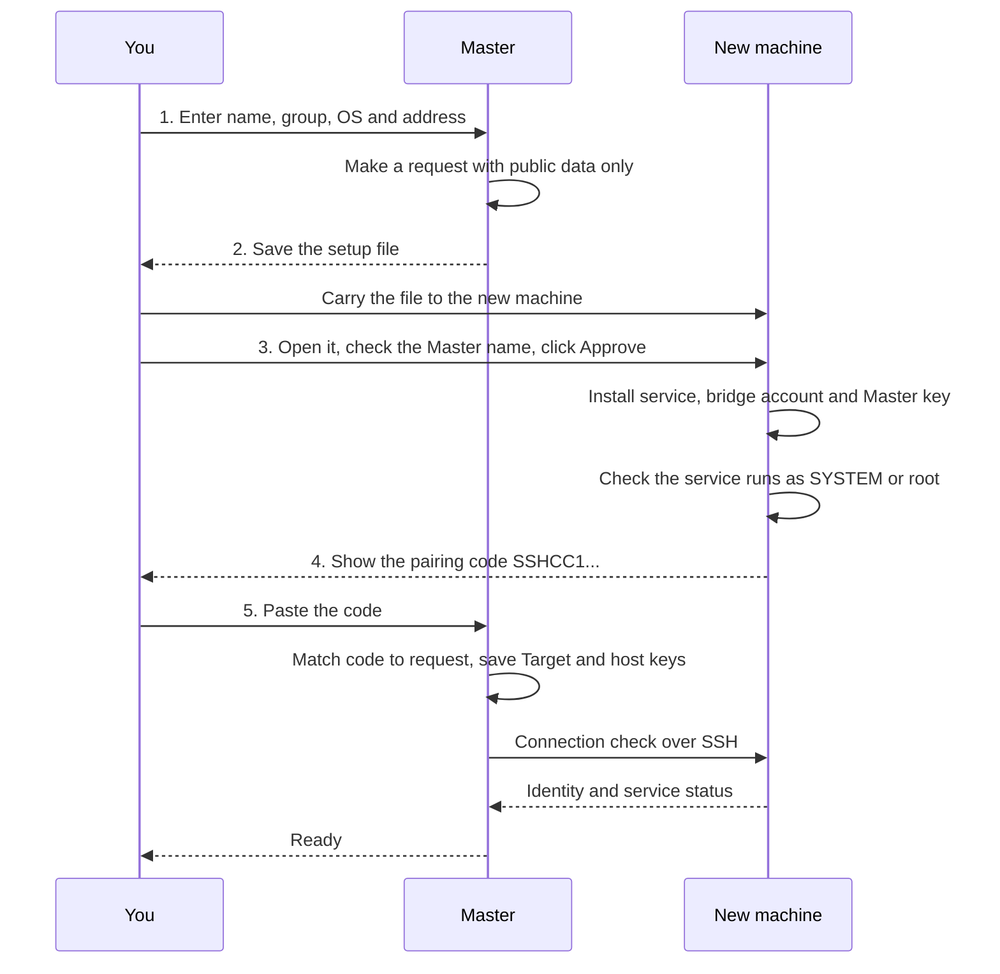
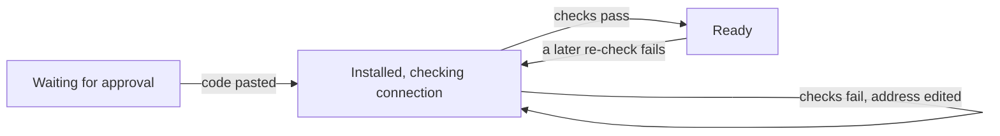

# Pairing: how a new machine joins the fleet

*Thai version: [th/pairing.md](th/pairing.md)*

**What this page covers.** How to add one new machine (a *Target*) so that your *Master*, the computer you work from, can run commands, edit files and open terminals on it. Someone has to sit at the new machine.

## The idea in plain words

Think of lending a spare key to a friend.

Your friend (the Master) gives you a paper showing the shape of their key. That paper is enough to build a lock for the key, but it cannot open anything. You stand at your own front door (the Target), check the name on the paper, fit a lock that accepts only that key, and write down your door's address and its fingerprint on a note. You give the note back. Your friend files it and tries the key once to see that it works. No secret ever travelled between you.

That is pairing:

- **What:** a one-time handshake that lets a Master control a new Target.
- **Why this way:** the owner of the new machine must say "yes" on that machine, and no password or private key is typed or sent anywhere.
- **How:** the Master prepares a setup file, you carry it to the new machine, you click **Approve**, and you carry the pairing code back.

SSH, used throughout this page, is the standard encrypted way one computer gives commands to another.

## Words used on this page

| Word | Meaning |
|---|---|
| Master | The machine you work from. It keeps the secret SSH key and the list of machines. |
| Target | A machine that is being controlled. Its service accepts only Masters you approved. |
| Group | A label you choose for a set of machines, such as `lab`. The code calls it `tenant`. The Master keeps one SSH key per group. |
| Setup file | One `.exe` (Windows) or `.deb` (Ubuntu) that the Master prepares for exactly one new machine. |
| Approve | The explicit "yes" a person gives on the Target. |
| Pairing code | A long piece of text starting with `SSHCC1.` that the Target prints at the end. You paste it on the Master. |
| Host key | The Target's own SSH identity. The Master saves ("pins") it, so a different machine at the same address is noticed later. |

## The five steps at a glance



*In plain words: the Master makes a file, you carry it over and approve it, and you carry a code back so the Master can check the new machine.*

The Master's "add machine" page shows four progress boxes. They map to the steps above like this:

| Progress box on the Master (Thai, with English) | Caption under the title (Thai, with English) | Steps on this page |
|---|---|---|
| **ตั้งค่าที่นี่** (Set up here) | กรอกข้อมูลเครื่องใหม่ (Fill in the new machine's details) | 1 |
| **ส่งชุดติดตั้ง** (Send the setup file) | เปิดที่เครื่องใหม่แล้วกด Approve (Open it on the new machine and click Approve) | 2 and 3 |
| **คัดลอกรหัส** (Copy the code) | จากเครื่องใหม่หลังติดตั้งเสร็จ (From the new machine, after the install finishes) | 4 |
| **วางรหัสกลับ** (Paste the code back) | ตรวจแล้วพร้อมใช้งาน (Checked and ready to use) | 5 |

## Before you start

- **Master.** SSH Control Center is installed from the full Master package, the one that contains the setup templates. Without them, step 2 fails with `SETUP_TEMPLATES_MISSING`.
- **New machine.** It runs Windows x64 or Ubuntu 24.04 (x86_64). The Ubuntu installer checks the version and the CPU type. The Windows installer only checks that Windows and PowerShell are 64-bit. It does not check the Windows version or edition. See [INSTALL.md](INSTALL.md) for the intended baseline. The automated tests do not cover every edition listed there.
- **A person with administrator rights is at the new machine.** Windows asks for UAC. Ubuntu asks for administrator rights through `pkexec` (graphical) or `sudo` (terminal).
- **The Owner account.** For new installs the default mode is *Owner session*: commands later run as the account that opened the setup file. On Windows that account must already be an administrator. On Ubuntu it must already be in the `sudo`, `admin` or `wheel` group. Open the setup file while logged in as the account you want to be the Owner. A machine that already had SSH Control Center keeps its earlier Owner. See [OWNER-SESSION.md](OWNER-SESSION.md).
- **Network.** The Master must be able to reach the new machine's address on its SSH port (22 unless you change it). The setup scripts contain no firewall or Tailscale commands, so opening the port and signing in to Tailscale stay your job. If you use Tailscale, sign in on the new machine first.
- **Internet on the new machine.** On Windows, the setup installs the OpenSSH optional feature only if it is missing, and that normally needs internet. On Ubuntu, `apt` must be able to reach its package sources on every setup, because the scripts always run `apt-get update` and install packages.
- **Nothing running.** If the new machine already runs SSH Control Center, finish or cancel its jobs and close its terminals first. The installer refuses to continue otherwise.
- **Room on the Master.** A Master holds at most 50 Targets.

## Step by step

### 1. On the Master: describe the new machine

**You do.** Open SSH Control Center from the tray icon and click **เพิ่มเครื่อง** ("Add machine") in the left menu. Fill in four boxes:

| Box | Meaning | Example |
|---|---|---|
| **ชื่อเครื่อง** | Name you will see in lists. Up to 256 bytes: Thai letters take 3 bytes each, so about 85 Thai characters. The box lets you type more than that, but the Master then rejects the name with `E_ARGUMENT: invalid machine name` | `win-box` |
| **กลุ่ม** | Group. English letters, digits, `-` or `_`, up to 64 characters (hint: "ภาษาอังกฤษ ตัวเลข - หรือ _ เช่น lab, office, demo") | `lab` |
| **ระบบปฏิบัติการ** | **Windows / Windows Server** or **Ubuntu 24.04 — Desktop หรือ Server** | Windows |
| **IP หรือชื่อเครื่อง** | An address the Master can reach (hint: "ที่อยู่ที่เครื่องหลักนี้เชื่อมต่อไปได้") | `192.0.2.20` |

Then click **สร้างชุดติดตั้งสำหรับเครื่องนี้** ("Create the setup file for this machine"). The **ตัวเลือกขั้นสูง** ("Advanced options") box holds the machine reference name (**ชื่ออ้างอิงเครื่อง**, made for you if left blank), the SSH port, network type (LAN, Tailscale, Public IP), bridge account name (default `sshcc-bridge`) and fallback routes (**เส้นทางสำรอง / ProxyJump**, for administrators). The app guesses the network type from the address if you leave it blank.

**You will see.** A message "คำขอพร้อมแล้ว บันทึกชุดติดตั้งเพื่อส่งไปเครื่องใหม่" ("The request is ready. Save the setup file to send to the new machine"), and a panel for your new machine with the badge **รออนุมัติที่เครื่องใหม่** ("Waiting for approval on the new machine"). The panel lists the Master name (**เครื่องหลัก**), group (**กลุ่ม**) and address (**ที่อยู่เครื่อง**).

**Behind the scenes.** The Master saves the request in its own database and, if this group has no key yet, creates an Ed25519 key pair for it. The private half stays on the Master. The request carries only public data: the Master's name, ID and public key, plus the new machine's name, ID, group, OS, SSH account, SSH port, network type and address, and any fallback routes. A route through a jump host (ProxyJump) also names the jump host's address, user and host keys, and the path of the jump key file on the Master. Only that path travels, never a key.

### 2. Save the setup file and carry it over

**You do.** Click **บันทึกชุดติดตั้งไฟล์เดียว…** ("Save single-file setup…") and choose where to save it. Copy the file to the new machine by any means you like, such as a USB drive or a shared folder. The file is for one machine and one OS.

**You will see.** A green box **บันทึกแล้ว** ("Saved") with the full path, and the message "บันทึกชุดติดตั้งแล้ว ส่งไฟล์นี้ไปเครื่องใหม่ได้เลย" ("Setup saved. You can send this file to the new machine"). A hint tells you how to open it:

- Windows: "เปิดไฟล์ .exe แล้วกด Approve" (open the `.exe` and click Approve).
- Ubuntu: "ติดตั้งไฟล์ .deb แล้วเปิด SSH Control Center Setup" (install the `.deb`, then open SSH Control Center Setup). For a server, install with `sudo apt install --no-install-recommends ./file.deb` and run `sshcc-setup` in a terminal.

**Behind the scenes.** The Master takes an installer template that ships with it, checks the template's SHA-256 against a manifest, and attaches the request. If the templates are missing the app says "ชุดติดตั้งยังไม่ครบ ให้ติดตั้งหรืออัปเดตเครื่องหลักด้วยแพ็กเกจแบบเต็ม แล้วบันทึกชุดติดตั้งอีกครั้ง" ("The setup package is incomplete. Install or update the Master with the full package, then save again").

### 3. On the new machine: open the file and click Approve

Make sure you opened the file you saved from the Master, not a generic installer. The right Windows window is headed **อนุญาตการเชื่อมต่อเครื่องนี้** ("Allow this machine to connect"). The generic installer shows the heading **ใช้เครื่องนี้เป็นเครื่องหลัก** ("Use this machine as the Master"), which would turn the machine into a Master instead. The title bar is the same in both cases, so look at the heading inside the window.

**Windows (desktop).** Open the `.exe`.

- *You will see:* a window titled "SSH Control Center — ติดตั้งและจับคู่". It lists "เครื่องหลัก:" (Master), "เครื่องใหม่:" with the "กลุ่ม:" (group), and "บัญชี Owner:" (Owner account) with the note that the Owner session uses administrator rights and must stay logged in. A box reads "ใช้ Owner session (administrator) สำหรับ jobs, files และ terminal" ("Use Owner session (administrator) for jobs, files and terminals"). It is ticked for a fresh install.
- *You do:* check the Master name, then click **Approve — อนุมัติและติดตั้ง** ("Approve and install"). Windows asks for administrator permission (UAC). With the Owner-session box ticked (the default), the account that opened the file must itself be an administrator, because the Owner needs an elevated token. Another administrator can type the UAC password for you only when that box is cleared (service mode). Either way, the account that opened the file stays the Owner.
- *You will see next:* "กำลังขอสิทธิ์ administrator และตรวจ prerequisites..." and then a progress bar with messages such as "กำลังติดตั้ง service และสำรองข้อมูลเดิม" ("Installing the service and backing up existing data") and "กำลังตั้ง SSH และเพิ่มสิทธิ์เครื่องหลักที่อนุมัติ" ("Setting up SSH and adding the approved Master"). It ends with "ติดตั้งและตรวจ service สำเร็จแล้ว นำรหัสนี้กลับไปวางที่เครื่องหลัก" ("Installed and checked the service. Take this code back to the Master").
- *If it fails:* "ติดตั้งไม่สำเร็จ กรุณาตรวจการเชื่อมต่ออินเทอร์เน็ตและสิทธิ์ administrator แล้วลองใหม่" ("Install failed. Check the internet connection and administrator rights, then try again"), plus the button **ลองติดตั้งอีกครั้ง** ("Try installing again").

**Windows Server without a desktop.** Run the same file with `/CONSOLE` (see [INSTALL.md](INSTALL.md)). It prints the Master name, the new machine and group, and the sentence "อนุญาตให้ agent บนเครื่องหลักสั่งงาน จัดการไฟล์ และเปิด terminal ตามโหมดบัญชีที่เลือก" ("Allow the agent on the Master to run commands, manage files and open terminals, in the chosen account mode"). Then it asks "พิมพ์ APPROVE เพื่ออนุมัติ หรือ Enter เพื่อยกเลิก" ("Type APPROVE to approve, or press Enter to cancel").

**Ubuntu Desktop.** Install the `.deb` with the package manager, then open **SSH Control Center Setup** from the app list.

- *You will see:* a dialog titled "อนุญาตเชื่อมต่อเครื่อง" ("Allow connecting this machine"). It shows the Master name, the new machine, the group and this text: "อนุญาตให้ agent บนเครื่องหลักสั่งงานและจัดการไฟล์ด้วยสิทธิ์ระบบ" ("Allow the agent on the Master to run commands and manage files with system rights"), "เครื่องหลักที่อนุญาตไว้ก่อนหน้านี้จะยังใช้งานได้" ("Masters allowed earlier keep working"). Below that come "บัญชีสำหรับงาน" (the account used for work), "โหมด" (mode) and "สิทธิ์" (rights). In Owner-session mode the rights line reads "Owner UID/GID; เลือก admin ใช้ root" ("the Owner's UID/GID; choosing admin uses root"). In service mode it reads "root (service)".
- *You do:* click **Approve — อนุญาต** ("Approve — allow") or **ยกเลิก** ("Cancel"). The helper asks for administrator rights through `pkexec`.
- *You will see next:* a progress window "ติดตั้ง SSH Control Center" with steps such as "ตรวจ prerequisites และติดตั้ง service" ("Checking prerequisites and installing the service") and "ตั้งค่าบัญชีระบบและ SSH" ("Setting up the system account and SSH").
- *If it fails:* a dialog "ติดตั้งยังไม่สำเร็จ" ("Install did not finish") with a details page. In this desktop mode a copy of the log is kept at `~/.local/share/sshcc/setup/last-error.log`. In terminal mode no file is written, so read the terminal output instead. You can retry with **ลองใหม่** ("Try again").

**Ubuntu Server (terminal).** Run `sshcc-setup --terminal`. The helper prints the same text, then asks "พิมพ์ APPROVE เพื่ออนุมัติ หรือกด Enter เพื่อยกเลิก" ("Type APPROVE to approve, or press Enter to cancel"). It asks for `sudo` afterwards. If you answer by pipe or script it refuses: "ต้องอนุมัติใน terminal แบบโต้ตอบเท่านั้น ไม่รับการอนุมัติผ่าน pipe" ("Approval must be given in an interactive terminal; a pipe is not accepted"). If you cancel it prints "ยกเลิกแล้ว — ไม่มีการเพิ่มสิทธิ์ SSH" ("Cancelled. No SSH rights were added"). The helper also falls back to the terminal when no graphical session or `zenity` is available.

Installing the Ubuntu `.deb` alone does not install the service and does not give any Master access. Only **Approve** does.

### 4. Copy the pairing code

**You will see.**

- Windows: the code appears in a box and the button changes to **คัดลอกรหัสจับคู่** ("Copy pairing code"). After you click, the window says "คัดลอกรหัสแล้ว กลับไปเครื่องหลักแล้ววางในช่อง “รหัสจับคู่”" ("Code copied. Go back to the Master and paste it in the pairing-code box").
- Ubuntu Desktop: a dialog **พร้อมจับคู่กับเครื่องหลัก** ("Ready to pair with the Master") with the button **คัดลอกรหัส** ("Copy code"). If no clipboard tool is found it says "เลือกข้อความรหัสแล้วกด Ctrl+C เพื่อคัดลอก" ("Select the code text and press Ctrl+C").
- Terminal: the code is printed under "ติดตั้งสำเร็จ — คัดลอกรหัสด้านล่างไปวางที่เครื่องหลัก:" ("Installed. Copy the code below to the Master:").

**You do.** Copy all of it. It is long text that starts with `SSHCC1.`. Do not type it. Send it to the Master through a channel you trust (see "Known limits" below).

If you close the window by mistake, open the same setup file again. It shows the saved code after checking that the local service is still the same machine. On Windows it also checks that the Master is still approved and not revoked. The Ubuntu helper only checks that the Master's ID and key are still in the list of Masters, and that list includes revoked ones, so a revoked Master does not stop it.

### 5. Paste the code on the Master

**You do.** Go back to **เพิ่มเครื่อง**. In the box **รหัสจับคู่** ("Pairing code", placeholder `SSHCC1.…`) paste the whole text and click **ยืนยันและตรวจการเชื่อมต่อ** ("Confirm and check the connection").

**You will see, on success.** The message "จับคู่สำเร็จ เครื่องพร้อมให้ agent ใช้งาน" ("Paired. The machine is ready for the agent") and a green box "ตรวจ service และตัวตนเครื่องผ่านแล้ว" ("Service and machine identity checked") with the buttons **เปิดเครื่องนี้** ("Open this machine") and **เพิ่มเครื่องถัดไป** ("Add the next machine"). The machine now shows in **เครื่องทั้งหมด** ("All machines").

**You will see, if the connection check fails.** The message "ติดตั้งแล้ว แต่ยังเชื่อมต่อไม่ได้ ตรวจที่อยู่เครื่องแล้วลองอีกครั้ง" ("Installed, but cannot connect yet. Check the address and try again"), and an amber box "ติดตั้งแล้ว แต่ยังตรวจการเชื่อมต่อไม่ผ่าน" ("Installed, but the connection check did not pass") with the failed checks listed. You do not need to install again. Fix the address in the box **IP หรือชื่อเครื่อง** and click **ตรวจอีกครั้ง** ("Check again"). This keeps the machine's identity and host key.

**Behind the scenes.** The Master checks that the code is intact and matches the request it made. Then it saves the Target with the host keys the Target reported, and runs a connection check over SSH against those saved keys.

If you close the window before step 5, nothing is lost. The request stays on the Master. Open **เพิ่มเครื่อง** again and use **ทำต่อ** ("Resume") in the list **คำขอที่ยังทำไม่เสร็จ** ("Requests not finished").

### Request states



*In plain words: a request starts as "waiting", moves to "checking" when you paste the code, and reaches "ready" when the checks pass. If the check fails it stays in "checking" until you fix the address and check again. "Ready" only describes the latest check: a later re-check that fails (for example `sshcc pairing status --retry`, or the agent tool `pairing_status` with `retry`) moves the request back to "checking".*

| State in the code | Label in the app (Thai) | English |
|---|---|---|
| `awaiting_approval` | รออนุมัติที่เครื่องใหม่ | Waiting for approval on the new machine |
| `needs_attention` | ติดตั้งแล้ว — รอตรวจการเชื่อมต่อ | Installed, waiting for the connection check |
| `ready` | พร้อมใช้งาน | Ready (the latest check passed) |

## What "Approve" grants

Approve is the only step in the normal pairing flow that gives a Master its own access to the Target. It is an interactive step on the Target itself: a button, or typing `APPROVE` in a terminal. Nothing is pushed to the Target over the network.

Two other routes exist, and both are for advanced use:

- **Advanced file enrollment** (`Setup.ps1 -EnrollmentBundle`, `setup.sh --bundle`, `sshcc configure accept-bundle`; see [INSTALL.md](INSTALL.md)) has no Approve window and no `APPROVE` prompt. It is a command run on the Target.
- **Merged Masters.** If Master A merges Master B, A can run jobs, files and terminal requests on B's own Targets through B, although those Targets never approved A. See [faq.md](faq.md) and section 4.9 of [security-model.md](security-model.md).

**After Approve, programs running as the Master's Owner account can do all of this on the Target, at any time, until you revoke that Master (revoking has limits, see "Taking the permission back" below):**

- run commands and scripts (jobs),
- read, write and delete files and create folders,
- open interactive terminals.

Who they run as depends on the mode ([OWNER-SESSION.md](OWNER-SESSION.md)):

| Mode | Windows | Ubuntu |
|---|---|---|
| Owner session (default for new installs) | The Owner account with its elevated administrator token. The Owner must be logged in. | The Owner's UID and GID. A request that sets `asAdmin: true` runs as root. |
| Service (kept on machines that were already in this mode) | SYSTEM | root |

An AI agent started under the Master's Owner account counts as such a program. SSH Control Center itself does not ask again before each command. `asAdmin` is only a request parameter: the Target asks nobody when it is set. On Ubuntu the Owner must already be in an administrator group, so Approve effectively grants root on that machine.

**What Approve does on the Target.** The setup scripts do these things and write backups first:

| | Windows | Ubuntu |
|---|---|---|
| Installs | OpenSSH Client and Server if missing; SSH Control Center in `C:\Program Files\SSH Control Center` | `openssh-client`, `openssh-server`, `openssl`; SSH Control Center from the bundled `.deb` |
| Service | `SSHControlCenter`, runs as LocalSystem, starts at boot | systemd service `sshcc`, runs as root |
| Bridge account | Local user `sshcc-bridge` (or the name you chose): non-administrator, with a random 48-byte password that is not exported | System user `sshcc-bridge`: no administrator groups, random password |
| Master's key | One line in `C:\ProgramData\ssh\sshcc\sshcc-bridge.authorized_keys` | One line in `/etc/ssh/sshcc/sshcc-bridge.authorized_keys` |
| SSH rules | A marked block in `sshd_config` | `/etc/ssh/sshd_config.d/90-sshcc.conf` |
| Private data | `C:\ProgramData\SSHControlCenter` | `/var/lib/sshcc` |

The key line is restricted. It starts with `restrict,command=`, so that key can run only SSH Control Center's bridge program. On Ubuntu the command names the Master's ID and key fingerprint in plain text. On Windows the command is stored as an encoded PowerShell command (`-EncodedCommand`), so the ID and fingerprint are inside it and not readable by eye. On both systems the line ends with the plain marker `sshcc:master:<Master ID>`. The SSH block for the bridge account sets `PasswordAuthentication no`, `AllowTcpForwarding no`, `AllowAgentForwarding no`, `PermitTTY no` and `X11Forwarding no`. The Ubuntu block also sets `KbdInteractiveAuthentication no`. The installer validates the SSH configuration before restarting `sshd` and stops if an existing rule overrides the bridge's key file.

**What Approve does not do.**

- No private key and no password is sent to or from the Master.
- The setup scripts contain no firewall or Tailscale commands, and they print that these stay managed by the operator when they finish. Installing the OpenSSH Server feature on Windows is done by the operating system, and this repository cannot show what that adds.
- It does not take over an existing account. If `sshcc-bridge` already exists and was not created by SSH Control Center, setup stops.
- It does not affect other Masters. Each Master is approved separately with its own key, and every Master you approved earlier keeps working.
- It does not expire. The code has no expiry time for a request or an approval.

**Taking the permission back.** On the Target, run `sshcc configure revoke-master <Master ID>` as administrator (Windows; the program is in `C:\Program Files\SSH Control Center`) or with `sudo` (Ubuntu). Find the ID with `sshcc request masters.list`, or in the key line after `sshcc:master:`. If the desktop package is installed on that machine, you can instead open **Master ที่อนุญาต** ("Allowed Masters") in the app and click **ถอนสิทธิ์** ("Revoke") next to that Master. A Target set up from a pairing file does not get the desktop app, so expect to use the command.

Revoking blocks the Master's new requests and interrupts its open terminals. It does not stop jobs that are already running: cancel those separately. The key line stays in the file until you delete it by hand. Remove only the line ending in `sshcc:master:<Master ID>`. See [INSTALL.md](INSTALL.md).

## What "Ready" means

"Ready" means three checks passed: the Master reached the Target over SSH using the saved host keys, the Target reported the identity (node ID) that the code promised, and the Target's service runs as SYSTEM or root.

It does not mean that work can start right now. In Owner-session mode the Owner must also be logged in on the Target, and on Windows must have an elevated token. If not, `targets_doctor` reports `ready: false` with `E_OWNER_NOT_LOGGED_IN` or `E_OWNER_NOT_ADMIN`, even though pairing shows **พร้อมใช้งาน**.

## If something goes wrong

Every code below exists in this repository. The Thai app shows one general sentence for every `E_PAIRING_*` code ("รหัสจับคู่ใช้ไม่ได้กับคำขอนี้ ตรวจว่าคัดลอกครบจากเครื่องที่เพิ่งติดตั้งและใช้เครื่องหลักที่ถูกต้อง", meaning "The pairing code does not fit this request. Check you copied all of it from the machine you just installed, and that you are on the right Master"). The CLI shows the exact code.

| Where | Message or code | What it means | What to do |
|---|---|---|---|
| Master, step 2 | `SETUP_TEMPLATES_MISSING` | The setup templates are not installed on this Master. | Install or update the Master from the full package, then save the setup file again. |
| Master, step 2 | `SETUP_TEMPLATE_MISMATCH` | A template does not match its checksum. | Reinstall the Master package. |
| Master, step 1 | `Master supports at most 50 targets` | The Master is full. | Remove a Target you no longer need. |
| Master, step 1 | `E_ROLE: master role is required` | This machine was set up as a Target only. | Create requests from a Master. |
| Master, step 1 | `E_ARGUMENT: invalid machine name` | The machine name is empty, has control characters, or is longer than 256 bytes (about 85 Thai characters). | Use a shorter name. |
| New machine, step 3 | "ชุดติดตั้งนี้ไม่ใช่สำหรับ Windows" ("This setup file is not for Windows") | The file was made for Ubuntu. | On the Master, create a new request with the right OS. |
| New machine, step 3 | Windows: "มี jobs หรือ terminals กำลังทำงาน กรุณาปิดก่อนติดตั้ง" ("Jobs or terminals are running, close them first") or "มีงานกำลังรันอยู่ กรุณารอให้งานเสร็จหรือยกเลิกงานก่อนติดตั้ง" ("Work is running, wait for it to finish or cancel it before installing"). Ubuntu: "เครื่องนี้มี jobs หรือ terminals กำลังทำงาน กรุณาปิดก่อนติดตั้ง" ("This machine has jobs or terminals running, close them first"). | An existing SSH Control Center there is busy. `E_BUSY` is the code behind it. You see that text only in the advanced `setup.sh`, the CLI and logs. | Finish or cancel the jobs, close the terminals, try again. |
| New machine, step 3 | `E_OWNER_NOT_ADMIN: Owner must already belong to an administrator group` | Ubuntu, Owner-session mode: the Owner is not in `sudo`, `admin` or `wheel`. | Open the setup as an administrator account, or add the Owner to the group first. |
| New machine, step 3 | "Refusing to take over an existing account not created by SSH Control Center" (Ubuntu words it "…an account not created…") | The bridge account name is already used by an account that SSH Control Center did not create. | Choose another bridge account name under **ตัวเลือกขั้นสูง** ("บัญชีเชื่อมต่อ") in step 1. |
| New machine, step 3 | "Existing SSH policy overrides bridge AuthorizedKeysFile; reconcile manually." | An existing SSH rule (for example `AllowUsers`) wins over the bridge settings. | A person who manages the machine's SSH settings must adjust them. |
| New machine, step 3 | "บัญชีเชื่อมต่อเดิมไม่ตรงกับชุดติดตั้ง กรุณาใช้บัญชีเดิมในตัวเลือกขั้นสูง" ("The earlier bridge account does not match the setup") | Windows: SSH Control Center was installed before with a different bridge name. | Create the request again with the old bridge account name. |
| New machine, step 3 | `Master key changed; revoke the existing enrollment before replacing it` | This Master is already approved on that machine with a different key, for example from an earlier pairing with another group. Setup stops. | On the Target, revoke that Master (see "Taking the permission back"), then run Approve again. |
| New machine, steps 3 and 4 | "service ยังไม่พร้อมสร้างรหัสจับคู่ กรุณาตรวจ log แล้วลองใหม่" ("The service is not ready to create the pairing code") | Windows: a check that runs as SYSTEM failed, and the window does not say which. Causes include `E_OWNER_NOT_LOGGED_IN` or `E_OWNER_NOT_ADMIN` (the Owner is not logged in or not an administrator), `E_PAIRING_SERVICE` (service not SYSTEM or root), `E_PAIRING_IDENTITY` (registration does not match this Target) and `E_PAIRING_APPROVAL` (this Master has not been approved). | Check that you opened the file as the Owner you want, and that this account is an administrator. Then run Approve again. On Ubuntu the exact error is on the details page of the failure dialog (desktop mode, also saved as `last-error.log`) or in the terminal output (terminal mode). |
| Master, step 5 | `E_PAIRING_DIGEST` or `E_PAIRING_CODE` ("pairing code is damaged", "missing pairing data", "invalid pairing format") | The code was cut off or changed while copying. | Copy the whole code again. Do not add line breaks. |
| Master, step 5 | `E_PAIRING_VERSION: invalid pairing code prefix` (or "unsupported pairing code") | The text does not start with `SSHCC1.`, or the code was made by an incompatible version. | Paste only the pairing code. Use the same version on both machines. |
| Master, step 5 | `E_PAIRING_SIZE` ("exceeds 64 KiB") | You pasted far more than the code. | Paste only the code. |
| Master, step 5 | `E_PAIRING_REQUEST: unknown setup request on this Master` | This Master has no such request. | Paste on the Master that made the file. If its data was reset, create a new request. |
| Master, step 5 | `E_PAIRING_MASTER: code belongs to another Master` | The file came from a different Master. | Paste on the Master that made it. |
| Master, step 5 | `E_PAIRING_BINDING: machine, group, OS or connection differs from approved request` | The code does not describe the machine that was requested. | Create a new request and start again. |
| Master, step 5 | `E_PAIRING_CONFLICT: a different machine already answered this request` | The same setup file was used on two machines and another code arrived first. | Create a separate request for each machine. |
| Master, step 5 | "Target nodeId already registered as …" or "route address/port already registered as …" | The machine, or its address and port, is already in your list. | Open the existing entry instead, or remove it first. |
| Master, step 5 | `target tenant cannot change; remove and re-enroll explicitly` | The machine ID already exists with another group. | Remove the old entry on the Master. Then, on the Target, revoke this Master (see "Taking the permission back"), because the Master uses a different key for each group. Then pair again with the group you want. |
| Master, step 5 or the check | `HOST_KEY_MISMATCH`, shown as "กุญแจยืนยันเครื่องไม่ตรงกับที่บันทึกไว้ ระบบหยุดเชื่อมต่อ กรุณาตรวจว่าเป็นเครื่องเดิมก่อน" ("The machine's key does not match the saved one. Connection stopped. Check it is the same machine") | The SSH host key on offer differs from the one the Master saved: another machine answers at that address, or the machine was reinstalled. The Master stops and does not try other routes. | Find out why before you continue. If the machine was truly reinstalled, remove the old registration after you verified the new keys yourself. |
| Master, step 5 or the check | `TARGET_IDENTITY_MISMATCH`, or "Target service must run as SYSTEM/root" in the check's stages | The machine at the address is not the one that was approved, or its service runs under the wrong account. | Check the address. If it is the right machine, run Approve on it again. |
| After pairing | `E_OWNER_NOT_LOGGED_IN` or `E_OWNER_NOT_ADMIN` | Owner-session mode: nobody is logged in as the Owner, or on Windows the Owner has no elevated token. | Log in as the Owner on the Target. Then run `targets_doctor` again. |
| After pairing | `E_TARGET_OUTDATED` | The Target is older than the Master and does not know `files_search` or `files_grep`. | Update SSH Control Center on the Master and the Target. |

## Known limits

- **The setup file and the code are not signed.** Their checksums only catch accidents such as a damaged copy. Anyone can build a file with a matching checksum. Approve only a setup file that you got from the Master you expect, and move the pairing code by a channel you trust.
- **No fingerprint check on screen.** The Approve windows show the Master's name and the machine's name. Both are text carried in the request and are not checked against anything. The machine name is typed when the request is made. The Master name comes from the Master's own configured name, which is its computer name by default. Anyone who builds a file can set both. Neither the Approve windows nor the Master's screens show the Master's key fingerprint. The command `sshcc pairing inspect --request <file>` prints it.
- **Approve is powerful.** See the section above. It also covers an AI agent on the Master. Prompt injection against an agent is a real risk. See [security-model.md](security-model.md).
- **No cancel for a pending request.** The Master only offers create, status and complete for requests. A request that is never answered stays in its list.
- **The group cannot be changed later.** To move a machine to another group, remove it on the Master, revoke that Master on the Target (see "Taking the permission back"), then pair again with the new group. The revoke is needed because the Master uses a different key for each group, and a Target refuses a changed key for a Master it still allows.
- **Installers are not code-signed** ([INSTALL.md](INSTALL.md)).
- **The app is Thai only**, including the Approve windows.
- **Only Windows x64 and Ubuntu 24.04 (x86_64)** are intended as Targets ([INSTALL.md](INSTALL.md)). A request accepts only `windows` or `linux`, so macOS is not supported as a Target.
- **A failed install is not an atomic undo.** Setup restores the files it backed up, but it does not claim to roll back the whole operating system. Optional features and new accounts can remain. See [INSTALL.md](INSTALL.md).

## For developers

**Where things are**

| Piece | File |
|---|---|
| Request, code, checks, state machine | `crates/core/src/pairing.rs` |
| Setup file builder (Windows `.exe`, Ubuntu `.deb`) | `crates/core/src/setup_package.rs` |
| Group key, enrollment export, Target save and collision checks, Master list | `crates/core/src/fleet.rs` |
| Connection check ("doctor") | `crates/core/src/fleet_ssh.rs` |
| Master screens and Thai texts | `desktop/ui/app.js` (`renderEnrollment`, `renderPairingProgress`, `pairingError`), `desktop/ui/index.html` |
| Windows Approve window | `installers/windows/PairingBootstrap.ps1` |
| Windows privileged install | `installers/windows/Setup.ps1` |
| Ubuntu Approve dialog | `installers/ubuntu/setup-helper.py` |
| Ubuntu privileged install | `installers/ubuntu/setup-worker.sh`, `installers/ubuntu/setup.sh` |
| Wire formats and API | [CONTRACT.md](CONTRACT.md) |

**Wire formats.** The request ("envelope") is `{schemaVersion:1, requestId, masterId, bundleDigest, targetLabel, bundle}`. The pairing code is `SSHCC1.<base64url, no padding, of the receipt JSON>.<SHA-256 hex of that JSON>`. The receipt is `{schemaVersion:1, requestId, masterId, bundleDigest, registration}`. Both are capped at 64 KiB. The checksum has no secret in it.

**Setup file layout.** Windows: the template `.exe`, then the request JSON, an 8-byte little-endian length and the 16-byte marker `SSHCCPAIRING0001`. Ubuntu: the template `.deb` with the request added at `usr/lib/sshcc-setup/assets/envelope.json` and the package version set to `<version>+pairing.<UTC time>.<request id without dashes>`.

**What the Master checks on paste** (`pairing.rs`, `complete`): the prefix, size and checksum; that the code names this Master; that a request with this ID exists; that the registration's ID, group, OS, SSH user and routes equal the request; and that a repeat of the same code returns the same result without changing edited routes. A different code for the same request is `E_PAIRING_CONFLICT`. Then `fleet::save_target` pins the host keys and refuses clashes, and the doctor check runs. Ready requires `ok`, the expected node ID, `privileged: true` and execution principal `S-1-5-18` (Windows) or `0` (Ubuntu).

**The Target side.** Receipts are written only after the local service reports the same node ID and runs as SYSTEM or root, and the Master's key is on the approved list (`installer_receipt`).

**Command line equivalents** (`crates/cli/src/main.rs`):

```text
sshcc pairing create --label NAME --tenant GROUP --os windows|linux --address ADDR --output request.json
sshcc pairing package --request request.json --output setup-file [--templates DIR]
sshcc pairing inspect --request request.json
sshcc pairing status [REQUEST_ID] [--retry] [--routes-file routes.json]
sshcc pairing complete --code-file code.txt
```

An AI agent connected to the Master can call the MCP tools `pairing_create`, `pairing_status` and `pairing_complete`. It cannot Approve: that happens on the Target.

## See also

- [How it works](how-it-works.md) and [Architecture](architecture.md): the big picture.
- [Security model](security-model.md) and [SECURITY.md](../SECURITY.md): what is trusted and what is not.
- [INSTALL.md](INSTALL.md) and [OWNER-SESSION.md](OWNER-SESSION.md): installation details and who commands run as.
- [FAQ](faq.md).
