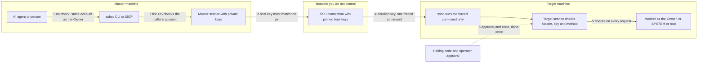

# Security model

This page explains, in plain words, what SSH Control Center can do, who can drive it, what protects you, and what does **not** protect you. It ends with a checklist for safe use.

It is the author's own review of the code in this repository. No third-party security audit is included or claimed. Read it before you install the tool on a machine that matters. To report a problem, see [SECURITY.md](../SECURITY.md).

## The short version

- **What:** SSH Control Center lets you, or your AI agent, run commands, edit files and open terminals on other computers.
- **Why it matters:** that is administrator-level power. On Windows the work runs with the logged-in owner's administrator rights. On Ubuntu it can run as root.
- **How it is kept safe:** the local door is closed to other users, SSH host keys are pinned, each Target accepts one locked-down command, and every request is checked again on the Target.
- **What it does not do:** it does not ask "are you sure?" before a command. A tricked AI agent can do anything its Master can do. The people and programs that can use your Master machine are your real security boundary.

An everyday picture: the Master is a **key ring** that opens every door in a building. The tool puts a guard at each door (the checks below). The key ring is still powerful. Whoever holds the ring holds the building, so keep the ring safe.

## Words used on this page

| Word | Plain meaning |
|---|---|
| **Master** | The computer that holds the keys and sends the orders. |
| **Target** | A computer that receives orders. One machine can be both. |
| **Owner** | The person account that installed the tool and is logged in. The tool decides who may use it from this account. |
| **SSH** | The standard, encrypted way to log in to another computer. |
| **Host key** | A machine's SSH identity card. To **pin** it means to remember it and refuse any machine that shows a different one. |
| **Forced command** | An SSH setting that lets a key run exactly one program and nothing else. |
| **IPC** | "Talking inside one computer". Here: a Windows named pipe or an Ubuntu Unix socket. |
| **SYSTEM / root** | The all-powerful built-in account on Windows / Ubuntu. |
| **MCP** | The plug that lets an AI agent call the tool. |
| **Prompt injection** | Text an AI reads (a web page, a file, a log line) that tricks it into following the writer's orders. |
| **Atomic write** | Write a file to a temporary name, then swap it in, so nobody ever sees half a file. |

Larger pictures live in [How it works](how-it-works.md), [Architecture](architecture.md) and [Pairing](pairing.md).

## Trust boundaries at a glance

In plain words: each numbered arrow crosses a boundary, and each boundary has its own check. Boundary 1 has none, which is why the Master machine and its Owner account matter so much.

## 1. What the tool can do

This is the power you hand over when you connect a Master to a Target.

| You can | How far it reaches |
|---|---|
| Run a script (PowerShell on Windows, Bash on Ubuntu) | Anything the executing account can run. Scripts up to 1 MiB, in a folder you choose, with environment values you choose. |
| List, read, search, write, create and delete files | Any absolute path that account can reach. There is no folder sandbox. One write is limited to 4 MiB. Delete removes one file or one empty folder. |
| Open an interactive terminal | A live shell as the same account. |
| Start pairing of a new machine | Only starts the approval flow in [section 4.3](#43-approving-a-pairing-hands-over-powerful-access). |

Which account does the work?

- **New installs (owner-session mode, the default).** Jobs, files and terminals run as the **Owner**. On Windows that is the Owner's elevated administrator token, and the Owner must already be an administrator. On Ubuntu it is the Owner's normal user, or **root** when the request says `asAdmin: true`.
- **Installs kept from earlier builds (service mode).** Work runs as SYSTEM / root until the installer is told to switch.
- **The tool's own service on a Target** always runs as SYSTEM / root. The `doctor` check fails a Target whose service does not.

So: **treat access to a Master like an administrator password for every machine it controls.** See [OWNER-SESSION.md](OWNER-SESSION.md) for the account rules.

## 2. Who can drive it, and how that is checked

### On the Master (and on any machine running the service)

The tool's service has **no network port of its own**. It listens only on a local pipe (Windows) or Unix socket (Ubuntu). SSH, run by the operating system, is the only network door. Every caller is identified by asking the operating system who it is, never by what the caller claims.

| Caller | Allowed? |
|---|---|
| The Owner account | Yes. |
| SYSTEM / root | Yes. |
| The `sshcc-bridge` account (Targets only) | Only the two bridge calls: `bridge.request`, and `bridge.stream` for terminal and relay streams. Each is checked again (see section 3.4). |
| Any other local account | No. On Ubuntu the connection is rejected before any request is read. On Windows the pipe's access list does not name them, and remote pipe clients are refused. |

Two details worth knowing:

- On Ubuntu the socket file is open to everyone (mode `0666`) on purpose. The gate is the kernel's peer-credential check, not the file mode.
- The client also checks the other end. It refuses a service pipe or socket that is not owned by SYSTEM / root, the Administrators group (Windows) or the current user.

**The check is by account, not by program.** Every program running as the Owner passes it. That includes your AI agent, your browser, and any malware you run.

### On a Target (over the network)

A request arrives through SSH and must pass every step:

1. SSH logs in as the dedicated bridge account (`sshcc-bridge` by default) with a key. Password login is turned off for that account.
2. SSH runs the one forced command, `sshcc bridge`, which names the Master ID and the Master's key fingerprint.
3. The Target service checks that this Master is enrolled and not revoked, that the key fingerprint matches, and that the request is meant for this Target.
4. The Target service checks the method is on the allowed list.
5. Only then does it start work as the Owner (or SYSTEM / root in service mode).

## 3. What protects you

Each item says what it does, then where to find it. Paths are relative to the repository root.

### 3.1 A closed local door

Only the Owner, SYSTEM / root and (for the two bridge calls only) the bridge account can talk to the service. Other users and remote machines cannot. Limits: 64 simultaneous local connections and 8 MiB per message.

*For developers:* `crates/core/src/ipc.rs` (`Listener::bind`, `peer`, `connect`), `crates/core/src/service.rs` (`run`, `handle`), `crates/core/src/protocol.rs`.

### 3.2 Pinned host keys

A Master connects to a Target only if the Target shows an SSH host key that was recorded when it was added. The tool starts OpenSSH with its own private settings and its own known-hosts file. It never reads your personal SSH files, and it turns off agent forwarding, port forwarding, password login and "update host keys". If the host key does not match, the tool stops. It does **not** try the next route.

*For developers:* `crates/core/src/fleet_ssh.rs` (`session_config`, `host_mismatch`, unit tests); `docs/CONTRACT.md`.

### 3.3 One locked-down command per Master key

The Target installer adds the Master's key to a separate key file with `restrict` and a forced command. It also adds a `Match User` block for `sshcc-bridge` that turns off password login, TCP forwarding, agent forwarding, terminals and X11. The bridge account is a separate, non-administrator account whose generated password is not exported. So a stolen key cannot open a normal shell. It can only talk to the bridge, which checks again.

*For developers:* `installers/windows/Setup.ps1` and `installers/ubuntu/setup.sh` (search for `restrict,command=` and `Match User`).

### 3.4 Checks on every request

The Target service re-checks each request. It needs the target role; an enrolled, not-revoked Master ID whose key fingerprint equals the one in the forced command; the expected Target ID; and a method from a fixed list. Revocation is read each time, so `masters.revoke` blocks new requests at once and ends that Master's terminals. Jobs it already started keep running until cancelled. The old key line stays in the SSH key file until you remove it, so SSH still accepts the key, but the Target service refuses every request from it.

*For developers:* `crates/core/src/service.rs` (`handle`, `bridge_master`), `crates/core/src/fleet.rs` (`authorized_master_key`, `revoke_master`).

### 3.5 Safe file writes

A write goes to a temporary file next to the real one, private to its account. The data is flushed to disk, then the file is swapped in. Existing owner, group, mode (Ubuntu) and ACL (Windows) are kept. An optional SHA-256 guard (`expectedSha256`) refuses the write if the file changed meanwhile. Writing to a path that is itself a symbolic link, or is not a regular file, is refused. File changes are briefly serialized so two Masters cannot both pass the same guard.

This protects **data integrity**. It is not a sandbox: any absolute path is allowed.

*For developers:* `crates/core/src/files.rs`.

### 3.6 Jobs are never replayed

A job has an ID chosen by the caller. Sending the same ID with the same command returns the old job. The same ID with a different command is refused. If the Target service restarts, unfinished jobs are marked `interrupted` and are **not** started again. A dropped SSH connection does not stop a job.

*For developers:* `crates/core/src/jobs.rs`.

### 3.7 Terminals belong to the Master that opened them

Only the Master that created a terminal can read from it or write to it. Revoking that Master ends it. SSH Control Center itself never writes typed input to disk, but the shell you open may keep its own history file. Output is kept only in memory, up to 4 MiB, and a terminal left detached for 30 minutes is closed.

*For developers:* `crates/core/src/terminal.rs`, [OWNER-SESSION.md](OWNER-SESSION.md).

### 3.8 A fenced desktop window

The desktop window loads only the app's own bundled files. Its Content Security Policy (CSP, a browser rule list) allows scripts and styles only from the app itself, no objects, and connections only to the app's local bridge. The window's capability file names only the main window.

*For developers:* `desktop/src-tauri/tauri.conf.json`, `desktop/src-tauri/capabilities/default.json`.

### 3.9 Private keys stay home

The Master creates one Ed25519 key per group and keeps it in its protected state folder. Enrollment bundles, pairing requests and pairing codes carry **public** data only. The state folders are locked down (on Windows, ACLs that name only SYSTEM and Administrators; the service runs as SYSTEM, so the Owner account is not named. On Ubuntu, modes `0700` / `0600`).

*For developers:* `crates/core/src/fleet.rs` (`master_key`), `crates/core/src/security.rs` (`protect`), `crates/core/src/pairing.rs`.

## 4. What does NOT protect you

These are real gaps. Read them before you decide how to use the tool.

### 4.1 `asAdmin` is just a parameter

`asAdmin` is a yes/no field in the request. Whoever sends the request sets it. The code checks only that it is a true/false value, then does what it says. On Ubuntu the work then runs as root. On Windows it changes nothing, because the Owner is already elevated. There is no prompt and no second approval. The MCP text that tells an agent to "leave `asAdmin` off unless the user asked" is advice to the AI, not a lock.

*For developers:* `crates/core/src/executor.rs` (`select`, `spawn`, `metadata`), `crates/core/src/mcp.rs` (`INSTRUCTIONS`), `crates/core/src/agent_tools.rs`.

### 4.2 AI agents can be tricked (prompt injection)

An agent that reads a file, a web page or a log line from a Target may be steered by text hidden in it. If that happens, the agent can use every tool here, on every Target of its Master: run commands, edit or delete files, open terminals. The tools carry labels such as `readOnlyHint` and `destructiveHint`, but those are hints for the AI client. SSH Control Center does not enforce them, and it has no approval prompt of its own for commands. Any "ask me first" step comes from the AI client you use.

*For developers:* `crates/core/src/mcp.rs`, `crates/core/src/agent_tools.rs`; [AGENT.md](AGENT.md) says to treat logs and source files as untrusted.

### 4.3 Approving a pairing hands over powerful access

When you approve an installer on a Target, it asks for administrator rights (UAC on Windows; `pkexec` or `sudo` on Ubuntu, and a typed `APPROVE` in terminal mode). It then installs a SYSTEM / root service, creates the bridge account and adds the Master's key. From that moment the Master's agents can act as described in section 1.

- The approval text is in **Thai** (the Ubuntu dialog's confirm button reads "Approve — อนุญาต"). It names the Master, the new machine and the group. It does **not** show the Master's key fingerprint. (`sshcc pairing inspect` can print it as `masterFingerprint`.)
- A pairing request has no automatic expiry. Abandoning a request on the Master does not take back access already granted on the Target.
- A Target is reported ready only if its service runs as SYSTEM / root and its node identity matches.

*For developers:* `installers/windows/PairingBootstrap.ps1`, `installers/windows/Setup.ps1`, `installers/ubuntu/setup-helper.py`, `installers/ubuntu/org.sshcc.setup.policy`, `crates/core/src/pairing.rs`; [pairing.md](pairing.md).

### 4.4 The pairing-code checksum is not a signature

A pairing code looks like `SSHCC1.<data>.<sha256>`. The last part is a SHA-256 hash of the data. It catches a typo or a cut-off copy. It does **not** stop an attacker, because no secret key is involved: anyone who changes the data can compute a new hash.

The code carries the Target's SSH host keys, and the Master pins them. The Master does check that the code matches the request it created (request ID, Master ID, bundle digest, machine ID, group, OS, user and routes). For a machine the Master has not registered before, it has no earlier host key to compare with. For a Target ID that is already registered, a code that carries different host keys is refused (`HOST_KEY_MISMATCH`). A forged code could therefore make the Master trust the wrong key for a new machine. The routes must still match, so the attacker would also have to answer at that address. Move installers and codes only over a channel you trust.

*For developers:* `crates/core/src/pairing.rs` (`decode_receipt`, `validate_binding`); [CONTRACT.md](CONTRACT.md) says the checksum "is corruption detection".

### 4.5 Job scripts and environment values are stored in plain text

When a job starts, the Target saves the whole request in its job database, `jobs.sqlite`. That includes the script and the environment values. Output goes to log files. These files sit in a protected state folder but are not encrypted. Also, the first 4,096 characters of each script appear in the job record that **every enrolled Master** can list. Environment values are not in that record.

The Master keeps a copy too. Its `fleet.sqlite` also stores each job request (script, working folder, environment values and options) so that an identical retry can be recognised. The same no-secrets rule applies.

Do not put passwords or tokens in scripts, command lines or environment values. Provision credentials on the Target instead ([INSTALL.md](INSTALL.md) explains how).

*For developers:* `crates/core/src/jobs.rs` (the `payload` and `record` columns, `start`, `list`); `crates/core/src/fleet.rs` (the Master's `dispatches` table).

### 4.6 The Master's private key has no passphrase

The group key is created with an empty passphrase (`ssh-keygen -N ""`) so the service can use it unattended. File permissions are its only protection. Anyone who can read it, such as an administrator or root on the Master or malware with those rights, can log in to every Target of that group from any computer that can reach it, until you revoke the Master.

*For developers:* `crates/core/src/fleet.rs` (`master_key`).

### 4.7 Any program running as the Owner can use every Target

As section 2 explains, the local check is by account. There is no per-program permission and no extra login. Anything that runs as the Owner on the Master can run commands on all of its Targets.

### 4.8 A group is a label, not a wall

The "group" (tenant) selects which key a Master uses and organizes the list. It is not an operating-system sandbox and not a network boundary. Every enrolled Master has administrative authority over its Targets, and nothing locks a project against two Masters working at once. Your own firewall and Tailscale rules decide which machines can reach which.

*For developers:* [AGENT.md](AGENT.md), section "Concurrency and registry import".

### 4.9 Merging Masters extends reach

When one Master is merged into another, requests travel one hop to the merged Master, which sends them with its own keys. Whoever controls the merging Master can then also act on the merged Master's Targets. The merged Master can stop it with `relays.revoke`, and the merging Master can remove the merge with `merges.remove`. In a two-way merge each side can revoke its own direction. Revoking the Master itself (`masters.revoke`) also stops its relays.

*For developers:* [AGENT.md](AGENT.md), section "Merged Masters"; `crates/core/src/service.rs` (`handle`).

### 4.10 Installers are unsigned

Installers built from this source are not code-signed. The generated `SHA256SUMS` file only shows that a file was not damaged, and only if you got the hash from a place you trust. It does not show who built the file. (The Windows installer does check the signature of the Microsoft WebView2 installer that it runs.) If in doubt, build from source.

*For developers:* [BUILD-TOOLS.md](BUILD-TOOLS.md), [INSTALL.md](INSTALL.md), [VALIDATION.md](VALIDATION.md), `installers/windows/Setup.ps1`.

### 4.11 No third-party audit, and limited testing

This repository contains no third-party security audit. It ships no continuous-integration configuration and no dependency-scan configuration. It does have automated tests, including ones for host-key mismatch, revoked keys and rejected local callers. [VALIDATION.md](VALIDATION.md) lists what is tested and, just as important, what is not. For example, nothing in the tree runs the Windows installer end to end.

## 5. Safe use checklist

1. **Try it on disposable machines first** (virtual machines), as [INSTALL.md](INSTALL.md) advises. Use it only on computers you own or are allowed to administer.
2. **Guard the Master like an administrator password.** Lock the screen, encrypt the disk, do not share the Owner account, and do not run software you do not trust as the Owner.
3. **Move installers and pairing codes only over channels you trust.** Do not paste a pairing code into a public chat.
4. **Approve only requests you started.** On the Target, read the Master name, machine name and group in the approval text (use a translator if you do not read Thai). If anything looks wrong, cancel.
5. **Keep `asAdmin` off unless you need it, and let your AI client ask before it acts.** Turn on the approval prompts in your AI client. Do not point an agent at machines it does not need.
6. **Keep secrets out of scripts and environment values.** They are stored in plain text on the Target and can show up in logs.
7. **Limit who can reach SSH.** Use your firewall or Tailscale rules, because groups are not a network boundary. Keep the operating system and OpenSSH up to date.
8. **Clean up.** Revoke a Master you no longer use (`masters.revoke`), remove its marked key line (`sshcc:master:<UUID>`) from the Target's key file, and remove Targets you no longer manage. Check any download against its `SHA256SUMS`, or build from source.

## Related reading

- [How it works](how-it-works.md), [Pairing](pairing.md), [Architecture](architecture.md), [FAQ](faq.md)
- [INSTALL.md](INSTALL.md), [OWNER-SESSION.md](OWNER-SESSION.md), [AGENT.md](AGENT.md), [CONTRACT.md](CONTRACT.md), [VALIDATION.md](VALIDATION.md)
- Thai version of this page: [th/security-model.md](th/security-model.md)
- Reporting a vulnerability: [SECURITY.md](../SECURITY.md)
