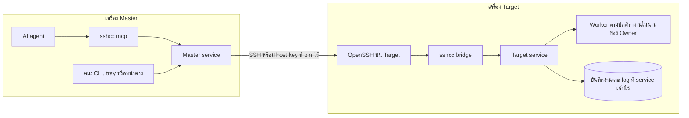

# สถาปัตยกรรม: แต่ละชิ้นส่วนทำอะไร

> SSH Control Center ให้คุณ (หรือ AI agent) สั่งงาน แก้ไฟล์ และเปิด terminal บนเครื่อง Windows และ Ubuntu ทุกเครื่องผ่าน SSH ได้จากที่เดียว

หน้านี้คือแผนที่ บอกว่ามีชิ้นส่วนอะไรบ้าง แต่ละชิ้นทำหน้าที่อะไรด้วยภาษาง่าย ๆ และอยู่ตรงไหนใน repository อธิบายซอร์สรุ่น 0.4.0

- อยากอ่านเรื่องของคำสั่งหนึ่งคำสั่งตั้งแต่ต้นจนจบ: [วิธีทำงาน](how-it-works.md)
- วิธีเพิ่มเครื่องใหม่: [การจับคู่ (Pairing)](pairing.md)
- กฎความปลอดภัยและความเสี่ยงที่ทราบแล้ว: [โมเดลความปลอดภัย](security-model.md)
- ฉบับภาษาอังกฤษของหน้านี้: [architecture.md](../architecture.md)

## 1. แนวคิดในหนึ่งย่อหน้า

ลองนึกถึงบริษัทที่มี **โต๊ะต้อนรับ** อยู่ที่สำนักงานใหญ่ และมี **สาขา** อยู่ไกลออกไปหลายแห่ง คุณไม่ต้องเดินทางไปสาขาเอง แค่ยื่นคำขอที่โต๊ะต้อนรับ เช่น "รันสคริปต์นี้ที่สาขาเหนือ" หรือ "แก้ไฟล์นั้นที่สาขาตะวันออก" โต๊ะต้อนรับเก็บรายชื่อสาขาไว้ และถือกุญแจเพียงที่เดียว โต๊ะโทรหาสาขาผ่านสายส่วนตัว ก่อนจะพูดอะไรก็ตรวจก่อนว่าเสียงปลายสายเป็นสาขานั้นจริง ไม่ใช่คนแอบอ้าง แต่ละสาขามีประตูบานเดียวและยามหนึ่งคน ยามให้เข้าได้เฉพาะกุญแจของโต๊ะต้อนรับ และมีหน้าที่ส่งคำขอต่อเท่านั้น ผู้จัดการสาขาตรวจซ้ำอีกครั้งว่าโต๊ะนี้อยู่ในรายชื่อที่อนุมัติไว้ จากนั้นพนักงานจึงลงมือทำงานโดยใช้บัญชีของเจ้าของสาขานั้น พนักงานส่งผลให้ผู้จัดการ และผู้จัดการเป็นผู้จดลงสมุดบันทึกของสาขา ถ้าสายโทรศัพท์หลุด งานก็ยังเดินต่อ และโต๊ะต้อนรับกลับมาเปิดสมุดอ่านทีหลังได้

เมื่อเทียบกับของจริง:

| ในเรื่องเล่า | ใน SSH Control Center |
|---|---|
| โต๊ะต้อนรับ | **Master** (เครื่องหลัก คือเครื่องที่คุณใช้สั่งงาน) |
| สาขา | **Target** (เครื่องปลายทาง คือเครื่องที่รับคำสั่ง) |
| สายโทรศัพท์ส่วนตัว | **SSH** (วิธีมาตรฐานแบบเข้ารหัสสำหรับ login เข้าคอมพิวเตอร์เครื่องอื่น) |
| การตรวจเสียงปลายสาย | **pinned host key** (host key SSH ของสาขา ซึ่งเป็นตัวตนสาธารณะของเครื่อง บันทึกไว้ล่วงหน้า) |
| ยามหน้าประตู | `sshcc bridge` |
| ผู้จัดการสาขา | **Target service** |
| พนักงาน | **worker** |
| สมุดบันทึก | บันทึกงาน (job) และ log ที่ Target service เป็นผู้เขียนและเก็บไว้บน Target |

### ศัพท์ที่จะเจอ

- **Service**: โปรแกรมที่ทำงานอยู่เบื้องหลังตลอดเวลา ไม่มีหน้าต่าง
- **OpenSSH**: โปรแกรมฟรีที่ใช้กันทั่วไปสำหรับทำ SSH SSH Control Center ใช้ OpenSSH ที่มากับระบบปฏิบัติการ (ตัวติดตั้งจะเพิ่มให้จากแหล่งของระบบปฏิบัติการเองถ้ายังไม่มี) ไม่ได้แถม SSH มาเอง
- **MCP** (Model Context Protocol): "ปลั๊ก" มาตรฐานที่ทำให้ AI assistant เรียกใช้เครื่องมือได้
- **Local channel (ช่องทางภายในเครื่อง)**: การเชื่อมต่อส่วนตัวระหว่างสองโปรแกรมบนคอมพิวเตอร์เครื่องเดียวกัน Windows เรียกว่า named pipe ส่วน Linux ใช้ Unix socket เครือข่ายเข้าถึงช่องทางนี้ไม่ได้
- **Owner**: บัญชีผู้ใช้ของคนที่รันตัวติดตั้งบนเครื่องนั้น บน Target งานใหม่ตามปกติจะรันด้วยบัญชีนี้
- **Job**: สคริปต์ที่สั่งให้ทำงานเบื้องหลัง มี ID กำกับ จึงกลับมาค้นดูทีหลังได้

## 2. ชิ้นส่วนต่าง ๆ

| ชิ้นส่วน | ทำอะไร (ภาษาง่าย ๆ) | อยู่ตรงไหนใน repo |
|---|---|---|
| **CLI** (`sshcc`) | โปรแกรมเล็ก ๆ ตัวเดียวที่มีหลายโหมด พิมพ์ `sshcc targets` หรือ `sshcc exec` เพื่อขอให้ local service ทำอะไรบางอย่าง โปรแกรมเดียวกันนี้ยังทำหน้าที่เป็น service, MCP server, bridge และ worker ได้ ขึ้นอยู่กับคำที่ใส่ต่อท้าย | `crates/cli/src/main.rs`, `crates/cli/src/shell.rs` (terminal ของ `sshcc shell`) |
| **Core service** (`sshcc service run`) | โปรแกรมที่ทำงานตลอดเวลา และเป็นหัวใจของผลิตภัณฑ์ บน Master เก็บรายชื่อ Target กับกุญแจ SSH และเป็นฝ่ายเริ่มการเรียก SSH ขาออก บน Target รัน job ไฟล์ และ terminal โดยรับฟังเฉพาะบน local channel | `crates/core/src/service.rs`, `ipc.rs`, `fleet.rs` (กับ `fleet_ssh.rs`, `fleet_merge.rs`), `jobs.rs`, `files.rs`, `terminal.rs`, `config.rs` |
| **โหมด MCP server** (`sshcc mcp`) | ให้ AI assistant ใช้เครื่องมือได้ อ่านและเขียนข้อความ MCP ทาง stdin และ stdout ทุกการเรียกเครื่องมือจะถูกส่งต่อให้ local service ตัวมันเองไม่ถือกุญแจ SSH | `crates/core/src/mcp.rs`, `agent_tools.rs`; `client_links.rs` เพิ่มรายการ `ssh_control_center` ลงใน Cursor, Claude Code หรือ Codex |
| **Desktop tray และหน้าต่าง** | ไอคอน tray เล็ก ๆ อยู่มุมจอ ส่วนหน้าต่างจัดการ (หน้าจอเป็นภาษาไทย) เป็นโปรแกรมแยกที่เปิดเมื่อต้องการ และคุยกับ service แบบเดียวกับ CLI ปิดหน้าต่างแล้วหน้าต่างจะซ่อนไว้ และจบการทำงานเองเมื่อว่าง 10 นาที (ค่าเริ่มต้น) ออกจาก tray แล้ว service ยังทำงานต่อ | `desktop/src-tauri/src/` (tray และหน้าต่าง), `desktop/ui/` (หน้าจอ) |
| **Installers (ตัวติดตั้ง)** | วางชิ้นส่วนลงเครื่อง ติดตั้ง service สร้างบัญชี `sshcc-bridge` ที่ถูกจำกัดสิทธิ์ เพิ่มกุญแจของ Master พร้อม forced command และให้คนกดอนุมัติบน Target Windows ใช้ไฟล์ `.exe` ไฟล์เดียว Ubuntu ใช้ `.deb` กับตัวช่วยติดตั้ง | `installers/windows/`, `installers/ubuntu/`; `crates/core/src/setup_package.rs` สร้างตัวติดตั้งเฉพาะเครื่อง ส่วน `pairing.rs` ดูแลข้อมูลการอนุมัติ |
| **Bridge ฝั่ง Target** (`sshcc bridge`) | ยามหน้าประตู SSH server ของ Target เป็นผู้เรียกมันเมื่อ Master เชื่อมต่อเข้ามา มันอ่านคำขอหนึ่งรายการ เติม Master ID และ key fingerprint ที่ SSH ตรึงไว้ในบรรทัดกุญแจ ส่งคำขอให้ local service แล้วพิมพ์คำตอบกลับ | `crates/cli/src/main.rs` (โหมด `bridge`), `crates/core/src/stream.rs` (terminal แบบสด) |
| **Worker ฝั่ง Target** (โหมดซ่อน `sshcc worker`) | พนักงาน เป็นโปรแกรมช่วยอายุสั้น ตามปกติจะสวมตัวตนของ Owner (เป็น root ถ้าผู้เรียกขอสิทธิ์ผู้ดูแลบน Ubuntu) แล้วจึงรัน job การทำงานกับไฟล์ หรือ terminal มันรายงานผลลัพธ์กลับไปที่ Target service ซึ่งเป็นผู้เก็บ log | `crates/core/src/worker.rs`, `executor.rs` กับ `executor_windows.rs` และ `executor_linux.rs` |
| **OpenSSH** (ไม่ได้อยู่ใน repo นี้) | Master เรียก `ssh` และ `ssh-keygen` ที่มีอยู่ในเครื่อง ฝั่ง Target ตอบรับด้วย SSH server ของเครื่องนั้น | เรียกจาก `crates/core/src/fleet_ssh.rs` และ `fleet.rs` ส่วนการตั้งค่าฝั่ง server เขียนโดยตัวติดตั้ง |

> **สำหรับนักพัฒนา** workspace (`Cargo.toml`) มีสาม crate `crates/core` คือไลบรารี `sshcc-core` `crates/cli` สร้างไบนารี `sshcc` ต่อยอดจากมัน ส่วน `desktop/src-tauri` คือ `sshcc-desktop` ซึ่งไม่อยู่ใน default members ของ workspace (ดู `desktop/README.md` สำหรับสิ่งที่ต้องติดตั้งเพิ่ม) หน้าต่างกับ CLI ใช้โค้ด client ชุดเดียวกัน คือ `crates/core/src/client.rs` ดังนั้นฝั่ง desktop ไม่มีทางลัดส่วนตัวเข้า service หน้าต่างเรียก service ผ่านคำสั่งทั่วไปชื่อ `rpc` ใน `desktop/src-tauri/src/tauri_app.rs`
>
> บน Windows tray (`sshcc-desktop`) เปิดโปรแกรมหน้าต่าง (`sshcc-window`) ภายใน Job Object ส่วนตัว (`windows_window.rs`) บน Ubuntu tray เป็นโปรแกรม GTK และ AppIndicator ขนาดเล็ก (`linux_tray.rs`) ที่เปิด `sshcc-window` เมื่อจำเป็น เวลาว่างก่อนปิดปรับได้ด้วย `SSHCC_WINDOW_IDLE_SECS`

## 3. สองบทบาท: Master และ Target

เครื่องหนึ่งมีบทบาทเดียวหรือทั้งสองบทบาทก็ได้ บทบาทเลือกตอนติดตั้ง (`sshcc init --role master|target|both`) และเก็บไว้ใน `config.json` ของเครื่องนั้น

| | **Master** (โต๊ะต้อนรับ) | **Target** (สาขา) |
|---|---|---|
| พูดง่าย ๆ | เครื่องที่คุณใช้สั่งงาน | เครื่องที่รับคำสั่ง |
| เก็บอะไร | รายชื่อ Target (ไม่เกิน 50 เครื่อง) คู่กุญแจ SSH ของแต่ละกลุ่มเครื่อง และ host key ที่ pin ไว้ | ตัวตนของเครื่องเอง รายชื่อ Master ที่รับ บันทึก job และ log และรายละเอียดของ terminal |
| เริ่มการเชื่อมต่อ SSH | ใช่ เฉพาะขาออก | ไม่ แค่ตอบรับ |
| ลงมือทำงานเอง | ไม่ ส่งคำขอต่อไป | ใช่ ทั้ง job ไฟล์ และ terminal |
| บัญชีที่ service ใช้ | SYSTEM บน Windows, root บน Ubuntu | SYSTEM บน Windows, root บน Ubuntu |

สามเรื่องที่ควรรู้:

- **เครื่องหนึ่งเป็นได้ทั้งสองบทบาท** ลองนึกถึงโน้ตบุ๊กที่คุณใช้ทำงาน (เป็นโต๊ะต้อนรับ) และ Master เครื่องอื่นก็เข้าถึงมันได้ด้วย (เป็นสาขา) เครื่องนี้มีสองบทบาทใน service ตัวเดียว
- **Master แต่ละเครื่องเป็นอิสระต่อกัน** แต่ละเครื่องมีรายชื่อและกุญแจของตัวเอง ไม่คัดลอกกุญแจหรือข้อมูลการลงทะเบียนให้กัน Target หนึ่งเครื่องรับหลาย Master พร้อมกันได้ และบันทึกว่า Master ไหนเป็นผู้เริ่มแต่ละ job
- **Master ส่งต่อผ่าน Master อีกเครื่องได้** ถ้า Target เครื่องหนึ่งเป็น Master ด้วย คุณ "merge" มันได้ คำขอของคุณจะเดินทางผ่านเครื่องนั้นหนึ่งช่วงเพื่อไปถึง Target ของมันเอง ได้แค่หนึ่งช่วงเท่านั้น merge ซ้อน merge จะไม่ถูกแชร์ต่อ ดู `docs/AGENT.md` หัวข้อ "Merged Masters"

> **สำหรับนักพัฒนา** service บังคับบทบาทใน `crates/core/src/service.rs` ถ้าไม่มีบทบาท `target` จะปฏิเสธคำขอผ่าน bridge (`E_ROLE`) ถ้าไม่มีบทบาท `master` จะปฏิเสธ `targets.*`, `jobs.*`, `files.*`, `terminal.*`, `pairing.*` และ `enrollment.export` บัญชีที่ใช้รันงานตามค่าเริ่มต้นขึ้นกับ config คือการติดตั้งใหม่ (config schema 2) รันงานใหม่ด้วยบัญชี Owner (`owner-session`) ส่วนการติดตั้งรุ่นเก่า (schema 1) ยังรันงานโดยตรงด้วยบัญชีของ service โดยไม่มี worker จนกว่าตัวติดตั้งจะสลับโหมด ดู [OWNER-SESSION.md](../OWNER-SESSION.md) และ `crates/core/src/config.rs`

## 4. ชิ้นส่วนเชื่อมกันอย่างไร



*คำขอเดินทางจาก AI agent หรือคน ผ่าน Master service และการเชื่อมต่อ SSH หนึ่งช่วง ไปถึง Target service ซึ่งให้ worker ลงมือทำงาน Target service เป็นผู้เก็บบันทึกงานและ log ผลลัพธ์จึงยังอยู่บน Target*

ไล่ตามลูกศร:

1. AI agent คุยกับ `sshcc mcp` ส่วนคนใช้ CLI, tray หรือหน้าต่าง ทุกทางไปถึงที่เดียวกัน คือ Master service ผ่าน local channel
2. Master service หา Target ในรายชื่อ แล้วลองเส้นทาง (route) ที่บันทึกไว้ของเครื่องนั้นตามลำดับ (เช่น LAN ก่อน แล้ว Tailscale แล้ว Public และอาจผ่านเครื่องกลางที่เรียกว่า ProxyJump) จากนั้นเรียก OpenSSH ด้วย config ชั่วคราวแบบเข้มงวดที่มันเขียนขึ้นเอง
3. OpenSSH บน Target รับเฉพาะกุญแจของ Master และกุญแจนั้นผูกกับ forced command ตายตัวที่เริ่มได้เฉพาะ `sshcc bridge` (บน Windows ผ่านตัวห่อ `powershell.exe -EncodedCommand` ที่ตายตัว)
4. Bridge ส่งคำขอต่อให้ Target service ผ่าน local channel
5. Target service ตรวจคำขอ แล้ว worker จึงลงมือทำงาน ตามปกติ worker รันในนามของ Owner (เป็น root ถ้าผู้เรียกขอ `asAdmin` บน Ubuntu) ส่วนการติดตั้งรุ่นเก่า schema 1 รันงานด้วยบัญชีของ service โดยไม่มี worker
6. worker รายงานผลลัพธ์ไปที่ Target service ซึ่งเก็บผลลัพธ์ไว้บน Target เมื่อ Master ต้องการก็มาขอดู แม้การเชื่อมต่อจะหลุดไปแล้ว

> **สำหรับนักพัฒนา** Target service รับเฉพาะเมธอดจากรายการตายตัวที่มาทาง bridge (`runner.*`, `fs.*`, `pty.*` และ `system.status` รวมถึงการเรียก `relay.*` ที่ Master แบบ merge ใช้) ที่เหลือปฏิเสธด้วย `E_PERMISSION` และยังตรวจด้วยว่า Master ลงทะเบียนอยู่และยังไม่ถูกเพิกถอน key fingerprint ตรงกัน และ Target ID ในคำขอเป็นของเครื่องนี้ (`bridge_master` ใน `crates/core/src/service.rs`) การเรียกปกติใช้การเชื่อมต่อ SSH หนึ่งครั้งต่อหนึ่งคำขอ ส่วน terminal แบบโต้ตอบเปิดการเชื่อมต่อค้างไว้หนึ่งเส้น (`crates/core/src/fleet_ssh.rs`) ถ้า host key ไม่ตรง ระบบหยุดการสลับ route ทันที ไม่ลองเส้นทางถัดไป

## 5. อะไรอยู่ที่ไหน

ใน repository:

```text
crates/
  cli/src/main.rs        คำสั่ง `sshcc` ทุกโหมด (service, mcp, bridge, shell, pairing, ...)
  cli/src/shell.rs       `sshcc shell` ตัว client ของ terminal แบบโต้ตอบ
  core/src/
    service.rs           service ที่ทำงานตลอดเวลา: รับคำขอ ตรวจบทบาทและตัวผู้เรียก
    ipc.rs               local channel (named pipe หรือ Unix socket) และการตรวจตัวตนผู้เรียก
    protocol.rs          รูปแบบข้อความ: JSON หนึ่งข้อความต่อหนึ่งบรรทัด ไม่เกิน 8 MiB
    client.rs            วิธีที่ CLI, MCP และหน้าต่างคุยกับ service
    mcp.rs               โหมด MCP server และรายการเครื่องมือ
    agent_tools.rs       เครื่องมือแบบข้อความเป็นหลักสำหรับ AI agent (รันคำสั่ง แก้ไฟล์ ค้นหา)
    client_links.rs      เพิ่มรายการ MCP ลงใน Cursor, Claude Code หรือ Codex
    fleet.rs             Master: รายชื่อ Target, กุญแจ, การเรียก SSH ขาออก
      fleet_ssh.rs         การเรียก OpenSSH แบบเข้มงวดและการสลับ route
      fleet_merge.rs       Master ที่ merge, relay และการตรวจสุขภาพเครื่อง
    pairing.rs           ขั้นตอนนำทาง "เพิ่มเครื่อง"
    setup_package.rs     สร้างตัวติดตั้งเฉพาะเครื่องจาก template
    jobs.rs              Target: job เบื้องหลังที่คงทน
    files.rs, search.rs  Target: อ่านและเขียนไฟล์, ค้นหาไฟล์
    terminal.rs          Target: terminal แบบโต้ตอบ; stream.rs ส่งผ่านแบบสด
    executor*.rs         Target: เลือก session ของ Owner และเริ่ม worker
    worker.rs            Target: โหมด worker ที่ซ่อนอยู่
    config.rs, security.rs  การตั้งค่า, โฟลเดอร์สถานะ, สิทธิ์ของไฟล์
    windows_service.rs   ตัวห่อ service ของ Windows
desktop/
  src-tauri/             โปรแกรม tray และหน้าต่าง (Tauri 2, Rust)
  ui/                    หน้าจอของหน้าต่าง: HTML, CSS และ JavaScript ธรรมดา (ภาษาไทย)
installers/
  windows/               Setup.ps1, PairingBootstrap.ps1, sshcc.nsi, Uninstall.ps1, Configure-Codex.ps1
  ubuntu/                setup.sh, setup-helper.py, sshcc.service (systemd), สคริปต์ของ package
scripts/                 ตัวช่วย build, smoke และ benchmark
tests/                   ชุดทดสอบ end-to-end, lifecycle และ benchmark
docs/                    เอกสาร
```

บนเครื่องที่ติดตั้งแล้ว (ไม่ได้อยู่ใน repository) แสดงเฉพาะรายการหลัก:

```text
Windows   C:\ProgramData\SSHControlCenter
Ubuntu    /var/lib/sshcc
  config.json         บทบาท, Owner, โหมดการทำงาน
  fleet.sqlite        Master: Target, กุญแจสาธารณะของแต่ละกลุ่ม, คำขอจับคู่, merge, สุขภาพเครื่อง
                      และสำเนาคำขอของแต่ละ job (สคริปต์, โฟลเดอร์, environment) ไว้ใช้ตอนลองใหม่
                      Target: Master ที่รับ
  keys/               Master: คู่กุญแจ SSH ที่ service เป็นเจ้าของ
  jobs.sqlite         Target: บันทึก job
  jobs/               Target: ไฟล์ log stdout และ stderr ของแต่ละ job (หนึ่งโฟลเดอร์ต่อหนึ่ง job)
  terminals.sqlite    Target: เฉพาะรายละเอียดของ terminal (ไม่เก็บข้อความ)
```

> **สำหรับนักพัฒนา** ย้ายโฟลเดอร์สถานะได้ด้วย environment variable `SSHCC_DATA_DIR` และย้าย local channel ได้ด้วย `SSHCC_SOCKET` (`crates/core/src/config.rs`) ถ้าต้องการทดสอบแบบแยกขาด ให้ตั้งทั้งสองตัวพร้อมกัน บน Ubuntu socket อยู่ที่ `/run/sshcc/control.sock` และ service คือ systemd unit ชื่อ `sshcc` บน Windows ชื่อ pipe สร้างจาก hash ของ path โฟลเดอร์สถานะ และ service ชื่อ `SSHControlCenter` ทำงานเป็น LocalSystem

## 6. สิ่งที่ตั้งใจไม่ทำ

ทุกข้อด้านล่างตรวจสอบได้จากโค้ดและเอกสารใน tree นี้ ไฟล์ในวงเล็บคือที่ที่ควรไปดู

- **ไม่มี network listener ของตัวเอง** service รับฟังเฉพาะบน local channel บน Windows pipe ปฏิเสธ client ที่มาจากเครื่องอื่น บน Ubuntu kernel บอก service ว่าผู้เรียกคือผู้ใช้คนไหน และ service ตรวจผู้ใช้นั้นก่อนอ่านคำขอ โหมด MCP ใช้เพียง stdin และ stdout การเข้าถึงจากระยะไกลเกิดผ่าน SSH server ของเครื่องนั้นเท่านั้น (`crates/core/src/ipc.rs`, `service.rs`, `docs/AGENT.md`)
- **ไม่ใช้การตั้งค่า SSH ส่วนตัวของคุณบน Master** ทุกการเรียกเขียน config และไฟล์ pin ชั่วคราวของตัวเอง แล้วลบทิ้ง ไม่อ่าน SSH config, SSH agent หรือไฟล์ known-hosts ของคุณ บน Target ตัวติดตั้งเพิ่มเฉพาะบล็อกและบรรทัดกุญแจที่ทำเครื่องหมายว่าเป็นของมัน และไม่แตะบรรทัดอื่น (`crates/core/src/fleet_ssh.rs`, `docs/CONTRACT.md`)
- **ไม่เชื่อเครื่องใดเพียงเพราะมันตอบกลับ** host key ถูก pin ไว้ตอนจับคู่ การเรียกงาน ไฟล์ และ terminal ตรวจมันอย่างเข้มงวด ถ้าไม่ตรงจะหยุดการเรียกทันที ไม่ลองเส้นทางถัดไป ส่วนตัวบอกสถานะออนไลน์/ออฟไลน์ที่ตรวจเป็นประจำอ่านเพียง SSH banner จึงใช้ดูได้แค่ว่าเข้าถึงเครื่องได้ ไม่ได้ยืนยันว่าเป็นเครื่องไหน (`crates/core/src/fleet_ssh.rs`, `fleet_merge.rs`, `docs/AGENT.md`)
- **ไม่ใช้รหัสผ่าน SSH agent หรือ forwarding** การเรียก SSH ฝั่ง Master ปิดสิ่งเหล่านี้ทั้งหมด บัญชี bridge ฝั่ง Target ถูกตั้งให้ไม่มี login ด้วยรหัสผ่าน ไม่มี port หรือ agent forwarding ไม่มี X11 และไม่มี terminal ในระดับ SSH ส่วน terminal แบบโต้ตอบนั้น Target service เป็นผู้สร้างให้ (`crates/core/src/fleet_ssh.rs`, `installers/ubuntu/setup.sh`, `installers/windows/Setup.ps1`)
- **ไม่ให้ SSH key มี shell** คำสั่งเดียวที่รันได้คือ bridge ตายตัวกับเมธอดในรายการ Master ที่ลงทะเบียนแล้วยังคงเริ่ม job และเขียนไฟล์ได้ ซึ่งเป็นจุดประสงค์ของผลิตภัณฑ์ ดู[โมเดลความปลอดภัย](security-model.md) (`crates/core/src/service.rs`, `installers/ubuntu/setup.sh`, `installers/windows/Setup.ps1`)
- **ไม่รัน job ซ้ำ** ถ้า Target service รีสตาร์ท job ที่อยู่ในคิวหรือกำลังรันจะถูกทำเครื่องหมาย `interrupted` และไม่ถูกรันอีก job ID เดิมพร้อมเนื้อหาเดิมจะได้ job เดิมกลับมา (`crates/core/src/jobs.rs`, `docs/OWNER-SESSION.md`)
- **ไม่บันทึกสิ่งที่คุณพิมพ์ใน terminal** ข้อมูลที่พิมพ์เข้า terminal ไม่เคยถูกเขียนลงดิสก์ ส่วนผลลัพธ์เก็บในบัฟเฟอร์หน่วยความจำ 4 MiB มีเพียงรายละเอียดของ terminal ที่ถูกบันทึก (`crates/core/src/terminal.rs`, `docs/OWNER-SESSION.md`)
- **ไม่คัดลอกกุญแจส่วนตัว** การจับคู่ส่งผ่านเฉพาะข้อมูลสาธารณะ กุญแจส่วนตัวของ Master ถูกสร้างและอยู่ในโฟลเดอร์ `keys/` ของมันเอง (`crates/core/src/pairing.rs`, `docs/CONTRACT.md`)
- **ไม่ล็อกโปรเจกต์ ไม่ซิงก์โฟลเดอร์ และไม่รวมการแก้ไข** Master สองเครื่องทำงานบน Target เครื่องเดียวกันพร้อมกันได้ สำหรับไฟล์ คุณส่ง hash ที่เห็นล่าสุด (`expectedSha256`) มาด้วยได้ และถ้าไฟล์เปลี่ยนไปแล้วจะปฏิเสธการเขียน Master ไม่คัดลอกกุญแจหรือข้อมูลการลงทะเบียนให้กัน การ merge เก็บเพียงชื่อ ID และรายละเอียดพื้นฐานของ Target ของ Master ที่ merge (เป็นข้อมูลสาธารณะ) เพื่อให้แสดงรายการได้ (`crates/core/src/mcp.rs`, `crates/core/src/fleet_merge.rs`, `docs/AGENT.md`)
- **ไม่ลบทั้งโฟลเดอร์** เครื่องมือลบจะลบได้เพียงไฟล์เดียวหรือโฟลเดอร์ว่างหนึ่งโฟลเดอร์ (`crates/core/src/mcp.rs`, `docs/AGENT.md`)
- **ไม่จัดการเครือข่ายของคุณ** ที่อยู่ Tailscale เป็นเพียง route ชนิดหนึ่ง ผลิตภัณฑ์ไม่ได้ login Tailscale และไม่ได้ตั้งกฎ firewall ให้ (`docs/INSTALL.md`, `crates/core/src/pairing.rs`)
- **ไม่รองรับ macOS** มีตัวติดตั้งเฉพาะ Windows และ Ubuntu 24.04 x64 (`installers/`, `docs/INSTALL.md`)

หน้านี้เล่าเรื่องการตัดสินใจด้านการออกแบบ ไม่ได้ครอบคลุมทุกความเสี่ยง ข้อจำกัดที่ทราบแล้ว เช่น สิ่งที่ AI agent ซึ่งถูกหลอกด้วย prompt injection อาจทำได้ อยู่ใน [โมเดลความปลอดภัย](security-model.md)

## อ่านต่อ

- [วิธีทำงาน](how-it-works.md): หนึ่งคำสั่ง ทีละขั้น
- [การจับคู่ (Pairing)](pairing.md): การเพิ่มเครื่อง
- [โมเดลความปลอดภัย](security-model.md): กฎและความเสี่ยงที่ทราบ
- [คำถามที่พบบ่อย](faq.md): คำตอบสั้น ๆ
- เอกสารอ้างอิง (ภาษาอังกฤษ): [INSTALL.md](../INSTALL.md), [CONTRACT.md](../CONTRACT.md), [AGENT.md](../AGENT.md), [OWNER-SESSION.md](../OWNER-SESSION.md)
- คู่มือเริ่มใช้งานภาษาไทย: [QUICKSTART.th.md](../QUICKSTART.th.md)
- กลับไปที่ [README.th.md](../../README.th.md)
