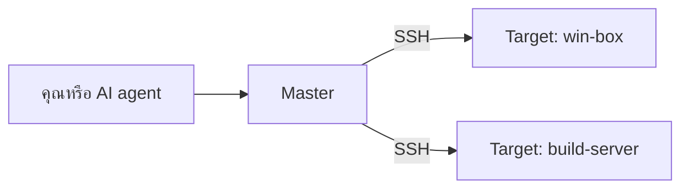
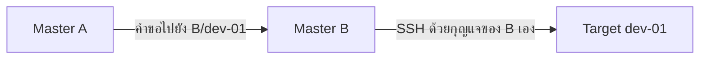

# คำถามที่พบบ่อย

คำตอบสั้น ๆ เกี่ยวกับ SSH Control Center เวอร์ชัน 0.4.0 (ค่า `version` ใน [`Cargo.toml`](../../Cargo.toml) ที่รากของ repository) ฉบับภาษาอังกฤษ: [faq.md](../faq.md)

ทุกคำตอบเริ่มด้วยภาษาง่าย ๆ ส่วนที่ติดป้าย **สำหรับนักพัฒนา** จะบอกไฟล์ใน repository นี้ที่ใช้ยืนยันข้อความ เพื่อให้คุณตรวจสอบเองได้

1. [SSH Control Center คืออะไร](#1-ssh-control-center-คืออะไร)
2. [ใครควรใช้](#2-ใครควรใช้)
3. [รองรับระบบปฏิบัติการอะไรบ้าง](#3-รองรับระบบปฏิบัติการอะไรบ้าง)
4. [ต้องมี AI agent ถึงจะใช้ได้หรือไม่](#4-ต้องมี-ai-agent-ถึงจะใช้ได้หรือไม่)
5. [เชื่อมกับ AI แอปตัวไหนได้บ้าง](#5-เชื่อมกับ-ai-แอปตัวไหนได้บ้าง)
6. [เปิดพอร์ตเครือข่ายหรือไม่](#6-เปิดพอร์ตเครือข่ายหรือไม่)
7. [กุญแจและข้อมูลเก็บไว้ที่ไหน](#7-กุญแจและข้อมูลเก็บไว้ที่ไหน)
8. [Master กับ Target คืออะไร](#8-master-กับ-target-คืออะไร)
9. [Master สองเครื่องใช้ Target ร่วมกันได้ไหม](#9-master-สองเครื่องใช้-target-ร่วมกันได้ไหม)
10. [ปล่อยให้ AI agent สั่งงานปลอดภัยหรือไม่](#10-ปล่อยให้-ai-agent-สั่งงานปลอดภัยหรือไม่)
11. [ถอนการติดตั้งอย่างไร](#11-ถอนการติดตั้งอย่างไร)
12. [ทำไมแอปบนเดสก์ท็อปเป็นภาษาไทย](#12-ทำไมแอปบนเดสก์ท็อปเป็นภาษาไทย)
13. [พร้อมใช้งานจริงแล้วหรือยัง](#13-พร้อมใช้งานจริงแล้วหรือยัง)
14. [ส่งความเห็นหรือแจ้งปัญหาได้อย่างไร](#14-ส่งความเห็นหรือแจ้งปัญหาได้อย่างไร)
15. [ไลเซนส์คืออะไร](#15-ไลเซนส์คืออะไร)

## 1. SSH Control Center คืออะไร

SSH Control Center ให้คุณ (หรือ AI agent) สั่งงาน แก้ไฟล์ และเปิด terminal บนเครื่อง Windows และ Ubuntu ทุกเครื่องผ่าน SSH ได้จากที่เดียว

ศัพท์สองคำ **SSH** คือวิธีมาตรฐานที่เข้ารหัสไว้สำหรับล็อกอินเข้าคอมพิวเตอร์อีกเครื่อง ส่วน **AI agent** คือผู้ช่วย AI ที่ใช้เครื่องมือได้ (ในที่นี้คือสั่งรันคำสั่งและแก้ไฟล์) ไม่ใช่แค่คุยโต้ตอบ

ระบบมีสี่ส่วน: **service** เล็ก ๆ ที่ทำงานเบื้องหลังบนแต่ละเครื่อง โปรแกรมบรรทัดคำสั่งชื่อ `sshcc` โหมด MCP server (`sshcc mcp`) ที่ให้แอป AI เรียกใช้ผ่าน **MCP** (รูปแบบปลั๊กอินที่แอป AI นิยมใช้ ดูข้อ 5) และไอคอน tray พร้อมหน้าต่างจัดการ ซึ่งเป็นส่วนเสริม

> **สำหรับนักพัฒนา** Rust workspace: `crates/core` (service, jobs, files, terminals, pairing), `crates/cli` (ไบนารี `sshcc`), `desktop/` (tray พร้อมหน้าต่างจัดการแบบ Tauri 2 ที่ใช้ UI เป็น HTML/CSS/JS ธรรมดา ส่วน tray บน Ubuntu เป็น GTK/AppIndicator) ดู [architecture.md](architecture.md)

## 2. ใครควรใช้

คนที่ดูแลเครื่อง Windows หรือ Ubuntu ของตัวเองจำนวนไม่มาก และอยากสั่งงานทั้งหมดจากที่เดียว จะสั่งเองหรือสั่งผ่าน AI agent ก็ได้ Master หนึ่งเครื่องเก็บ Target ได้สูงสุด 50 เครื่อง (คำว่า Master และ Target อธิบายในข้อ 8)

นี่เป็นโปรเจกต์โชว์ผลงานส่วนตัว (ข้อ 13) จึงเหมาะกับการลองใช้ เรียนรู้ และอ่านโค้ด มากกว่าใช้กับระบบที่สำคัญมาก

ยังไม่เหมาะกับ: เครื่อง Mac (ข้อ 3) หรือคนที่ต้องการผลิตภัณฑ์ที่ลงลายเซ็นดิจิทัลและผ่านการตรวจความปลอดภัยโดยผู้ตรวจอิสระ (ข้อ 13)

> **สำหรับนักพัฒนา** ขีดจำกัดคือ `MAX_TARGETS = 50` ใน `crates/core/src/fleet.rs`

## 3. รองรับระบบปฏิบัติการอะไรบ้าง

Windows และ Ubuntu แบบ 64 บิต (x64) เท่านั้น ทั้งฝั่ง Master และ Target

- ระบบที่ตั้งเป้าไว้สำหรับเครื่อง Target (ตามถ้อยคำที่ [INSTALL.md](../INSTALL.md) ใช้): Windows 10 หรือ 11 (Windows 10 ต้องมีฟีเจอร์เสริม OpenSSH), Windows Server 2019, 2022 หรือ 2025 และ Ubuntu 24.04
- ตัวติดตั้งตรวจเงื่อนไขพื้นฐานให้ทุกบทบาท: สคริปต์ติดตั้งบน Ubuntu จะหยุดทำงานถ้าไม่ใช่ Ubuntu 24.04 บน x86_64 และสคริปต์ติดตั้งบน Windows ต้องใช้ Windows 64 บิต ลินุกซ์ดิสโทรอื่นตัวติดตั้งไม่รองรับ สำหรับเครื่อง Master ไม่มีเอกสารระบุรายการรุ่นที่ละเอียดไปกว่านี้
- ไม่รองรับ macOS และไม่มีส่วนไหนใน repository นี้ที่ทำเพื่อ macOS
- การทดสอบอัตโนมัติไม่ได้ครอบคลุมทุกรุ่นของ Windows ที่ระบุข้างต้น [INSTALL.md](../INSTALL.md) (ภาษาอังกฤษ) ก็บอกไว้เช่นกัน

> **สำหรับนักพัฒนา** `crates/core/src/fleet.rs` ปฏิเสธ OS ที่ไม่ใช่ `windows` หรือ `linux` ส่วน `installers/ubuntu/setup.sh` และ `installers/ubuntu/setup-worker.sh` ตรวจ `/etc/os-release` ว่าเป็น Ubuntu 24.04 และตรวจ `uname -m` ว่าเป็น `x86_64` ส่วน `installers/windows/Setup.ps1` ต้องใช้ Windows 64 บิต รายการระบบที่ตั้งเป้าไว้สำหรับ Target: [INSTALL.md](../INSTALL.md#packages-and-roles) สิ่งที่มีการทดสอบ: [VALIDATION.md](../VALIDATION.md)

## 4. ต้องมี AI agent ถึงจะใช้ได้หรือไม่

ไม่ต้อง AI agent เป็นส่วนเสริม คุณใช้เองได้สองทาง:

- ไอคอน tray และหน้าต่างจัดการ: ดูรายการเครื่อง สั่งงานและอ่านผลของงาน แก้ไฟล์ และกด **เปิด Shell** เพื่อเปิด terminal
- คำสั่ง `sshcc` ใน terminal เช่น `sshcc doctor <Target>` เพื่อตรวจเครื่อง `sshcc exec` เพื่อรันสคริปต์ หรือ `sshcc shell <Target>` เพื่อเปิด terminal แบบโต้ตอบ

หน้าต่างจัดการ บรรทัดคำสั่ง และโหมด MCP ล้วนคุยกับ service ในเครื่องตัวเดียวกัน จึงเห็นเครื่องและงานชุดเดียวกัน

> **สำหรับนักพัฒนา** คำสั่งอยู่ใน [AGENT.md](../AGENT.md) และ [OWNER-SESSION.md](../OWNER-SESSION.md#shell) ส่วนหน้าต่างจัดการดู `desktop/README.md`

## 5. เชื่อมกับ AI แอปตัวไหนได้บ้าง

ใช้ **MCP** (Model Context Protocol วิธีมาตรฐานที่แอป AI ใช้เสียบเครื่องมือเพิ่ม) ผ่าน standard input และ output แอป AI จะเปิด `sshcc mcp` เป็นโปรแกรมช่วยตัวเล็ก ๆ แล้วคุยกับมัน ดังนั้นแอป AI ใดก็ตามที่เปิด MCP server ในเครื่องแบบนี้ได้ ก็น่าจะใช้งานได้

มีสามแอปที่ได้รับการช่วยเหลือในตัว: **Cursor**, **Claude Code** และ **Codex**

- แอปบนเดสก์ท็อปมีปุ่มเชื่อมให้แต่ละแอป ปุ่มนี้เขียนรายการชื่อ `ssh_control_center` ลงในไฟล์ตั้งค่าของแอปนั้น ถ้ามีรายการนี้อยู่แล้ว ปุ่มจะไม่แตะต้อง มีปุ่ม "อัปเดต path" แยกต่างหากสำหรับแก้ path ของคำสั่งเมื่อคุณสั่ง
- ตัวติดตั้งเครื่อง Master ยังตั้งค่า Codex ให้เองด้วยเมื่อพบ Codex
- สำหรับแอปอื่น ให้เพิ่มรายการเองโดยใช้ snippet ด้านล่าง

ข้อจำกัดที่ต้องบอกตรง ๆ: การทดสอบอัตโนมัติตรวจว่าไฟล์ตั้งค่าเหล่านี้ถูกเขียนถูกต้อง และการจับมือ MCP ทำงานกับสคริปต์ทดสอบ แต่ไม่ได้รันใช้งานจริงกับแอป AI แต่ละตัว

> **สำหรับนักพัฒนา** โค้ดลงทะเบียนและเทสต์อยู่ที่ `crates/core/src/client_links.rs` ไฟล์ตั้งค่าที่มันจัดการ: `~/.cursor/mcp.json`, `~/.claude.json`, `~/.codex/config.toml` เหตุผลที่ปุ่มเชื่อมไม่เขียนทับ: [ADR 0001](../adr/0001-mcp-registration-no-overwrite.md) เซิร์ฟเวอร์รายงาน MCP protocol version `2025-06-18` และตอบ `initialize`, `tools/list` และ `tools/call` (`crates/core/src/mcp.rs`)
>
> Snippet สำหรับแอปที่ใช้ JSON เช่น Cursor และ Claude Code (บน Ubuntu ใช้ `/usr/bin/sshcc`):
>
> ```json
> {
>   "mcpServers": {
>     "ssh_control_center": {
>       "command": "C:\\Program Files\\SSH Control Center\\sshcc.exe",
>       "args": ["mcp"]
>     }
>   }
> }
> ```
>
> Codex ใช้ TOML:
>
> ```toml
> [mcp_servers.ssh_control_center]
> command = 'C:\Program Files\SSH Control Center\sshcc.exe'
> args = ["mcp"]
> enabled = true
> ```

## 6. เปิดพอร์ตเครือข่ายหรือไม่

ตัวผลิตภัณฑ์เองไม่รอรับการเชื่อมต่อจากเครือข่าย service ของมันรอรับเฉพาะช่องทางที่อยู่ในเครื่องเดียวกัน คือ named pipe บน Windows ที่ปฏิเสธไคลเอนต์ระยะไกล หรือไฟล์ Unix socket (`/run/sshcc/control.sock`) บน Ubuntu ไม่มีเซิร์ฟเวอร์ HTTP หรือ MCP บนเครือข่าย และหน้าต่างบนเดสก์ท็อปโหลดไฟล์ของตัวเองในเครื่อง

แต่เครื่องที่มันควบคุมต้องเข้าถึงได้ทาง SSH:

- Target แต่ละเครื่องต้องให้ Master เข้าถึงพอร์ต SSH ได้ ปกติคือพอร์ต 22 มีตัวเลือกขั้นสูงให้ route ใช้พอร์ตอื่น
- สคริปต์ตัวติดตั้งตั้งค่า OpenSSH บน Target (บน Windows อาจติดตั้งฟีเจอร์ OpenSSH Server ให้) สคริปต์ไม่เพิ่มหรือแก้ไข firewall, NAT หรือการตั้งค่า Tailscale ส่วนนี้คุณทำเอง การติดตั้งฟีเจอร์ OpenSSH Server ของ Windows อาจเพิ่มกฎ firewall เริ่มต้นของ Windows เองด้วย จึงควรตรวจ firewall ของคุณ
- Master ยังเปิดการเชื่อมต่อขาออกสั้น ๆ เพื่ออ่านข้อความทักทายของ SSH จากแต่ละ Target สำหรับตรวจสถานะ ขั้นตอนนี้ไม่ได้ล็อกอิน

> **สำหรับนักพัฒนา** ตัวรอรับการเชื่อมต่ออยู่ที่ `crates/core/src/ipc.rs` (`PIPE_REJECT_REMOTE_CLIENTS` บน Windows ส่วนบน Unix โหมดของ socket เป็น 0666 และระบุตัวผู้เรียกแต่ละรายด้วย peer credentials ของ kernel ตามคอมเมนต์ในไฟล์นั้น) `TcpStream` ขาออกตัวเดียวใน `crates/core/src` คือการตรวจ banner ใน `fleet_merge.rs` [AGENT.md](../AGENT.md) ระบุว่า "There is no network HTTP/MCP listener" และ [architecture.md](architecture.md) กล่าวประเด็นเดียวกัน ตัวติดตั้งไม่แตะนโยบาย firewall: `installers/windows/Setup.ps1` และ `installers/ubuntu/setup.sh` พิมพ์ข้อความว่าเป็นหน้าที่ของผู้ดูแล

## 7. กุญแจและข้อมูลเก็บไว้ที่ไหน

บนแต่ละเครื่อง เก็บในโฟลเดอร์ข้อมูลโฟลเดอร์เดียว:

- Windows: `C:\ProgramData\SSHControlCenter`
- Ubuntu: `/var/lib/sshcc`

ภายในมี:

- **กุญแจส่วนตัวของ Master:** `keys/<tenant>.ed25519` หนึ่งไฟล์ต่อหนึ่ง tenant (ชื่อกลุ่มที่คุณตั้งตอนเพิ่มเครื่อง) สร้างด้วย `ssh-keygen` เป็นกุญแจ Ed25519 แบบไม่มี passphrase การป้องกันจึงอาศัยสิทธิ์ของไฟล์ Target ได้รับเฉพาะกุญแจสาธารณะ
- **รายการเครื่อง** (รวมถึง SSH host key ที่ปักหมุดไว้): `fleet.sqlite` บน Master ไฟล์นี้ยังเก็บสำเนาคำขอของแต่ละงาน (สคริปต์ โฟลเดอร์ทำงาน ค่า environment) เพื่อให้จดจำได้ว่าการลองใหม่ด้วยคำขอเดิมเป็นคำขอเดียวกัน กฎห้ามใส่ความลับใช้เหมือนกัน
- **งาน (jobs):** `jobs.sqlite` กับโฟลเดอร์ `jobs/<id>` ที่เก็บ stdout และ stderr ข้อมูลนี้อยู่บน Target ที่รันงานนั้น
- **Terminal:** `terminals.sqlite` เก็บบันทึกของ terminal ส่วนผลลัพธ์ของ terminal เก็บอยู่ในหน่วยความจำ (ring ขนาด 4 MiB) และสิ่งที่คุณพิมพ์จะไม่ถูกเขียนลงดิสก์
- **ตัวตนและการตั้งค่าของเครื่องนี้:** `config.json`

บน Target กุญแจสาธารณะของ Master ที่อนุมัติแล้วอยู่ใน `C:\ProgramData\ssh\sshcc` (Windows) หรือ `/etc/ssh/sshcc` (Ubuntu) ผลิตภัณฑ์ยังแก้ไขการตั้งค่า SSH server ในรูปแบบที่ทำเครื่องหมายไว้ชัดเจนอย่างเดียว คือบล็อกที่ทำเครื่องหมายไว้ในไฟล์ `sshd_config` บน Windows และไฟล์ drop-in ที่ทำเครื่องหมายไว้ `/etc/ssh/sshd_config.d/90-sshcc.conf` บน Ubuntu

งานเก็บทั้งสคริปต์และผลลัพธ์ไว้ จึงไม่ควรใส่รหัสผ่านลงในสคริปต์หรือค่า environment

> **สำหรับนักพัฒนา** พาธ: `data_dir()` ใน `crates/core/src/config.rs` (เปลี่ยนได้ด้วยตัวแปรสภาพแวดล้อม `SSHCC_DATA_DIR` ซึ่งเทสต์ใช้) การสร้างกุญแจ: `master_key()` ใน `crates/core/src/fleet.rs` ตำแหน่งไฟล์และการตั้งค่า SSH server: [INSTALL.md](../INSTALL.md#packages-and-roles) ring ของ terminal และกฎเรื่องข้อมูลที่พิมพ์: [OWNER-SESSION.md](../OWNER-SESSION.md#mcp--api) คำเตือนเรื่องรหัสผ่าน: [INSTALL.md](../INSTALL.md#service-environment-and-credentials)

## 8. Master กับ Target คืออะไร

ลองนึกถึงผู้จัดการอาคารที่ถือพวงกุญแจ **Master** คือผู้จัดการ: ถือกุญแจ เก็บรายชื่อห้อง และเป็นคนเดินไปหา ส่วน **Target** คือห้อง หมายถึงเครื่องที่ Master ควบคุม เจ้าของห้องต้องเปิดประตูและยื่นกุญแจให้ (ขั้นตอน **Approve**) ผู้จัดการจึงจะเข้าห้องได้



คุณคุยกับ Master เครื่องเดียว แล้ว Master ไปหาแต่ละ Target ผ่าน SSH

- Master เก็บรายการ Target (สูงสุด 50 เครื่อง) ถือกุญแจส่วนตัว และเป็นฝ่ายเริ่มการเชื่อมต่อ SSH
- Target รับเฉพาะ Master ที่ตนอนุมัติ รันงานและเก็บผลลัพธ์ไว้เอง งานจึงทำต่อได้แม้การเชื่อมต่อ SSH หลุด
- เครื่องหนึ่งเป็น Master, Target หรือเป็นทั้งสองอย่างก็ได้
- เครื่องจะกลายเป็น Target ได้อย่างไร (pairing) อธิบายไว้ใน [pairing.md](pairing.md)

> **สำหรับนักพัฒนา** บทบาท `master`, `target`, `both`: `init()` ใน `crates/core/src/config.rs` งานรันที่ไหน (Target ที่ติดตั้งด้วยตัวติดตั้งรุ่นปัจจุบันรันงานด้วยบัญชี Owner ที่ล็อกอินอยู่ ส่วนเครื่องที่ติดตั้งจากรุ่นเก่ายังอยู่ในโหมด SYSTEM/root): [OWNER-SESSION.md](../OWNER-SESSION.md)

## 9. Master สองเครื่องใช้ Target ร่วมกันได้ไหม

ได้ มีสองวิธี

**1. ลงทะเบียน Target กับ Master ทั้งสองเครื่อง** Master แต่ละเครื่องมีกุญแจและรายการเครื่องของตัวเอง และ Target อนุมัติแต่ละเครื่องแยกกัน Master สองเครื่องไม่ซิงก์กัน Target บันทึกว่า Master ใดเป็นผู้สั่งแต่ละงาน ไม่มีการล็อกโปรเจกต์ข้าม Master ดังนั้นถ้าสองเครื่องจะ deploy ไปที่เดียวกัน ให้ประสานงานกันในสคริปต์

**2. Merge Master เครื่องหนึ่งเข้ากับอีกเครื่อง** ถ้า Master B เป็น Target ของ Master A ด้วย A สามารถ merge B ได้ จากนั้น A จะเข้าถึง Target ของ B โดยขอให้ B ลงมือแทน เครื่องเหล่านั้นจะแสดงเป็น ID แบบ `B/dev-01`



Master A ไม่เคยได้รับกุญแจของ Master B มันเพียงขอให้ B ลงมือ

- การ merge ไปได้แค่หนึ่งทอด: การ merge ของ B เองจะไม่ถูกส่งต่อ
- B ปิดสิทธิ์ของ A ได้ทุกเมื่อ และ A จะถูกบล็อกจนกว่า B จะอนุญาตอีกครั้ง
- ถ้า B ออฟไลน์ จะเข้าถึง Target ของ B ผ่าน A ไม่ได้
- Master ที่ได้รับอนุมัติทุกเครื่องมีอำนาจระดับผู้ดูแลระบบเหนือ Target ของตน จึงควร merge เฉพาะ Master ที่คุณไว้ใจ

> **สำหรับนักพัฒนา** `crates/core/src/fleet_merge.rs` (relay, สิทธิ์, การตรวจสถานะ) รายการเมธอดที่ relay ได้ `RELAY_METHODS` ในไฟล์เดียวกัน และ [AGENT.md](../AGENT.md#merged-masters) พฤติกรรมของ Master สองเครื่องและ relay ถูกทดสอบโดย `crates/core/tests/fleet.rs` และชุดทดสอบในคอนเทนเนอร์ที่อธิบายไว้ใน [VALIDATION.md](../VALIDATION.md)

## 10. ปล่อยให้ AI agent สั่งงานปลอดภัยหรือไม่

เครื่องมือนี้ทรงพลังโดยเจตนา จึงต้องระวังให้สมกัน ภาพที่ตรงไปตรงมาคือ:

- **การ Approve เป็นก้าวใหญ่** เมื่อคุณอนุมัติ Master บน Target คุณอนุญาตให้ agent ของ Master นั้นรันคำสั่งและเข้าถึงไฟล์บนเครื่องนั้นได้ Master ที่ได้รับอนุมัติทุกเครื่องมีอำนาจระดับผู้ดูแลระบบเหนือ Target ของตน
- **งานรันด้วยบัญชีใด** สำหรับการติดตั้งใหม่ (โหมด owner-session): บน Windows บัญชี Owner ต้องเป็นผู้ดูแลระบบอยู่แล้ว และงานรันด้วย token ที่ยกระดับสิทธิ์ของบัญชีนั้น ส่วนบน Ubuntu งานรันด้วยผู้ใช้ของ Owner และรันเป็น root เฉพาะเมื่อผู้เรียกขอ `asAdmin` เครื่องที่ติดตั้งค้างมาจากรุ่นเก่าจะรันงานด้วย SYSTEM (Windows) หรือ root (Ubuntu) จนกว่าตัวติดตั้งจะสลับให้เป็นโหมด owner-session
- **สิทธิ์ผูกกับบัญชี ไม่ผูกกับแอป** โปรแกรมใดก็ตามที่รันด้วยบัญชี Owner บน Master ใช้ service ในเครื่องตัวเดียวกันได้ ไม่ใช่เฉพาะแอป AI ของคุณ
- **AI ถูกหลอกได้ด้วยข้อความที่มันอ่าน** ล็อก ไฟล์ซอร์สโค้ด หรือหน้าเว็บอาจมีคำสั่งแฝง เอกสารบอกให้ปฏิบัติต่อล็อกและซอร์สโค้ดเป็นข้อมูลที่ไม่น่าไว้ใจ และตัวเครื่องมือแยกไม่ออกว่าอะไรคือคำสั่งจริงของคุณและอะไรคือข้อความที่แฝงอยู่ในไฟล์เหล่านั้น ควรมีคนตรวจก่อนทำสิ่งที่ลบหรือทำลายข้อมูล
- **เริ่มจากเล็ก ๆ** ลองกับเครื่องเสมือนที่ทิ้งได้ก่อน ตามที่ [INSTALL.md](../INSTALL.md) แนะนำ

หากต้องการถอนสิทธิ์ ให้ถอน Master ที่ Target: จากหน้า "Master ที่อนุญาต" ของแอปบนเดสก์ท็อป หรือด้วย `masters.revoke` การเลิกทำคำขอ pairing ไม่ได้ถอนสิทธิ์ที่อนุมัติไปแล้ว

อ่านเพิ่ม: [security-model.md](security-model.md) และ [SECURITY.md](../../SECURITY.md)

> **สำหรับนักพัฒนา** ถ้อยคำของการอนุมัติและข้อควรระวังเรื่องรหัส pairing (checksum ช่วยจับการคัดลอกผิด ไม่ใช่ลายเซ็น): [INSTALL.md](../INSTALL.md#normal-installation-and-pairing) อำนาจและขีดจำกัดของ tenant: [AGENT.md](../AGENT.md#concurrency-and-registry-import) ล็อกที่ไม่น่าไว้ใจ: [AGENT.md](../AGENT.md) ตัวตนบน Windows และ Ubuntu: [OWNER-SESSION.md](../OWNER-SESSION.md#accounts) รายการสิทธิ์ของ pipe สร้างจาก owner บวกบัญชีที่อนุญาต: `Listener::bind` ใน `crates/core/src/ipc.rs`

## 11. ถอนการติดตั้งอย่างไร

รันสคริปต์ถอนการติดตั้งบนเครื่องนั้นด้วยสิทธิ์ผู้ดูแลระบบ ควรรอให้งานที่ค้างอยู่เสร็จหรือยกเลิก และปิด terminal ก่อน เพราะสคริปต์จะหยุด service และทำให้สิ่งที่ยังรันอยู่ถูกขัดจังหวะ สคริปต์ของแพ็กเกจบน Ubuntu จะปฏิเสธการถอนขณะยังมีงานทำงานอยู่ แต่เฉพาะเมื่อถอนแพ็กเกจโดยตรงด้วย `apt` หรือ `dpkg` เท่านั้น ส่วน `uninstall.sh` หยุด service ก่อน จึงไม่ติดการตรวจนี้ สคริปต์บน Windows ไม่มีการตรวจแบบนี้

Windows ใน PowerShell ที่เปิดแบบ Run as administrator:

```powershell
powershell.exe -NoProfile -ExecutionPolicy Bypass -File 'C:\Program Files\SSH Control Center\Uninstall.ps1'
```

Ubuntu:

```bash
sudo /usr/lib/sshcc/uninstall.sh
```

สิ่งที่สคริปต์ลบ: service, ไฟล์โปรแกรมที่รันได้ (`sshcc.exe` และไฟล์ที่รันได้ของแอปเดสก์ท็อปบน Windows ส่วนบน Ubuntu คือแพ็กเกจ), ทางลัดหรือรายการเริ่มอัตโนมัติของ tray ของ Owner และสิ่งที่ผลิตภัณฑ์เพิ่มในการตั้งค่า SSH server คือบล็อกที่ทำเครื่องหมายไว้ในไฟล์ `sshd_config` บน Windows หรือไฟล์ drop-in ที่ทำเครื่องหมายไว้บน Ubuntu (สคริปต์ตรวจว่าไฟล์ตั้งค่ายังใช้งานได้หลังลบ) บน Windows สคริปต์ช่วยติดตั้งและโฟลเดอร์ติดตั้งยังอยู่ที่เดิม

สิ่งที่สคริปต์ตั้งใจเก็บไว้ เพื่อให้ติดตั้งใหม่หรือย้อนรุ่นได้: โฟลเดอร์ข้อมูล (กุญแจ ประวัติงาน ล็อก) บัญชี `sshcc-bridge` ไฟล์กุญแจสาธารณะ และสิ่งที่ต้องมีมาก่อน เช่น OpenSSH หากต้องการลบสิ่งเหล่านี้ด้วย ให้ลบเอง สคริปต์ไม่ลบหรือแก้กุญแจ service หรือการตั้งค่า Tailscale ที่ผลิตภัณฑ์นี้ไม่ได้สร้าง ยกเว้นอย่างเดียว คือเมื่อสคริปต์ลบการตั้งค่า SSH ของตัวเอง จะรีสตาร์ต SSH server บน Windows (หรือสั่ง reload บน Ubuntu) เพื่อให้การเปลี่ยนมีผล การรีสตาร์ตบน Windows อาจทำให้ session SSH ที่เปิดอยู่หลุด

ข้อจำกัดที่ต้องบอกตรง ๆ: ไม่มีการทดสอบอัตโนมัติใน repository นี้ที่รัน `Uninstall.ps1` (ดู [VALIDATION.md](../VALIDATION.md#not-covered-by-anything-in-this-tree)) จึงควรลองในเครื่องเสมือนก่อน

> **สำหรับนักพัฒนา** `installers/windows/Uninstall.ps1`, `installers/ubuntu/uninstall.sh` และสคริปต์ของแพ็กเกจ `installers/ubuntu/prerm` (ปฏิเสธการถอนหรืออัปเกรดโดยตรงด้วย `apt` หรือ `dpkg` ขณะมีงานหรือ terminal ทำงาน ส่วน `uninstall.sh` สั่ง `systemctl stop sshcc` ก่อน และการปิด service จะทำให้งานกับ terminal ที่รันอยู่ถูกทำเครื่องหมายว่าถูกขัดจังหวะ) กับ `installers/ubuntu/postrm` (เก็บข้อมูลไว้แม้สั่ง purge) รายละเอียด: [INSTALL.md](../INSTALL.md#upgrade-uninstall-and-rollback)

## 12. ทำไมแอปบนเดสก์ท็อปเป็นภาษาไทย

เพราะข้อความในแอปเขียนเป็นภาษาไทยโดยตรง สำหรับผู้ใช้ที่อ่านภาษาไทย หน้าต่างจัดการ เมนู tray และข้อความของตัวติดตั้งจำนวนมากเป็นภาษาไทย โดยมีศัพท์เทคนิคภาษาอังกฤษปนอยู่ ใน repository นี้ไม่มีตัวสลับภาษาหรือไฟล์แปล จึงยังไม่มีหน้าจอภาษาอังกฤษ


*ภาพจำลองประกอบคำอธิบาย ข้อมูลเป็นข้อมูลสมมติ หน้าจอจริงของแอปเป็นภาษาไทย (Illustrative mockup with fake data. The real app UI is in Thai.)*

สิ่งที่ไม่ใช่ภาษาไทย: คำสั่ง `sshcc` ส่วนใหญ่พิมพ์ผลลัพธ์เป็น JSON (`sshcc shell` ที่โต้ตอบได้เป็น terminal ปกติ), เครื่องมือ MCP และ API ใช้ชื่อภาษาอังกฤษ และเอกสารส่วนใหญ่เป็นภาษาอังกฤษ มีคู่มือรุ่นเก่าบางฉบับเป็นภาษาไทยอย่างเดียว เช่น [QUICKSTART.th.md](../QUICKSTART.th.md) ถ้าอยากได้หน้าจอภาษาอังกฤษ บอกไว้ใน issue ได้ (ข้อ 14) แต่ไม่มีคำมั่นสัญญา

> **สำหรับนักพัฒนา** `desktop/ui/index.html` (`lang="th"`), `desktop/ui/app.js` (ข้อความภาษาไทย, รูปแบบวันที่ `th-TH`), `desktop/README.md` ("Thai guidance and English technical terms")

## 13. พร้อมใช้งานจริงแล้วหรือยัง

ยังไม่พร้อม นี่เป็นโปรเจกต์โชว์ผลงานเวอร์ชัน 0.4.0 ซึ่งยังไม่ถึง 1.0 โปรดอย่านำไปใช้กับเครื่องที่คุณเสียหายไม่ได้

- **ไม่มีการตรวจความปลอดภัยโดยบุคคลที่สาม** ใน repository นี้ไม่มีรายงานการตรวจดังกล่าว และไม่ได้อ้างว่ามี
- **ไม่ได้ลงลายเซ็นดิจิทัล** ตัวติดตั้งและโปรแกรมไม่ได้ลงลายเซ็น ไฟล์ checksum ใช้ตรวจได้เพียงว่าไฟล์ที่ดาวน์โหลดมาครบสมบูรณ์
- **ทดสอบบางส่วน** มี unit test, smoke test ในเครื่อง และการทดสอบด้วย Docker ที่ใช้ OpenSSH จริง (Master สองเครื่อง Target ห้าเครื่อง) ไม่มีการทดสอบใดที่ติดตั้งหรือถอนการติดตั้งบนเครื่อง Windows จริง รีบูตเครื่อง เชื่อมผ่านอินเทอร์เน็ตสาธารณะ หรือตรวจการล็อกอิน Git และ network share
- **ยังไม่มี CI** repository นี้ไม่มีไฟล์ตั้งค่า continuous integration เทสต์จึงรันก็ต่อเมื่อคุณรันเอง (ดู quick start ใน [VALIDATION.md](../VALIDATION.md#quick-start))
- **ช่องว่างที่รู้อยู่แล้ว** ไม่รองรับ macOS (ข้อ 3) หน้าจอเป็นภาษาไทยอย่างเดียว (ข้อ 12) และความเสี่ยงในข้อ 10

[VALIDATION.md](../VALIDATION.md) (ภาษาอังกฤษ) ระบุทุกการตรวจและสิ่งที่การตรวจนั้นไม่ครอบคลุม ส่วน [INSTALL.md](../INSTALL.md) แนะนำให้ติดตั้งลงเครื่องเสมือนที่ทิ้งได้ก่อน

> **สำหรับนักพัฒนา** เวอร์ชัน: `[workspace.package]` ใน `Cargo.toml` ไม่ได้ลงลายเซ็นและสิ่งที่ไม่มีการทดสอบ: [INSTALL.md](../INSTALL.md#build-packages) และ [VALIDATION.md](../VALIDATION.md#not-covered-by-anything-in-this-tree)

## 14. ส่งความเห็นหรือแจ้งปัญหาได้อย่างไร

เปิด issue บน GitHub: <https://github.com/VK-butter/SSH-control-center/issues> จะช่วยได้มากถ้าระบุเวอร์ชัน ระบบปฏิบัติการ สิ่งที่คาดหวัง และสิ่งที่เกิดขึ้นจริง ใช้ชื่อเครื่องและที่อยู่สมมติ และห้ามวางกุญแจ token หรือรหัส pairing

นี่เป็นโปรเจกต์ส่วนตัว ไม่มีคำมั่นว่าจะตอบ จะแก้ หรือจะแก้เสร็จเมื่อไร

หากเป็นปัญหาด้านความปลอดภัย โปรดอ่าน [SECURITY.md](../../SECURITY.md) ก่อน

## 15. ไลเซนส์คืออะไร

MIT ลิขสิทธิ์ปี 2026 ของ VK-butter พูดให้ง่ายคือ คุณใช้ คัดลอก แก้ไข แจกจ่าย หรือแม้แต่ขายได้ ตราบใดที่คงข้อความลิขสิทธิ์และไลเซนส์ไว้ ซอฟต์แวร์นี้ให้ตามสภาพ ไม่มีการรับประกัน ไลบรารีที่มันใช้ (ดูรายการใน `Cargo.lock`) มีไลเซนส์ของตัวเอง นี่เป็นเพียงการสรุปด้วยภาษาง่าย ๆ ไม่ใช่คำปรึกษาทางกฎหมาย

> **สำหรับนักพัฒนา** ข้อความเต็ม: [LICENSE](../../LICENSE) ประกาศใน `Cargo.toml` เป็น `license = "MIT"`
