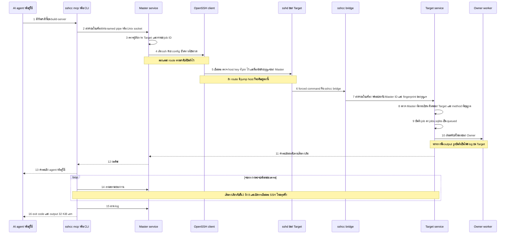
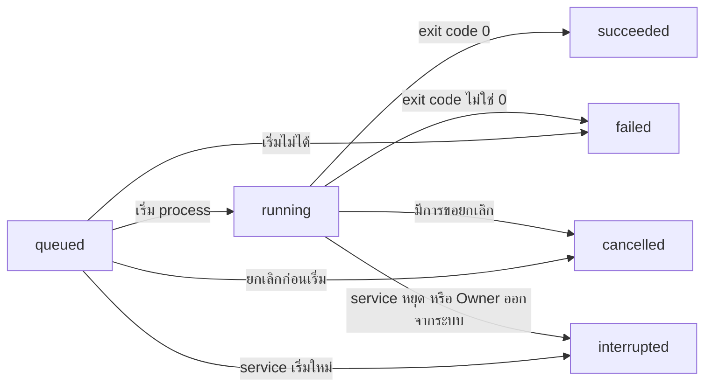

# How it works (ทำงานอย่างไร)

SSH Control Center ให้คุณ (หรือ AI agent) สั่งงาน แก้ไฟล์ และเปิด terminal บนเครื่อง Windows และ Ubuntu ทุกเครื่องผ่าน SSH ได้จากที่เดียว

หน้านี้ตามดู **คำขอหนึ่งรายการ** ตั้งแต่ตอนที่มีคนบอกว่า "ช่วยรันคำสั่งนี้หน่อย" จนถึงตอนที่ผลลัพธ์กลับมา จากนั้นขยายดูสามเรื่องที่คนใช้บ่อยที่สุด คือ การรันคำสั่งเป็น job การแก้ไฟล์ และการใช้ terminal

English version: [../how-it-works.md](../how-it-works.md) · กลับไปที่ [README.th.md](../../README.th.md)

- **คืออะไร:** คำสั่งหนึ่งข้อ (เช่น "รันอันนี้" "แก้อันนั้น" "เปิด terminal") ถูกทำให้บนอีกเครื่องหนึ่ง
- **ทำไมออกแบบแบบนี้:** การเชื่อมต่อหลุดได้ ดังนั้นเครื่องที่ลงมือทำงาน ไม่ใช่การเชื่อมต่อ เป็นฝ่ายเก็บบันทึกของงาน
- **ทำอย่างไร:** ผ่าน SSH โดยใช้โปรแกรม OpenSSH มาตรฐาน และมี service เล็ก ๆ ที่ปลายทั้งสองข้างคอยตรวจตัวตนและจำงานไว้

## ภาพเปรียบเทียบในชีวิตประจำวัน

ลองนึกถึง **สำนักงานใหญ่** กับ **สาขา** หลายแห่ง

สำนักงานใหญ่ไม่เดินเข้าไปในสาขาเอง แต่ส่ง **ใบสั่งงาน** ที่ผนึกซองแล้วไปกับ **พนักงานส่งเอกสารที่ล็อกกุญแจ** สาขาตรวจบัตรของพนักงานส่งเอกสาร จดใบสั่งลงใน **สมุดบันทึก** ของตัวเองพร้อม **หมายเลขใบสั่ง** แล้วให้พนักงานของสาขาลงมือทำ เอกสารทั้งหมดเก็บไว้ที่สาขา ถ้าพนักงานส่งเอกสารหลงทาง งานก็ยังเดินต่อ และคุณโทรไปถามทีหลังด้วยหมายเลขใบสั่งเดิมได้

เครื่องมือนี้ก็เหมือนกัน สำนักงานใหญ่คือ **Master** สาขาคือ **Target** พนักงานส่งเอกสารคือ **SSH** และหมายเลขใบสั่งคือ **job ID**

## คำศัพท์ที่ใช้ในหน้านี้

| คำ | ความหมายแบบง่าย |
|---|---|
| Master | เครื่องที่คุณใช้สั่งงาน เก็บกุญแจและรายการ Target |
| Target | เครื่องที่ถูกสั่งงาน (Windows หรือ Ubuntu) |
| Owner | บัญชีที่เจ้าของเครื่องใช้ล็อกอินบน Target ในโหมดตั้งต้นของการติดตั้งใหม่ งานจะรันในนามบัญชีนี้ |
| SSH / OpenSSH | วิธีมาตรฐานที่เข้ารหัสในการเชื่อมต่อไปยังเครื่องปลายทาง เครื่องมือนี้เรียกโปรแกรม `ssh` ตัวปกติ |
| MCP | มาตรฐานที่ให้ผู้ช่วย AI เรียกใช้เครื่องมือได้ `sshcc mcp` คือโปรแกรมเล็ก ๆ ที่เปิดเครื่องมือเหล่านี้ให้ AI agent |
| Job | คำสั่ง (สคริปต์) ที่เริ่มรันบน Target และถูกติดตามอยู่ที่ Target |
| Host key | "ลายนิ้วมือ" SSH ของ Target Master บันทึกไว้ตอนจับคู่เครื่อง (เรียกว่า pin) และปฏิเสธเครื่องใดก็ตามที่แสดงลายนิ้วมือต่างออกไป |
| Forced command | ค่า SSH ที่บอกว่า "กุญแจดอกนี้รันได้โปรแกรมเดียวเท่านั้น ห้ามรันอย่างอื่น" |
| Hash (SHA-256) | ลายนิ้วมือสั้น ๆ ของเนื้อหาไฟล์ แก้เพียงหนึ่ง byte แฮชก็เปลี่ยน |

## คำขอหนึ่งรายการ ตั้งแต่ต้นจนจบ

ตัวอย่าง: AI agent ขอให้ `build-server` (Target ที่เป็น Ubuntu) รัน `make test` ในโฟลเดอร์ `/home/alice/projects/app`

*พูดง่าย ๆ คือ คำขอผ่านประตูในเครื่อง แล้วผ่านการเชื่อมต่อ SSH ที่ล็อกกุญแจหนึ่งเส้น แล้วผ่านจุดตรวจสองจุดบน Target ก่อนจะมีอะไรถูกรัน งานเป็นของ Target ไม่ใช่ของการเชื่อมต่อ*

### ขั้นตอน

- **1. ขอ.** agent เรียก MCP tool ชื่อ `exec_run` ส่วนคนจะพิมพ์ `sshcc exec` ทั้งสองทางใช้โปรแกรมเล็ก ๆ ชื่อ `sshcc`
- **2. ส่งต่อให้ service ในเครื่อง.** `sshcc` ไม่แตะ SSH เอง แต่คุยกับ Master service บนเครื่องเดียวกันผ่านช่องทางส่วนตัวในเครื่อง คือ named pipe บน Windows หรือ Unix socket บน Ubuntu ผลิตภัณฑ์นี้ไม่เปิด network port สำหรับขั้นตอนนี้
- **3. ตรวจ ค้นหา ออกเลข.** Master service ตรวจว่าใครเป็นคนขอ มีเพียง Owner (หรือบัญชีระบบ) เท่านั้นที่ใช้ได้ จากนั้นหา `build-server` ในทะเบียนของตัวเอง และทำให้แน่ใจว่าคำขอมี job ID (ถ้าผู้เรียกไม่ส่งมา จะสุ่มให้) service จดไว้ว่า "รหัสนี้หมายถึงคำสั่งนี้บน Target นี้" และปฏิเสธคำสั่งอื่นที่ใช้รหัสเดิม
- **4. เปิดช่องทางส่งเอกสาร.** ทุกคำขอ service จะเขียนไฟล์ config SSH ชั่วคราวแบบส่วนตัว แล้วรันโปรแกรม `ssh` ตัวปกติด้วย config นั้น config ปิดสิ่งที่สะดวกแต่เสี่ยงทั้งหมด ได้แก่ การล็อกอินด้วยรหัสผ่าน agent forwarding port forwarding และการเชื่อใจ host key ใหม่ตั้งแต่เจอครั้งแรก มันเชื่อเฉพาะ host key ที่บันทึกไว้สำหรับ Target นี้ และใช้ไฟล์กุญแจจากโฟลเดอร์กุญแจส่วนตัวของ service เอง
- **5. เลือก route แล้วเชื่อมต่อ.** Target หนึ่งเครื่องมีได้หลาย **route** ได้แก่ LAN (เครือข่ายออฟฟิศเดียวกัน) Tailscale (เครือข่ายส่วนตัวแบบ mesh) หรือ Public (อินเทอร์เน็ต) route หนึ่งอาจระบุ jump host ด้วย Master ลอง route ตามลำดับที่บันทึกไว้สำหรับ Target นั้น โดยปกติหน้าจอตั้งค่าจะบันทึกหนึ่ง route (ชนิดเดาจากที่อยู่) และเพิ่ม route สำรอง เช่น LAN แล้ว Tailscale แล้ว Public ได้ในตัวเลือกขั้นสูง ถ้าเชื่อมต่อไม่ได้หรือหมดเวลา จะลอง route ถัดไป ถ้า host key ไม่ตรง หรือ Target ตอบกลับมาเป็นข้อผิดพลาดจริง จะหยุดทันทีและไม่ลอง route อื่น
- **6. Target ตรวจบัตร.** `sshd` ของ Target รับกุญแจของ Master สำหรับบัญชีเฉพาะที่ตัวติดตั้งสร้างไว้ (ในเอกสารการติดตั้งชื่อ `sshcc-bridge`) กุญแจดอกนั้นถูกล็อกให้รันได้โปรแกรมเดียวคือ `sshcc bridge` และ Master ID กับ fingerprint ของกุญแจมาจากการตั้งค่า SSH ของ Target เอง
- **7. bridge ส่งต่อ.** `sshcc bridge` อ่านคำขอหนึ่งรายการ ประทับ Master ID และ fingerprint ที่ตัวเองได้รับมา แล้วส่งให้ Target service ผ่านช่องทางในเครื่องแบบเดียวกับขั้น 2 Target service รับการเรียกในเครื่องนี้จาก Owner หรือบัญชีระบบ (ส่งคำขอได้ทุกชนิด) หรือจากบัญชีที่การติดตั้งอนุญาตไว้อย่างชัดเจน (ส่งได้เฉพาะคำขอ bridge หรือ bridge stream สำหรับ terminal)
- **8. Target ตรวจอีกรอบ.** Master นี้ลงทะเบียนไว้และยังไม่ถูกเพิกถอนหรือไม่ fingerprint ของกุญแจตรงหรือไม่ คำขอนี้ตั้งใจส่งมาที่ *เครื่องนี้* จริงหรือไม่ และการกระทำนี้อยู่ในรายการที่อนุญาตหรือไม่
- **9. จดไว้ก่อน.** Target service บันทึก job เป็น `queued` ลงฐานข้อมูลก่อนจะรันอะไรทั้งนั้น
- **10. ลงมือทำงาน.** ในโหมดตั้งต้นของการติดตั้งใหม่ Target จะเริ่ม worker แบบแยกส่วนในนามของ Owner ที่ล็อกอินอยู่ และ worker รันสคริปต์ output ไหลกลับมาที่ service ซึ่งบันทึกเป็นไฟล์ log บน Target (ในโหมด service แบบเก่า service รันสคริปต์เอง)
- **11 ถึง 13 ตอบกลับ.** คำตอบเดินทางย้อนกลับตามเส้นทางเดิม ถ้าเป็นการเริ่มครั้งแรก คำตอบคือ job record ที่ยังเป็น `queued`
- **14 ถึง 16 รอและอ่านผล (เฉพาะ MCP `exec_run`).** `exec_run` ถามสถานะซ้ำหลังผ่านไป 0.25 วินาที แล้วรอนานขึ้นเรื่อย ๆ จนห่างกันสูงสุด 2 วินาที มันหยุดเมื่องานจบหรือเมื่อเกินเวลารอ (ค่าตั้งต้น 30 วินาที สูงสุด 120 วินาที) จากนั้นอ่าน log 32 KiB แรกของแต่ละสาย การถามแต่ละครั้งคือการเชื่อมต่อ SSH ใหม่ ส่วนคำสั่ง CLI `sshcc exec` จบหลังขั้น 13 ให้ตรวจทีหลังด้วย `sshcc job`

### ถ้ามีอะไรผิดพลาด

| เกิดอะไรขึ้น | ผลที่ได้ |
|---|---|
| การเชื่อมต่อ SSH หลุดหลังจากงานเริ่มแล้ว | งานยังรันต่อบน Target ถามซ้ำด้วย job ID เดิม |
| คำตอบหายหรือหมดเวลา | ส่งคำสั่งเดิมด้วยรหัสเดิมอีกครั้ง Target จำใบสั่งได้และคืน job เดิมให้ ไม่เริ่มงานที่สอง Master ทำแบบเดียวกันตอนย้ายไปลอง route ถัดไป |
| มีคำสั่งอื่นมาใช้รหัสที่ใช้ไปแล้ว | ถูกปฏิเสธพร้อมข้อผิดพลาด (`JOB_ID_CONFLICT` ฝั่ง Master และ `E_CONFLICT` ฝั่ง Target) |
| host key ของ Target ไม่ตรงกับที่ pin ไว้ | หยุด ไม่ย้ายไป route อื่น และไม่มีข้อความถามว่า "ไปต่อเลยไหม" |
| Target ถูกนำเข้าจากไฟล์ทะเบียนรูปแบบก่อนหน้าเท่านั้น และยังไม่มี runner ที่ติดตั้ง | ถูกปฏิเสธด้วย `RUNNER_NOT_INSTALLED` |
| ทุก route เชื่อมต่อไม่ได้ | ข้อผิดพลาด `ALL_ROUTES_FAILED` จะแสดงว่าแต่ละ route รายงานว่าอะไร |

### Target ที่เข้าถึงผ่าน Master อีกเครื่อง (merge)

Target ที่เป็น Master ด้วยสามารถถูก **merge** ได้ Target ของมันจะโผล่ในรายการของคุณด้วยรหัสแบบ `build-server/dev-01` คำขอไปยัง Target แบบนี้จะมีอีกหนึ่งต่อ คือ Master ของคุณส่ง `relay.request` ไปที่ `build-server` แล้ว Master เครื่องนั้นส่งคำขอต่อไปยัง `dev-01` ด้วยกุญแจของตัวเอง กรณีนี้รอได้สูงสุด 100 วินาที เพราะรวมการเรียก SSH ครั้งที่สองไว้ด้วย และต่อได้เพียงหนึ่งต่อ merge ของ Master ที่ถูก merge จะไม่ถูกแชร์ต่อ ดู [AGENT.md](../AGENT.md#merged-masters)

## การรันคำสั่งเป็น job

**คืออะไร.** job คือคำสั่งที่เริ่มรันบน Target และถูกติดตามอยู่ที่นั่น Target เป็นเจ้าของ ไม่ใช่การเชื่อมต่อ SSH

**ทำอย่างไร.**

- Master ส่งสคริปต์ โฟลเดอร์ทำงาน และหมายเลขใบสั่ง (job ID)
- Target เขียน job ลง `jobs.sqlite` ก่อน แล้วค่อยเริ่มรันด้วยตัวเอง
- standard output และ error ไปอยู่ในไฟล์ log สองไฟล์บน Target แต่ละไฟล์จำกัด 64 MiB
- คุณถามสถานะหรืออ่าน log ด้วย job ID เมื่อไรก็ได้ log อ่านเป็นชิ้นตาม byte offset ครั้งละไม่เกิน 1 MiB
- ถ้า job ID เดิมมาอีกพร้อมเนื้อหาเดิม Target จะคืน record เดิมและไม่รันอะไรเพิ่ม

*พูดง่าย ๆ คือ job มักเดินจากรอคิว ไปกำลังรัน แล้วไปจบแบบใดแบบหนึ่งในสี่แบบ และอาจจบตั้งแต่ยังรอคิวได้ถ้าเริ่มไม่ได้หรือถูกยกเลิกก่อน "interrupted" แปลว่า "ถูกหยุดโดยสิ่งที่อยู่นอก job ดังนั้นให้ตรวจดูว่ามันทิ้งสภาพอะไรไว้"*

**เมื่อมีอะไรผิดพลาด.**

- **SSH หลุด.** job ยังรันต่อ ไม่มีอะไรเกิดขึ้นอีก
- **Target service หยุดหรือเริ่มใหม่.** job ที่กำลังรันถูกหยุดและบันทึกเป็น `interrupted` ตอนเริ่มครั้งถัดไป record ใดที่ยังเป็น `queued` หรือ `running` จะถูกเขียนทับเป็น `interrupted` ด้วย Target ไม่เคยรัน job ซ้ำเอง
- **Owner ออกจากระบบ** (โหมดตั้งต้นของการติดตั้งใหม่). process ทั้งชุดของ job ถูกหยุดและบันทึกเป็น `interrupted`
- **คุณยกเลิก.** `jobs_cancel` หยุด job และโปรแกรมที่ job เปิดขึ้น

**ทำไมสำคัญ:** การเชื่อมต่อหลุด การลองใหม่ หรือ agent ที่ใจร้อนกดซ้ำสองครั้ง จะไม่ทำให้ deploy เดียวกันเริ่มสองรอบ และงาน build ยาว ๆ รอดจากเน็ตสะดุด

## การแก้ไฟล์

**คืออะไร.** คุณแสดงรายการ อ่าน ค้นหา เขียน แก้ไข สร้างโฟลเดอร์ และลบไฟล์บน Target ได้

**ทำอย่างไร.**

- **การอ่าน** ให้เนื้อหาพร้อมแฮช SHA-256 ของไฟล์ ข้อมูลที่อ่านและแฮชมาจากไฟล์ที่เปิดอยู่ไฟล์เดียวกัน จึงเป็นของคู่กันเสมอ
- **การแก้ไข** (`files_edit`) รับข้อความเก่าและข้อความใหม่ ข้อความเก่าต้องตรงกันพอดีหนึ่งจุด ถ้าตรงศูนย์จุดหรือมากกว่าหนึ่งจุด การแก้ไขจะถูกปฏิเสธ เครื่องมือจะอ่านไฟล์ แทนที่จุดนั้นจุดเดียว แล้วเขียนกลับพร้อมส่งแฮชที่เพิ่งอ่านเป็นตัวกัน
- **การเขียนเป็นแบบ atomic (ทำทีเดียวจบ).** Target เขียนเนื้อหาใหม่ลงไฟล์ชั่วคราวแบบส่วนตัวในโฟลเดอร์เดียวกัน (ชื่อหน้าตาเป็น `.sshcc-<random>.tmp`) สั่งบันทึกลงดิสก์ แล้วนำเข้าที่ในขั้นเดียว การแทนที่ไฟล์ที่มีอยู่แล้วใช้ `rename` บน Ubuntu และ `ReplaceFileW` บน Windows ส่วนการสร้างไฟล์ใหม่ใช้ link (Ubuntu) หรือการย้ายแบบไม่เขียนทับ (Windows) ผู้อ่านจะเห็นไฟล์เก่าหรือไฟล์ใหม่ ไม่เห็นไฟล์ครึ่ง ๆ กลาง ๆ บน Ubuntu เจ้าของและสิทธิ์ของไฟล์เดิมคงอยู่ บน Windows รายการสิทธิ์ (access list) ของไฟล์เดิมคงอยู่
- **ตัวกันด้วยแฮช.** การเขียนใส่ `expectedSha256` ได้ ซึ่งเป็นแฮชของเวอร์ชันที่คุณอ่านมา ถ้าไฟล์เปลี่ยนไปแล้ว การเขียนจะล้มเหลวด้วย `E_CONFLICT` และไม่มีอะไรถูกเปลี่ยน ถ้าส่งแฮชที่คาดไว้เป็นค่าว่าง แปลว่า "ไฟล์นี้ต้องยังไม่มีอยู่" (สร้างใหม่เท่านั้น)
- Target ทำการเปลี่ยนไฟล์ทีละรายการ ในช่วงสั้น ๆ ดังนั้นผู้เขียนสองคนที่ใช้แฮชที่คาดไว้ตัวเดียวกันจะชนะพร้อมกันไม่ได้
- การเขียนปฏิเสธที่จะเขียนทับไฟล์ที่เป็น symbolic link เอง (โฟลเดอร์แม่ที่เป็น symlink จะถูกตามไป)

**ข้อจำกัด.** การเขียนหนึ่งครั้งไม่เกิน 4 MiB ถ้าไฟล์ใหญ่กว่านั้นให้ใช้ job

**ทำไมสำคัญ:** agent (หรือคุณ) จะเขียนทับงานใหม่กว่าของคนอื่นแบบเงียบ ๆ ไม่ได้ และไฟล์ที่คุณสนใจจะไม่ถูกทิ้งไว้ครึ่ง ๆ กลาง ๆ

## Terminal

**คืออะไร.** terminal คือ shell ที่ทำงานสดบน Target สำหรับโปรแกรมที่ต้องมีแป้นพิมพ์และหน้าจอ มันใช้ **pseudo-terminal** (PTY) ซึ่งเป็นแป้นพิมพ์และหน้าจอจำลองด้วยซอฟต์แวร์ ทำให้โปรแกรมเหล่านั้นเข้าใจว่ามีคนนั่งอยู่หน้าเครื่อง

**ทำอย่างไร.**

- การเปิด terminal จะเริ่ม shell บน Target ใน login session ของ Owner และให้รหัสประจำตัวหนึ่งรหัส
- output ถูกเก็บไว้ใน **หน่วยความจำ** ของ Target เป็นหน้าต่างขนาด 4 MiB ล่าสุด เมื่อเต็มก็ทิ้ง byte เก่าที่สุดไป คุณอ่านด้วย byte offset เหมือนที่คั่นหนังสือ ถ้าที่คั่นของคุณหลุดออกนอกหน้าต่างไปแล้ว คำตอบจะบอก `truncated` และให้ offset จริงมา
- input ถูกใส่เลข 1, 2, 3 ต่อไปเรื่อย ๆ ถ้าคุณส่ง byte เดิมซ้ำด้วยเลขเดิม Target จะตอบ `duplicate` และไม่พิมพ์ซ้ำ input ไม่เคยถูกบันทึกลงดิสก์
- ใช้งานได้สองแบบ MCP tools (`terminal_open`, `terminal_read`, `terminal_write`, `terminal_resize`, `terminal_status`, `terminal_close`) เรียก SSH สั้น ๆ หนึ่งครั้งต่อหนึ่งการกระทำ ส่วน `sshcc shell <Target>` เปิดการเชื่อมต่อ SSH เส้นเดียวค้างไว้และส่งข้อมูลสองทาง กด `Ctrl+]` เพื่อถอดออก (detach) และใช้ `--resume <terminalId>` เพื่อกลับเข้ามา
- เก็บเฉพาะ metadata (รหัส สถานะ โฟลเดอร์ และอื่น ๆ) ไว้ใน `terminals.sqlite` ข้อความบนหน้าจอไม่ถูกเก็บ

**ข้อจำกัด.** terminal ต้องใช้โหมด Owner-session Target ที่ยังอยู่ในโหมด service แบบเก่าจะตอบ `E_EXECUTION_MODE` รันพร้อมกันได้ไม่เกิน 8 terminal ต่อ Target terminal ที่ไม่มี client แบบ streaming เกาะอยู่ (`sshcc shell`) และไม่มีการเรียก tool เลย 30 นาที จะจบด้วยสถานะ `expired` การที่ service เริ่มใหม่ Owner ออกจากระบบ หรือการเพิกถอน Master ที่เปิด terminal ก็ทำให้ terminal จบเช่นกัน และมีเพียง Master ที่เปิด terminal เท่านั้นที่ใช้มันได้

**ทำไมสำคัญ:** คุณดูและบังคับโปรแกรมที่รันนาน ๆ ได้แบบสด และถ้าการเชื่อมต่อของคุณหลุด คุณกลับเข้ามาดูสิ่งที่พลาดไปได้ ตราบใดที่ Target service ยังทำงานอยู่และ output ยังอยู่ในหน้าต่าง 4 MiB

## ควรรู้

- **route เรียงตามที่บันทึกไว้.** เครื่องมือไม่ได้วัดว่า route ไหนเร็วที่สุด มันลองตามลำดับที่บันทึก
- **คำขอแต่ละรายการที่ Master ส่งคือการเชื่อมต่อ SSH ใหม่.** การเรียก MCP หนึ่งครั้งอาจส่งหลายคำขอ เช่น `exec_run` (เริ่ม ถามสถานะ อ่าน log) และ `files_edit` (อ่านแล้วเขียน) config ที่สร้างขึ้นปิดการแชร์การเชื่อมต่อ ข้อยกเว้นคือ `sshcc shell` ซึ่งเปิดการเชื่อมต่อเส้นเดียวค้างไว้
- **ทุก Master ที่ลงทะเบียนมีอำนาจผู้ดูแลเหนือ Target ของมัน.** ไม่มีขั้นตอนอนุมัติระหว่างคำขอของ agent กับ Target โปรแกรมใดก็ตามที่รันในนาม Owner บน Master รวมถึงเครื่องมือของ AI agent ส่งคำขอได้ อ่าน [security model](security-model.md) ก่อนจะให้ AI agent ควบคุมเครื่องที่คุณห่วง
- **สคริปต์และ environment ของ job ถูกเก็บเป็นข้อความธรรมดา** ใน `jobs.sqlite` ของ Target (Master ก็เก็บสำเนาคำขอของแต่ละ job ไว้ใน `fleet.sqlite` ของตัวเองด้วย) และ Master ที่ลงทะเบียนเครื่องใดก็ตามสามารถแสดงรายการ job ของ Target ได้ อย่าใส่ความลับลงในสคริปต์หรือค่า environment
- **โหมดตั้งต้นของการติดตั้งใหม่ต้องการให้ Owner ล็อกอินอยู่** เมื่อจะเริ่ม job แตะไฟล์ หรือเปิด terminal ไม่เช่นนั้นคำขอเหล่านั้นจะล้มเหลวด้วย `E_OWNER_NOT_LOGGED_IN` ส่วนการดูสถานะและ log ของ job ที่มีอยู่แล้วยังใช้ได้ ดู [OWNER-SESSION.md](../OWNER-SESSION.md)
- **ไม่มี project lock.** Master สองเครื่องแก้โฟลเดอร์เดียวกันพร้อมกันได้ ตัวกันด้วยแฮชปกป้องได้เฉพาะไฟล์ทีละไฟล์

## สำหรับนักพัฒนา

path ทั้งหมดนับจาก root ของ repository

| ขั้นตอนหรือหัวข้อ | ดูที่ไหน |
|---|---|
| MCP server, รายการ tool, `tools/call` | `crates/core/src/mcp.rs` (`tools`, `serve`) |
| `exec_run`, `files_edit`, `files_write_text` | `crates/core/src/agent_tools.rs` (`exec_run`, `edit`, `read_all`) |
| คำสั่ง CLI (`exec`, `job`, `bridge`, `mcp`) | `crates/cli/src/main.rs` |
| `sshcc shell` | `crates/cli/src/shell.rs` |
| ช่องทางในเครื่อง (ขั้น 2 และ 7) | `crates/core/src/client.rs`, `crates/core/src/ipc.rs` |
| จุดเริ่มของ Master service และการตรวจผู้เรียก | `crates/core/src/service.rs` (`run`, `handle`) |
| การจด job ID และการแปลง method | `crates/core/src/fleet.rs` (`dispatch`) |
| Target โดยตรงหรือผ่าน merge | `crates/core/src/fleet_merge.rs` (`resolve`, `send`, `relay_request`) |
| config SSH ชั่วคราว วนลอง route กฎหยุดหรือลองใหม่ | `crates/core/src/fleet_ssh.rs` (`session_config`, `attempt`, `request_within`, `attach`) |
| การตรวจบน Target (ขั้น 7 และ 8) | `crates/core/src/service.rs` (`bridge_master`, รายการ `allowed` ใน `handle`), `crates/core/src/fleet.rs` (`authorized_master_key`) |
| Jobs | `crates/core/src/jobs.rs` (`start`, `execute`, `execute_owner`, `open_for`, `shutdown`) |
| Owner worker | `crates/core/src/executor.rs`, `crates/core/src/worker.rs` |
| ไฟล์ | `crates/core/src/files.rs` (`handle`, `commit_file`) |
| Terminal และ streaming | `crates/core/src/terminal.rs`, `crates/core/src/stream.rs`, `crates/core/src/service.rs` (`serve_stream`) |
| รูปแบบข้อความ | `crates/core/src/protocol.rs`, [CONTRACT.md](../CONTRACT.md) |

test ที่แสดงพฤติกรรมข้างต้น:

- `crates/core/src/fleet_ssh.rs`: ความล้มเหลวเรื่อง host key ไม่ถูกมองเป็นการหลุดชั่วคราว และ config SSH ที่สร้างขึ้นเข้มงวด
- `crates/core/src/agent_tools.rs`: การรอและการจัดการ log ของ `exec_run` กฎของ `files_edit` การปฏิเสธเมื่อแฮชล้าสมัย และการเขียนแบบสร้างใหม่เท่านั้น
- `crates/core/src/files.rs`: การอ่านเก็บข้อมูลกับแฮชไว้คู่กัน การเขียนที่มีตัวกันด้วยแฮชพร้อมกันมีผู้ชนะคนเดียว และการแทนที่ไฟล์คงเจ้าของ กลุ่ม และสิทธิ์ (Ubuntu) หรือ access list (Windows) ไว้

สิ่งที่การตรวจสอบของ repository ครอบคลุมและไม่ครอบคลุมอยู่ใน [VALIDATION.md](../VALIDATION.md)

## อ่านต่อ

- [Architecture](architecture.md): ส่วนประกอบและวิธีที่มันต่อเข้าด้วยกัน
- [Pairing](pairing.md): เครื่องหนึ่งกลายเป็น Target ได้อย่างไร
- [Security model](security-model.md): สิ่งที่ไว้ใจ สิ่งที่ตรวจ และช่องว่างที่ทราบอยู่
- [FAQ](faq.md)
- [AGENT.md](../AGENT.md): การใช้ CLI และ MCP, Master ที่ merge กัน และ fleet health
- [CONTRACT.md](../CONTRACT.md): API และรูปแบบข้อความที่แน่นอน
- [OWNER-SESSION.md](../OWNER-SESSION.md): การรันในนาม Owner ที่ล็อกอินอยู่ และรายละเอียดของ terminal
