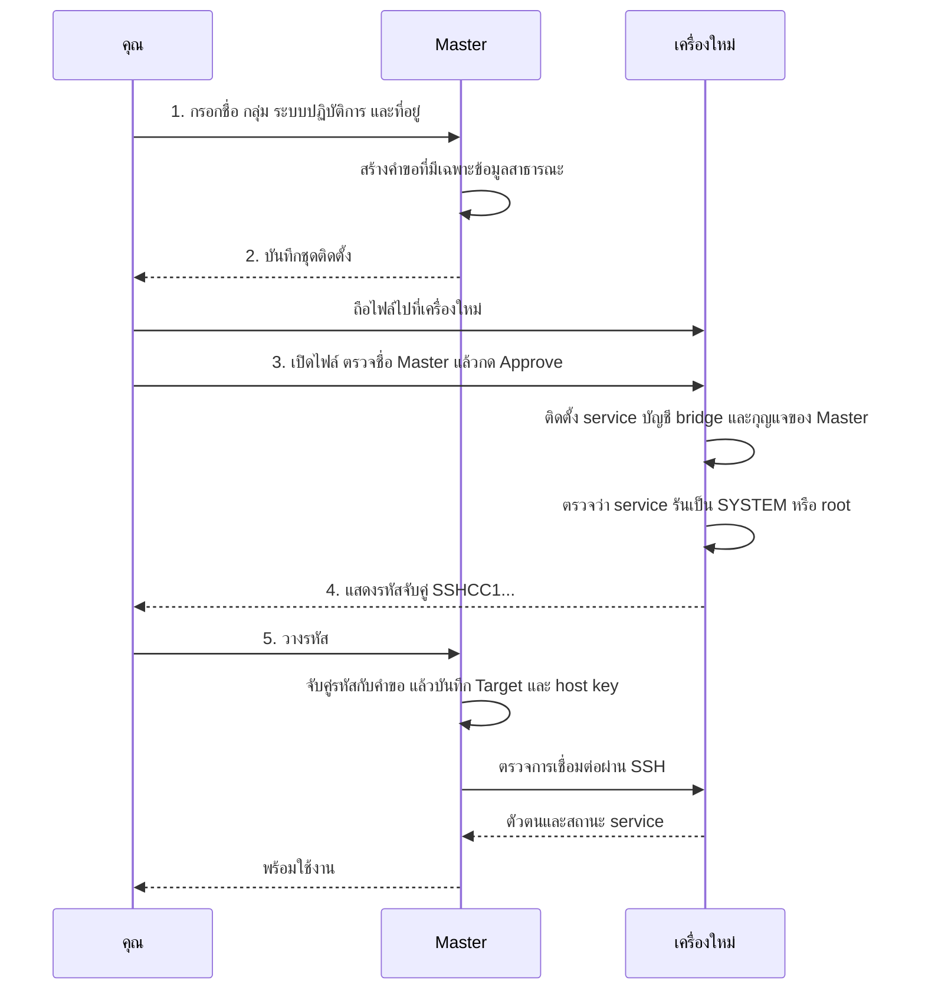
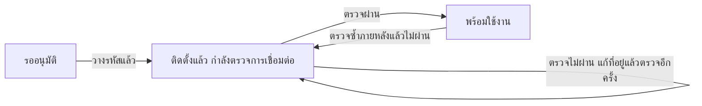

# การจับคู่ (Pairing): เครื่องใหม่เข้าร่วมกลุ่มเครื่องได้อย่างไร

*English version: [../pairing.md](../pairing.md)*

**หน้านี้พูดถึงอะไร** วิธีเพิ่มเครื่องใหม่หนึ่งเครื่อง (เรียกว่า *Target* หรือเครื่องปลายทาง) เพื่อให้ *Master* หรือเครื่องหลักที่คุณใช้ทำงาน สั่งคำสั่ง แก้ไฟล์ และเปิด terminal บนเครื่องนั้นได้ ต้องมีคนอยู่ที่หน้าเครื่องใหม่

## แนวคิดแบบเข้าใจง่าย

ลองนึกถึงการยืมกุญแจสำรองให้เพื่อน

เพื่อน (Master) ให้กระดาษที่วาดรูปร่างกุญแจของเขามา กระดาษนี้พอให้ช่างทำแม่กุญแจที่รับกุญแจดอกนั้นได้ แต่เปิดอะไรเองไม่ได้ คุณยืนอยู่ที่ประตูบ้านของคุณ (Target) ดูชื่อบนกระดาษ ใส่แม่กุญแจที่รับเฉพาะกุญแจดอกนั้น แล้วเขียนที่อยู่ของประตูบ้านกับลายนิ้วมือของประตูลงในกระดาษโน้ต คุณส่งโน้ตคืนให้เพื่อน เพื่อนเก็บโน้ตไว้ แล้วลองไขหนึ่งครั้งดูว่าใช้ได้ ไม่มีความลับอะไรเดินทางระหว่างกันเลย

นั่นคือการจับคู่:

- **คืออะไร** การจับมือครั้งเดียวที่ทำให้ Master ควบคุม Target เครื่องใหม่ได้
- **ทำไมทำแบบนี้** เจ้าของเครื่องใหม่ต้องพูดว่า "ตกลง" ที่หน้าเครื่องนั้นเอง และไม่มีรหัสผ่านหรือ private key ถูกพิมพ์หรือส่งไปที่ไหน
- **ทำอย่างไร** Master เตรียมชุดติดตั้ง คุณถือไปที่เครื่องใหม่ กด **Approve** แล้วถือรหัสจับคู่กลับมา

SSH ที่ใช้ตลอดหน้านี้ คือวิธีมาตรฐานที่เข้ารหัสไว้ซึ่งทำให้เครื่องหนึ่งสั่งงานอีกเครื่องหนึ่งได้

## ศัพท์ที่ใช้ในหน้านี้

| คำ | ความหมาย |
|---|---|
| Master (เครื่องหลัก) | เครื่องที่คุณใช้ทำงาน เก็บ SSH key ลับและรายชื่อเครื่องทั้งหมด |
| Target (เครื่องปลายทาง) | เครื่องที่ถูกควบคุม service ของเครื่องนี้รับเฉพาะ Master ที่คุณอนุมัติ |
| กลุ่ม (group) | ป้ายที่คุณตั้งให้เครื่องกลุ่มหนึ่ง เช่น `lab` ในโค้ดเรียกว่า `tenant` Master เก็บ SSH key หนึ่งชุดต่อหนึ่งกลุ่ม |
| ชุดติดตั้ง (setup file) | ไฟล์ `.exe` (Windows) หรือ `.deb` (Ubuntu) ไฟล์เดียวที่ Master เตรียมไว้ให้เครื่องใหม่เพียงเครื่องเดียว |
| Approve (อนุมัติ) | การตอบว่า "ตกลง" อย่างชัดเจนโดยคนที่หน้าเครื่อง Target |
| รหัสจับคู่ (pairing code) | ข้อความยาวที่ขึ้นต้นด้วย `SSHCC1.` ซึ่ง Target แสดงตอนท้าย คุณนำไปวางที่ Master |
| host key (กุญแจยืนยันเครื่อง) | ตัวตน SSH ของ Target เอง Master จดจำ ("pin") ไว้ เพื่อจะรู้ทันถ้ามีเครื่องอื่นมาตอบที่ที่อยู่เดิมในภายหลัง |

## ห้าขั้นตอนโดยสรุป



*พูดง่าย ๆ: Master สร้างไฟล์ คุณถือไปอนุมัติที่เครื่องใหม่ แล้วถือรหัสกลับมาให้ Master ตรวจเครื่องนั้น*

หน้า **เพิ่มเครื่อง** บน Master มีกล่องความคืบหน้าสี่กล่อง แต่ละกล่องตรงกับขั้นตอนข้างบนดังนี้

| กล่องความคืบหน้าบน Master | คำใต้ชื่อกล่อง | ขั้นตอนในหน้านี้ |
|---|---|---|
| **ตั้งค่าที่นี่** | กรอกข้อมูลเครื่องใหม่ | 1 |
| **ส่งชุดติดตั้ง** | เปิดที่เครื่องใหม่แล้วกด Approve | 2 และ 3 |
| **คัดลอกรหัส** | จากเครื่องใหม่หลังติดตั้งเสร็จ | 4 |
| **วางรหัสกลับ** | ตรวจแล้วพร้อมใช้งาน | 5 |

## ก่อนเริ่ม

- **Master** ติดตั้ง SSH Control Center จากแพ็กเกจ Master แบบเต็ม ซึ่งมี template สำหรับชุดติดตั้งรวมอยู่ ถ้าไม่มี ขั้นตอนที่ 2 จะล้มเหลวด้วย `SETUP_TEMPLATES_MISSING`
- **เครื่องใหม่** ใช้ Windows x64 หรือ Ubuntu 24.04 (x86_64) ตัวติดตั้งบน Ubuntu ตรวจเวอร์ชันและชนิด CPU ส่วนตัวติดตั้งบน Windows ตรวจเพียงว่า Windows และ PowerShell เป็น 64 บิต ไม่ได้ตรวจเวอร์ชันหรือรุ่นของ Windows ดูแนวทางที่ตั้งใจรองรับใน [INSTALL.md](../INSTALL.md) (ภาษาอังกฤษ) การทดสอบอัตโนมัติไม่ได้ครอบคลุมทุกรุ่นที่ระบุไว้ที่นั่น
- **มีคนที่มีสิทธิ์ administrator อยู่ที่หน้าเครื่องใหม่** Windows จะขอสิทธิ์ผ่าน UAC ส่วน Ubuntu ขอสิทธิ์ผ่าน `pkexec` (แบบกราฟิก) หรือ `sudo` (แบบ terminal)
- **บัญชี Owner** เครื่องที่ติดตั้งใหม่จะใช้โหมด *Owner session* เป็นค่าเริ่มต้น คือคำสั่งที่ตามมาจะรันด้วยบัญชีที่เปิดชุดติดตั้ง บน Windows บัญชีนั้นต้องเป็น administrator อยู่แล้ว บน Ubuntu ต้องอยู่ในกลุ่ม `sudo`, `admin` หรือ `wheel` อยู่แล้ว ให้เปิดชุดติดตั้งด้วยบัญชีที่คุณต้องการให้เป็น Owner เครื่องที่เคยมี SSH Control Center อยู่แล้วจะคง Owner เดิมไว้ ดู [OWNER-SESSION.md](../OWNER-SESSION.md) (ภาษาอังกฤษ)
- **เครือข่าย** Master ต้องเข้าถึงที่อยู่ของเครื่องใหม่ที่พอร์ต SSH ได้ (พอร์ต 22 ถ้าไม่เปลี่ยน) สคริปต์ติดตั้งไม่มีคำสั่งเกี่ยวกับ firewall หรือ Tailscale เลย การเปิดพอร์ตและการลงชื่อเข้า Tailscale จึงยังเป็นหน้าที่ของคุณ ถ้าใช้ Tailscale ให้ลงชื่อเข้าใช้บนเครื่องใหม่ก่อน
- **อินเทอร์เน็ตบนเครื่องใหม่** บน Windows ตัวติดตั้งจะลงฟีเจอร์เสริม OpenSSH เฉพาะเมื่อยังไม่มี ซึ่งโดยปกติต้องใช้อินเทอร์เน็ต บน Ubuntu `apt` ต้องเข้าถึงแหล่งแพ็กเกจได้ทุกครั้งที่ติดตั้ง เพราะสคริปต์รัน `apt-get update` และติดตั้งแพ็กเกจเสมอ
- **ไม่มีงานค้าง** ถ้าเครื่องใหม่มี SSH Control Center อยู่แล้ว ให้จบหรือยกเลิกงาน และปิด terminal ก่อน ไม่เช่นนั้นตัวติดตั้งจะไม่ทำต่อ
- **ที่ว่างบน Master** Master เก็บ Target ได้สูงสุด 50 เครื่อง

## ทีละขั้นตอน

### 1. บน Master: อธิบายเครื่องใหม่

**สิ่งที่คุณทำ** เปิด SSH Control Center จากไอคอน tray แล้วกด **เพิ่มเครื่อง** ในเมนูซ้าย กรอกสี่ช่อง

| ช่อง | ความหมาย | ตัวอย่าง |
|---|---|---|
| **ชื่อเครื่อง** | ชื่อที่คุณจะเห็นในรายการ ยาวได้ถึง 256 ไบต์ อักษรไทยใช้ตัวละ 3 ไบต์ จึงได้ประมาณ 85 ตัวอักษรไทย ช่องกรอกยอมให้พิมพ์ยาวกว่านั้นได้ แต่ Master จะปฏิเสธชื่อนั้นด้วย `E_ARGUMENT: invalid machine name` | `win-box` |
| **กลุ่ม** | กลุ่มของเครื่อง ใช้ตัวอักษรอังกฤษ ตัวเลข `-` หรือ `_` ยาวได้ถึง 64 ตัวอักษร (คำแนะนำในช่อง: "ภาษาอังกฤษ ตัวเลข - หรือ _ เช่น lab, office, demo") | `lab` |
| **ระบบปฏิบัติการ** | **Windows / Windows Server** หรือ **Ubuntu 24.04 — Desktop หรือ Server** | Windows |
| **IP หรือชื่อเครื่อง** | ที่อยู่ที่ Master เชื่อมต่อไปได้ (คำแนะนำในช่อง: "ที่อยู่ที่เครื่องหลักนี้เชื่อมต่อไปได้") | `192.0.2.20` |

จากนั้นกด **สร้างชุดติดตั้งสำหรับเครื่องนี้** กล่อง **ตัวเลือกขั้นสูง** มีชื่ออ้างอิงเครื่อง (**ชื่ออ้างอิงเครื่อง** ถ้าเว้นว่างจะสร้างให้อัตโนมัติ) พอร์ต SSH ประเภทเครือข่าย (LAN, Tailscale, Public IP) ชื่อบัญชี bridge (ค่าเริ่มต้น `sshcc-bridge`) และเส้นทางสำรอง (**เส้นทางสำรอง / ProxyJump** สำหรับผู้ดูแลระบบ) ถ้าเว้นประเภทเครือข่ายไว้ แอปจะเดาจากที่อยู่ให้

**สิ่งที่คุณจะเห็น** ข้อความ "คำขอพร้อมแล้ว บันทึกชุดติดตั้งเพื่อส่งไปเครื่องใหม่" และแผงของเครื่องใหม่ที่มีป้าย **รออนุมัติที่เครื่องใหม่** แผงนี้แสดงชื่อ Master (**เครื่องหลัก**) กลุ่ม (**กลุ่ม**) และที่อยู่ (**ที่อยู่เครื่อง**)

**เบื้องหลัง** Master บันทึกคำขอไว้ในฐานข้อมูลของตัวเอง และถ้ากลุ่มนี้ยังไม่มี key จะสร้างคู่กุญแจ Ed25519 ให้ครึ่งที่เป็นความลับอยู่บน Master เท่านั้น คำขอมีเฉพาะข้อมูลสาธารณะ คือชื่อ ID และกุญแจสาธารณะของ Master กับชื่อ ID กลุ่ม ระบบปฏิบัติการ บัญชี SSH พอร์ต SSH ประเภทเครือข่าย และที่อยู่ของเครื่องใหม่ รวมถึงเส้นทางสำรองถ้ามี เส้นทางที่ผ่านเครื่องกลาง (ProxyJump) ยังระบุที่อยู่ ผู้ใช้ และ host key ของเครื่องกลาง กับเส้นทางของไฟล์กุญแจสำหรับเครื่องกลางบน Master ด้วย ส่งไปเฉพาะเส้นทางนั้น ไม่ส่งกุญแจเอง

### 2. บันทึกชุดติดตั้งแล้วถือไปที่เครื่องใหม่

**สิ่งที่คุณทำ** กด **บันทึกชุดติดตั้งไฟล์เดียว…** แล้วเลือกที่เก็บไฟล์ คัดลอกไฟล์ไปเครื่องใหม่ด้วยวิธีใดก็ได้ เช่น USB drive หรือโฟลเดอร์แชร์ ไฟล์หนึ่งใช้กับเครื่องเดียวและระบบปฏิบัติการเดียว

**สิ่งที่คุณจะเห็น** กล่องสีเขียว **บันทึกแล้ว** พร้อมเส้นทางไฟล์เต็ม และข้อความ "บันทึกชุดติดตั้งแล้ว ส่งไฟล์นี้ไปเครื่องใหม่ได้เลย" มีคำแนะนำวิธีเปิดไฟล์

- Windows: "เปิดไฟล์ .exe แล้วกด Approve"
- Ubuntu: "ติดตั้งไฟล์ .deb แล้วเปิด SSH Control Center Setup" ถ้าเป็น server ให้ติดตั้งด้วย `sudo apt install --no-install-recommends ./ชื่อไฟล์.deb` แล้วรัน `sshcc-setup` ใน terminal

**เบื้องหลัง** Master หยิบ template ตัวติดตั้งที่มาพร้อมแพ็กเกจ ตรวจ SHA-256 ของ template เทียบกับ manifest แล้วแนบคำขอเข้าไป ถ้าไม่มี template แอปจะบอกว่า "ชุดติดตั้งยังไม่ครบ ให้ติดตั้งหรืออัปเดตเครื่องหลักด้วยแพ็กเกจแบบเต็ม แล้วบันทึกชุดติดตั้งอีกครั้ง"

### 3. บนเครื่องใหม่: เปิดไฟล์แล้วกด Approve

ตรวจให้แน่ใจว่าเปิดไฟล์ที่บันทึกจาก Master ไม่ใช่ตัวติดตั้งทั่วไป หน้าต่างที่ถูกต้องบน Windows มีหัวข้อ **อนุญาตการเชื่อมต่อเครื่องนี้** ส่วนตัวติดตั้งทั่วไปจะขึ้นว่า **ใช้เครื่องนี้เป็นเครื่องหลัก** ซึ่งจะเปลี่ยนเครื่องให้เป็น Master แทน แถบชื่อหน้าต่างเหมือนกันทั้งสองกรณี ให้ดูหัวข้อภายในหน้าต่าง

**Windows (มี desktop)** เปิดไฟล์ `.exe`

- *สิ่งที่คุณจะเห็น* หน้าต่างชื่อ "SSH Control Center — ติดตั้งและจับคู่" แสดง "เครื่องหลัก:" "เครื่องใหม่:" พร้อม "กลุ่ม:" และ "บัญชี Owner:" พร้อมหมายเหตุว่า Owner session ใช้สิทธิ์ administrator และต้อง login อยู่ มีช่องติ๊ก "ใช้ Owner session (administrator) สำหรับ jobs, files และ terminal" ซึ่งติ๊กไว้แล้วสำหรับการติดตั้งใหม่
- *สิ่งที่คุณทำ* ตรวจชื่อ Master แล้วกด **Approve — อนุมัติและติดตั้ง** Windows จะขอสิทธิ์ administrator (UAC) ถ้าติ๊กช่อง Owner session ไว้ (ค่าเริ่มต้น) บัญชีที่เปิดไฟล์ต้องเป็น administrator เองอยู่แล้ว เพราะ Owner ต้องมี token ระดับ administrator ผู้ดูแลระบบอีกคนใส่รหัสผ่าน UAC แทนได้เฉพาะเมื่อเอาเครื่องหมายติ๊กในช่องนั้นออก (โหมด service) ไม่ว่ากรณีใด บัญชีที่เปิดไฟล์ยังคงเป็น Owner
- *สิ่งที่คุณจะเห็นต่อมา* "กำลังขอสิทธิ์ administrator และตรวจ prerequisites..." แล้วเป็นแถบความคืบหน้าพร้อมข้อความ เช่น "กำลังติดตั้ง service และสำรองข้อมูลเดิม" และ "กำลังตั้ง SSH และเพิ่มสิทธิ์เครื่องหลักที่อนุมัติ" จบด้วย "ติดตั้งและตรวจ service สำเร็จแล้ว นำรหัสนี้กลับไปวางที่เครื่องหลัก"
- *ถ้าล้มเหลว* "ติดตั้งไม่สำเร็จ กรุณาตรวจการเชื่อมต่ออินเทอร์เน็ตและสิทธิ์ administrator แล้วลองใหม่" และปุ่ม **ลองติดตั้งอีกครั้ง**

**Windows Server ที่ไม่มี desktop** รันไฟล์เดิมด้วย `/CONSOLE` (ดู [INSTALL.md](../INSTALL.md)) จะพิมพ์ชื่อ Master เครื่องใหม่ และกลุ่ม พร้อมประโยค "อนุญาตให้ agent บนเครื่องหลักสั่งงาน จัดการไฟล์ และเปิด terminal ตามโหมดบัญชีที่เลือก" แล้วถามว่า "พิมพ์ APPROVE เพื่ออนุมัติ หรือ Enter เพื่อยกเลิก"

**Ubuntu Desktop** ติดตั้งไฟล์ `.deb` ด้วยตัวจัดการแพ็กเกจ แล้วเปิด **SSH Control Center Setup** จากรายการแอป

- *สิ่งที่คุณจะเห็น* กล่องโต้ตอบชื่อ "อนุญาตเชื่อมต่อเครื่อง" แสดงชื่อ Master เครื่องใหม่ กลุ่ม และข้อความ "อนุญาตให้ agent บนเครื่องหลักสั่งงานและจัดการไฟล์ด้วยสิทธิ์ระบบ" กับ "เครื่องหลักที่อนุญาตไว้ก่อนหน้านี้จะยังใช้งานได้" ถัดลงมาคือ "บัญชีสำหรับงาน" "โหมด" และ "สิทธิ์" ในโหมด Owner session บรรทัดสิทธิ์ขึ้นว่า "Owner UID/GID; เลือก admin ใช้ root" (UID/GID ของ Owner และถ้าเลือก admin จะใช้ root) ในโหมด service ขึ้นว่า "root (service)"
- *สิ่งที่คุณทำ* กด **Approve — อนุญาต** หรือ **ยกเลิก** ตัวช่วยจะขอสิทธิ์ administrator ผ่าน `pkexec`
- *สิ่งที่คุณจะเห็นต่อมา* หน้าต่างความคืบหน้า "ติดตั้ง SSH Control Center" พร้อมขั้นตอน เช่น "ตรวจ prerequisites และติดตั้ง service" และ "ตั้งค่าบัญชีระบบและ SSH"
- *ถ้าล้มเหลว* กล่องโต้ตอบ "ติดตั้งยังไม่สำเร็จ" พร้อมหน้ารายละเอียด ในโหมดกราฟิกนี้ สำเนา log เก็บไว้ที่ `~/.local/share/sshcc/setup/last-error.log` ส่วนโหมด terminal ไม่มีการเขียนไฟล์ ให้ดูผลลัพธ์บนหน้าจอ terminal แทน กด **ลองใหม่** เพื่อทำซ้ำได้

**Ubuntu Server (terminal)** รัน `sshcc-setup --terminal` ตัวช่วยจะพิมพ์ข้อความชุดเดียวกัน แล้วถามว่า "พิมพ์ APPROVE เพื่ออนุมัติ หรือกด Enter เพื่อยกเลิก" หลังจากนั้นจะขอ `sudo` ถ้าตอบผ่าน pipe หรือสคริปต์ ตัวช่วยจะปฏิเสธว่า "ต้องอนุมัติใน terminal แบบโต้ตอบเท่านั้น ไม่รับการอนุมัติผ่าน pipe" ถ้ายกเลิกจะพิมพ์ว่า "ยกเลิกแล้ว — ไม่มีการเพิ่มสิทธิ์ SSH" ตัวช่วยจะย้ายมาใช้ terminal เองเมื่อไม่มี graphical session หรือไม่มี `zenity`

การติดตั้งไฟล์ `.deb` บน Ubuntu อย่างเดียวไม่ได้ติดตั้ง service และไม่ได้ให้สิทธิ์ Master ใด ๆ มีเพียง **Approve** เท่านั้นที่ให้

### 4. คัดลอกรหัสจับคู่

**สิ่งที่คุณจะเห็น**

- Windows: รหัสปรากฏในกล่อง และปุ่มเปลี่ยนเป็น **คัดลอกรหัสจับคู่** เมื่อกดแล้วหน้าต่างบอกว่า "คัดลอกรหัสแล้ว กลับไปเครื่องหลักแล้ววางในช่อง “รหัสจับคู่”"
- Ubuntu Desktop: กล่องโต้ตอบ **พร้อมจับคู่กับเครื่องหลัก** พร้อมปุ่ม **คัดลอกรหัส** ถ้าไม่พบเครื่องมือ clipboard จะบอกว่า "เลือกข้อความรหัสแล้วกด Ctrl+C เพื่อคัดลอก"
- Terminal: รหัสถูกพิมพ์ใต้ข้อความ "ติดตั้งสำเร็จ — คัดลอกรหัสด้านล่างไปวางที่เครื่องหลัก:"

**สิ่งที่คุณทำ** คัดลอกทั้งหมด เป็นข้อความยาวที่ขึ้นต้นด้วย `SSHCC1.` อย่าพิมพ์เอง ส่งให้ Master ผ่านช่องทางที่คุณไว้ใจ (ดู "ข้อจำกัดที่ควรรู้" ด้านล่าง)

ถ้าเผลอปิดหน้าต่าง ให้เปิดไฟล์ชุดติดตั้งเดิมอีกครั้ง ระบบจะแสดงรหัสที่เก็บไว้ หลังจากตรวจแล้วว่า service บนเครื่องยังเป็นเครื่องเดิม บน Windows ระบบตรวจเพิ่มด้วยว่า Master ยังได้รับอนุมัติและไม่ถูกถอนสิทธิ์ ส่วนตัวช่วยบน Ubuntu ตรวจเพียงว่า ID และกุญแจของ Master ยังอยู่ในรายชื่อ Master ซึ่งรายชื่อนั้นรวม Master ที่ถูกถอนสิทธิ์แล้วด้วย Master ที่ถูกถอนสิทธิ์จึงไม่ทำให้ขั้นตอนนี้หยุด

### 5. วางรหัสที่ Master

**สิ่งที่คุณทำ** กลับไปที่หน้า **เพิ่มเครื่อง** ในช่อง **รหัสจับคู่** (ข้อความตัวอย่างในช่องคือ `SSHCC1.…`) วางข้อความทั้งหมด แล้วกด **ยืนยันและตรวจการเชื่อมต่อ**

**สิ่งที่คุณจะเห็นเมื่อสำเร็จ** ข้อความ "จับคู่สำเร็จ เครื่องพร้อมให้ agent ใช้งาน" และกล่องสีเขียว "ตรวจ service และตัวตนเครื่องผ่านแล้ว" พร้อมปุ่ม **เปิดเครื่องนี้** และ **เพิ่มเครื่องถัดไป** เครื่องจะแสดงในหน้า **เครื่องทั้งหมด**

**สิ่งที่คุณจะเห็นถ้าตรวจการเชื่อมต่อไม่ผ่าน** ข้อความ "ติดตั้งแล้ว แต่ยังเชื่อมต่อไม่ได้ ตรวจที่อยู่เครื่องแล้วลองอีกครั้ง" และกล่องสีเหลือง "ติดตั้งแล้ว แต่ยังตรวจการเชื่อมต่อไม่ผ่าน" ที่แสดงรายการข้อที่ไม่ผ่าน ไม่ต้องติดตั้งใหม่ แก้ที่อยู่ในช่อง **IP หรือชื่อเครื่อง** แล้วกด **ตรวจอีกครั้ง** วิธีนี้รักษาตัวตนและ host key ของเครื่องไว้เหมือนเดิม

**เบื้องหลัง** Master ตรวจว่ารหัสไม่เสียหายและตรงกับคำขอที่ตัวเองสร้าง จากนั้นบันทึก Target พร้อม host key ที่ Target รายงานมา แล้วตรวจการเชื่อมต่อผ่าน SSH โดยเทียบกับ key ที่บันทึกไว้นั้น

ถ้าปิดหน้าต่างก่อนถึงขั้นตอนที่ 5 ไม่มีอะไรหาย คำขอยังอยู่บน Master เปิดหน้า **เพิ่มเครื่อง** อีกครั้งแล้วกด **ทำต่อ** ในรายการ **คำขอที่ยังทำไม่เสร็จ**

### สถานะของคำขอ



*พูดง่าย ๆ: คำขอเริ่มที่ "รออนุมัติ" เมื่อวางรหัสจะเป็น "กำลังตรวจ" และเป็น "พร้อมใช้งาน" เมื่อตรวจผ่าน ถ้าตรวจไม่ผ่านจะค้างที่ "กำลังตรวจ" จนกว่าจะแก้ที่อยู่แล้วตรวจอีกครั้ง "พร้อมใช้งาน" หมายถึงผลการตรวจล่าสุดเท่านั้น ถ้าตรวจซ้ำภายหลังแล้วไม่ผ่าน (เช่น `sshcc pairing status --retry` หรือเครื่องมือ `pairing_status` ของ agent พร้อม `retry`) คำขอจะกลับไปเป็น "กำลังตรวจ"*

| สถานะในโค้ด | ข้อความในแอป | ความหมาย |
|---|---|---|
| `awaiting_approval` | รออนุมัติที่เครื่องใหม่ | รอให้อนุมัติที่เครื่องใหม่ |
| `needs_attention` | ติดตั้งแล้ว — รอตรวจการเชื่อมต่อ | ติดตั้งแล้ว รอผลตรวจการเชื่อมต่อ |
| `ready` | พร้อมใช้งาน | พร้อมใช้งาน (การตรวจล่าสุดผ่าน) |

## Approve ให้สิทธิ์อะไรบ้าง

Approve เป็นขั้นตอนเดียวในขั้นตอนจับคู่ปกติที่ให้ Master ได้สิทธิ์เข้าถึง Target ของตัวเอง เป็นขั้นตอนโต้ตอบที่ทำบนเครื่อง Target เอง คือกดปุ่ม หรือพิมพ์ `APPROVE` ใน terminal ไม่มีอะไรถูกผลักไปที่ Target ผ่านเครือข่าย

มีอีกสองทางที่ใช้ได้ และทั้งสองเป็นแบบขั้นสูง

- **การ enroll ด้วยไฟล์แบบขั้นสูง** (`Setup.ps1 -EnrollmentBundle`, `setup.sh --bundle`, `sshcc configure accept-bundle` ดู [INSTALL.md](../INSTALL.md)) ไม่มีหน้าต่าง Approve และไม่มีข้อความให้พิมพ์ `APPROVE` เป็นคำสั่งที่รันบน Target
- **Master ที่ถูก merge** ถ้า Master A merge Master B แล้ว A สั่งงาน จัดการไฟล์ และเปิด terminal บน Target ของ B ผ่าน B ได้ ทั้งที่ Target เหล่านั้นไม่เคยอนุมัติ A ดู [faq.md](faq.md) และหัวข้อ 4.9 ใน [security-model.md](security-model.md)

**หลัง Approve โปรแกรมที่รันด้วยบัญชี Owner ของ Master ทำสิ่งเหล่านี้บน Target ได้ทุกเมื่อ จนกว่าคุณจะถอนสิทธิ์ Master นั้น (การถอนสิทธิ์มีข้อจำกัด ดู "การถอนสิทธิ์" ด้านล่าง)**

- รันคำสั่งและสคริปต์ (jobs)
- อ่าน เขียน และลบไฟล์ รวมถึงสร้างโฟลเดอร์
- เปิด terminal แบบโต้ตอบ

งานจะรันด้วยบัญชีใดขึ้นกับโหมด ([OWNER-SESSION.md](../OWNER-SESSION.md))

| โหมด | Windows | Ubuntu |
|---|---|---|
| Owner session (ค่าเริ่มต้นของเครื่องที่ติดตั้งใหม่) | บัญชี Owner ด้วย token ระดับ administrator Owner ต้อง login อยู่ | UID และ GID ของ Owner คำขอที่ตั้ง `asAdmin: true` จะรันเป็น root |
| Service (คงไว้ในเครื่องที่อยู่ในโหมดนี้อยู่แล้ว) | SYSTEM | root |

AI agent ที่เริ่มทำงานภายใต้บัญชี Owner ของ Master ถือเป็นโปรแกรมแบบนี้ด้วย SSH Control Center เองไม่ถามซ้ำก่อนรันแต่ละคำสั่ง `asAdmin` เป็นเพียงพารามิเตอร์ของคำขอ Target ไม่ถามใครเมื่อมีการตั้งค่านี้ บน Ubuntu Owner ต้องอยู่ในกลุ่ม administrator อยู่แล้ว ดังนั้น Approve จึงเท่ากับให้สิทธิ์ root บนเครื่องนั้นในทางปฏิบัติ

**Approve ทำอะไรบน Target** สคริปต์ติดตั้งทำสิ่งต่อไปนี้ และสำรองไฟล์เดิมก่อน

| | Windows | Ubuntu |
|---|---|---|
| ติดตั้ง | OpenSSH Client และ Server ถ้ายังไม่มี และ SSH Control Center ใน `C:\Program Files\SSH Control Center` | `openssh-client`, `openssh-server`, `openssl` และ SSH Control Center จาก `.deb` ที่แนบมา |
| Service | `SSHControlCenter` รันเป็น LocalSystem เริ่มเมื่อเปิดเครื่อง | systemd service `sshcc` รันเป็น root |
| บัญชี bridge | ผู้ใช้ในเครื่อง `sshcc-bridge` (หรือชื่อที่คุณเลือก) ไม่ใช่ administrator มีรหัสผ่านสุ่มยาว 48 ไบต์ที่ไม่ส่งออก | ผู้ใช้ระบบ `sshcc-bridge` ไม่อยู่ในกลุ่ม administrator ใด รหัสผ่านสุ่ม |
| กุญแจของ Master | หนึ่งบรรทัดใน `C:\ProgramData\ssh\sshcc\sshcc-bridge.authorized_keys` | หนึ่งบรรทัดใน `/etc/ssh/sshcc/sshcc-bridge.authorized_keys` |
| กฎ SSH | บล็อกที่มีเครื่องหมายกำกับใน `sshd_config` | `/etc/ssh/sshd_config.d/90-sshcc.conf` |
| ข้อมูลส่วนตัว | `C:\ProgramData\SSHControlCenter` | `/var/lib/sshcc` |

บรรทัดกุญแจถูกจำกัดสิทธิ์ ขึ้นต้นด้วย `restrict,command=` กุญแจนั้นจึงรันได้เฉพาะโปรแกรม bridge ของ SSH Control Center บน Ubuntu คำสั่งระบุ ID กับลายนิ้วมือกุญแจของ Master เป็นข้อความธรรมดา บน Windows คำสั่งถูกเก็บเป็นคำสั่ง PowerShell ที่เข้ารหัส (`-EncodedCommand`) ID และลายนิ้วมือกุญแจจึงอยู่ข้างในและอ่านด้วยตาไม่ได้ ทั้งสองระบบลงท้ายบรรทัดด้วยตัวกำกับที่อ่านได้ `sshcc:master:<Master ID>` บล็อก SSH ของบัญชี bridge ตั้ง `PasswordAuthentication no`, `AllowTcpForwarding no`, `AllowAgentForwarding no`, `PermitTTY no` และ `X11Forwarding no` บล็อกบน Ubuntu ตั้ง `KbdInteractiveAuthentication no` เพิ่มอีกหนึ่งค่า ตัวติดตั้งตรวจค่า SSH ก่อนรีสตาร์ต `sshd` และหยุดถ้ากฎเดิมแทนที่ไฟล์กุญแจของ bridge

**Approve ไม่ทำอะไร**

- ไม่มี private key หรือรหัสผ่านถูกส่งไปหรือมาจาก Master
- สคริปต์ติดตั้งไม่มีคำสั่งเกี่ยวกับ firewall หรือ Tailscale และจะพิมพ์ว่าเรื่องเหล่านี้ผู้ดูแลเป็นผู้จัดการเองเมื่อทำเสร็จ การติดตั้งฟีเจอร์ OpenSSH Server บน Windows เป็นงานของระบบปฏิบัติการ และ repository นี้บอกไม่ได้ว่ามันเพิ่มอะไรบ้าง
- ไม่ยึดบัญชีที่มีอยู่ ถ้ามี `sshcc-bridge` อยู่แล้วและไม่ได้สร้างโดย SSH Control Center การติดตั้งจะหยุด
- ไม่กระทบ Master อื่น แต่ละ Master ได้รับอนุมัติแยกกันด้วยกุญแจของตัวเอง และ Master ที่อนุมัติไว้ก่อนหน้ายังใช้งานได้
- ไม่หมดอายุ โค้ดไม่มีเวลาหมดอายุของคำขอหรือการอนุมัติ

**การถอนสิทธิ์** บน Target รัน `sshcc configure revoke-master <Master ID>` ด้วยสิทธิ์ administrator (Windows โปรแกรมอยู่ใน `C:\Program Files\SSH Control Center`) หรือ `sudo` (Ubuntu) หา ID ได้จาก `sshcc request masters.list` หรือจากบรรทัดกุญแจหลัง `sshcc:master:` ถ้าเครื่องนั้นติดตั้งแพ็กเกจ desktop ไว้ จะเปิด **Master ที่อนุญาต** ในแอปแล้วกด **ถอนสิทธิ์** ที่ Master นั้นแทนก็ได้ Target ที่ติดตั้งจากชุดติดตั้งจับคู่ไม่มีแอป desktop จึงควรเตรียมใช้คำสั่ง

การถอนสิทธิ์จะบล็อกคำขอใหม่ของ Master และตัด terminal ที่ Master นั้นเปิดอยู่ แต่ไม่หยุดงาน (jobs) ที่เริ่มไปแล้ว ให้ยกเลิกงานเหล่านั้นแยกต่างหาก บรรทัดกุญแจยังอยู่ในไฟล์จนกว่าคุณจะลบเอง ให้ลบเฉพาะบรรทัดที่ลงท้ายด้วย `sshcc:master:<Master ID>` ดู [INSTALL.md](../INSTALL.md)

## "พร้อมใช้งาน" หมายถึงอะไร

"พร้อมใช้งาน" หมายถึงการตรวจสามอย่างผ่าน คือ Master เข้าถึง Target ผ่าน SSH ด้วย host key ที่บันทึกไว้ได้ Target รายงานตัวตน (node ID) ตรงกับที่รหัสสัญญาไว้ และ service ของ Target รันเป็น SYSTEM หรือ root

ไม่ได้หมายความว่าเริ่มงานได้ทันที ในโหมด Owner session Owner ต้อง login อยู่บน Target ด้วย และบน Windows ต้องมี token ระดับ administrator ถ้าไม่ใช่ `targets_doctor` จะรายงาน `ready: false` พร้อม `E_OWNER_NOT_LOGGED_IN` หรือ `E_OWNER_NOT_ADMIN` แม้หน้าจับคู่จะขึ้น **พร้อมใช้งาน**

## เมื่อเกิดปัญหา

ทุกรหัสในตารางข้างล่างมีอยู่จริงใน repository นี้ แอปภาษาไทยแสดงประโยคทั่วไปประโยคเดียวสำหรับทุกรหัส `E_PAIRING_*` ("รหัสจับคู่ใช้ไม่ได้กับคำขอนี้ ตรวจว่าคัดลอกครบจากเครื่องที่เพิ่งติดตั้งและใช้เครื่องหลักที่ถูกต้อง") ส่วนรหัสที่แน่ชัดดูได้จาก CLI

| ที่ไหน | ข้อความหรือรหัส | ความหมาย | สิ่งที่ต้องทำ |
|---|---|---|---|
| Master ขั้นตอน 2 | `SETUP_TEMPLATES_MISSING` | Master เครื่องนี้ไม่มี template ชุดติดตั้ง | ติดตั้งหรืออัปเดต Master จากแพ็กเกจแบบเต็ม แล้วบันทึกชุดติดตั้งใหม่ |
| Master ขั้นตอน 2 | `SETUP_TEMPLATE_MISMATCH` | template ไม่ตรงกับ checksum | ติดตั้งแพ็กเกจ Master ใหม่ |
| Master ขั้นตอน 1 | `Master supports at most 50 targets` | Master เต็มแล้ว | นำ Target ที่ไม่ใช้แล้วออก |
| Master ขั้นตอน 1 | `E_ROLE: master role is required` | เครื่องนี้ตั้งเป็น Target อย่างเดียว | สร้างคำขอจาก Master |
| Master ขั้นตอน 1 | `E_ARGUMENT: invalid machine name` | ชื่อเครื่องว่าง มีอักขระควบคุม หรือยาวเกิน 256 ไบต์ (ประมาณ 85 ตัวอักษรไทย) | ใช้ชื่อที่สั้นลง |
| เครื่องใหม่ ขั้นตอน 3 | "ชุดติดตั้งนี้ไม่ใช่สำหรับ Windows" | ไฟล์นี้สร้างไว้สำหรับ Ubuntu | สร้างคำขอใหม่บน Master โดยเลือกระบบปฏิบัติการให้ถูก |
| เครื่องใหม่ ขั้นตอน 3 | Windows: "มี jobs หรือ terminals กำลังทำงาน กรุณาปิดก่อนติดตั้ง" หรือ "มีงานกำลังรันอยู่ กรุณารอให้งานเสร็จหรือยกเลิกงานก่อนติดตั้ง" Ubuntu: "เครื่องนี้มี jobs หรือ terminals กำลังทำงาน กรุณาปิดก่อนติดตั้ง" | SSH Control Center ที่มีอยู่บนเครื่องนั้นกำลังทำงาน `E_BUSY` คือรหัสเบื้องหลัง จะเห็นข้อความนี้เฉพาะใน `setup.sh` แบบขั้นสูง CLI และ log | จบหรือยกเลิกงาน ปิด terminal แล้วลองใหม่ |
| เครื่องใหม่ ขั้นตอน 3 | `E_OWNER_NOT_ADMIN: Owner must already belong to an administrator group` | Ubuntu โหมด Owner session: Owner ไม่อยู่ในกลุ่ม `sudo`, `admin` หรือ `wheel` | เปิดชุดติดตั้งด้วยบัญชี administrator หรือเพิ่ม Owner เข้ากลุ่มก่อน |
| เครื่องใหม่ ขั้นตอน 3 | "Refusing to take over an existing account not created by SSH Control Center" (บน Ubuntu ข้อความเป็น "…an account not created…") | ชื่อบัญชี bridge ตรงกับบัญชีที่ SSH Control Center ไม่ได้เป็นผู้สร้าง | เลือกชื่อบัญชี bridge อื่นใน **ตัวเลือกขั้นสูง** ("บัญชีเชื่อมต่อ") ในขั้นตอน 1 |
| เครื่องใหม่ ขั้นตอน 3 | "Existing SSH policy overrides bridge AuthorizedKeysFile; reconcile manually." | กฎ SSH เดิม (เช่น `AllowUsers`) มีผลเหนือค่าของ bridge | ผู้ดูแลค่า SSH ของเครื่องต้องปรับเอง |
| เครื่องใหม่ ขั้นตอน 3 | "บัญชีเชื่อมต่อเดิมไม่ตรงกับชุดติดตั้ง กรุณาใช้บัญชีเดิมในตัวเลือกขั้นสูง" | Windows: เคยติดตั้ง SSH Control Center ด้วยชื่อ bridge อื่น | สร้างคำขอใหม่โดยใช้ชื่อบัญชี bridge เดิม |
| เครื่องใหม่ ขั้นตอน 3 | `Master key changed; revoke the existing enrollment before replacing it` | Master นี้ได้รับอนุมัติบนเครื่องนั้นอยู่แล้วด้วยกุญแจคนละดอก เช่น เคยจับคู่ไว้กับอีกกลุ่ม การติดตั้งหยุด | บน Target ให้ถอนสิทธิ์ Master นั้น (ดู "การถอนสิทธิ์") แล้วกด Approve อีกครั้ง |
| เครื่องใหม่ ขั้นตอน 3 และ 4 | "service ยังไม่พร้อมสร้างรหัสจับคู่ กรุณาตรวจ log แล้วลองใหม่" | Windows: การตรวจที่รันเป็น SYSTEM ไม่ผ่าน และหน้าต่างไม่บอกว่าข้อไหน สาเหตุที่เป็นไปได้ เช่น `E_OWNER_NOT_LOGGED_IN` หรือ `E_OWNER_NOT_ADMIN` (Owner ไม่ได้ login หรือไม่ใช่ administrator) `E_PAIRING_SERVICE` (service ไม่ใช่ SYSTEM หรือ root) `E_PAIRING_IDENTITY` (registration ไม่ตรงกับ Target นี้) และ `E_PAIRING_APPROVAL` (Master นี้ยังไม่ได้รับอนุมัติ) | ตรวจว่าเปิดไฟล์ด้วยบัญชี Owner ที่ต้องการ และบัญชีนั้นเป็น administrator แล้วกด Approve อีกครั้ง บน Ubuntu ข้อผิดพลาดที่แน่ชัดอยู่ในหน้ารายละเอียดของกล่องโต้ตอบที่แจ้งว่าล้มเหลว (โหมดกราฟิก และบันทึกไว้ใน `last-error.log` ด้วย) หรือในผลลัพธ์บน terminal (โหมด terminal) |
| Master ขั้นตอน 5 | `E_PAIRING_DIGEST` หรือ `E_PAIRING_CODE` ("pairing code is damaged", "missing pairing data", "invalid pairing format") | รหัสถูกตัดขาดหรือถูกเปลี่ยนระหว่างคัดลอก | คัดลอกรหัสทั้งหมดอีกครั้ง อย่าเติมการขึ้นบรรทัดใหม่ |
| Master ขั้นตอน 5 | `E_PAIRING_VERSION: invalid pairing code prefix` (หรือ "unsupported pairing code") | ข้อความไม่ได้ขึ้นต้นด้วย `SSHCC1.` หรือรหัสสร้างจากเวอร์ชันที่เข้ากันไม่ได้ | วางเฉพาะรหัสจับคู่ ใช้เวอร์ชันเดียวกันทั้งสองเครื่อง |
| Master ขั้นตอน 5 | `E_PAIRING_SIZE` ("exceeds 64 KiB") | วางข้อความยาวกว่ารหัสมาก | วางเฉพาะรหัส |
| Master ขั้นตอน 5 | `E_PAIRING_REQUEST: unknown setup request on this Master` | Master นี้ไม่มีคำขอนั้น | วางที่ Master ที่สร้างไฟล์ ถ้าข้อมูลของมันถูกรีเซ็ต ให้สร้างคำขอใหม่ |
| Master ขั้นตอน 5 | `E_PAIRING_MASTER: code belongs to another Master` | ไฟล์มาจาก Master คนละเครื่อง | วางที่ Master ที่สร้างไฟล์ |
| Master ขั้นตอน 5 | `E_PAIRING_BINDING: machine, group, OS or connection differs from approved request` | รหัสไม่ได้อธิบายเครื่องที่ขอไว้ | สร้างคำขอใหม่แล้วเริ่มอีกครั้ง |
| Master ขั้นตอน 5 | `E_PAIRING_CONFLICT: a different machine already answered this request` | ใช้ชุดติดตั้งไฟล์เดียวกับสองเครื่อง และรหัสของอีกเครื่องมาถึงก่อน | สร้างคำขอแยกสำหรับแต่ละเครื่อง |
| Master ขั้นตอน 5 | "Target nodeId already registered as …" หรือ "route address/port already registered as …" | เครื่องนี้ หรือที่อยู่และพอร์ตนี้ มีอยู่ในรายการของคุณแล้ว | เปิดรายการเดิมแทน หรือนำรายการเดิมออกก่อน |
| Master ขั้นตอน 5 | `target tenant cannot change; remove and re-enroll explicitly` | ID เครื่องนี้มีอยู่แล้วในอีกกลุ่มหนึ่ง | นำรายการเดิมออกบน Master จากนั้นบน Target ให้ถอนสิทธิ์ Master นี้ (ดู "การถอนสิทธิ์") เพราะ Master ใช้กุญแจต่างกันในแต่ละกลุ่ม แล้วจึงจับคู่ใหม่ด้วยกลุ่มที่ต้องการ |
| Master ขั้นตอน 5 หรือตอนตรวจ | `HOST_KEY_MISMATCH` แสดงเป็น "กุญแจยืนยันเครื่องไม่ตรงกับที่บันทึกไว้ ระบบหยุดเชื่อมต่อ กรุณาตรวจว่าเป็นเครื่องเดิมก่อน" | SSH host key ที่เสนอมาไม่ตรงกับที่ Master บันทึกไว้ อาจมีเครื่องอื่นตอบที่ที่อยู่นั้น หรือเครื่องถูกติดตั้งใหม่ Master หยุดและไม่ลองเส้นทางอื่น | หาสาเหตุก่อนทำต่อ ถ้าเครื่องถูกติดตั้งใหม่จริง ให้นำ registration เดิมออกหลังตรวจ key ใหม่ด้วยตัวเองแล้ว |
| Master ขั้นตอน 5 หรือตอนตรวจ | `TARGET_IDENTITY_MISMATCH` หรือ "Target service must run as SYSTEM/root" ในขั้นตอนของการตรวจ | เครื่องที่ที่อยู่นั้นไม่ใช่เครื่องที่อนุมัติไว้ หรือ service รันด้วยบัญชีที่ไม่ถูกต้อง | ตรวจที่อยู่ ถ้าเป็นเครื่องที่ถูกต้องให้กด Approve บนเครื่องนั้นอีกครั้ง |
| หลังจับคู่ | `E_OWNER_NOT_LOGGED_IN` หรือ `E_OWNER_NOT_ADMIN` | โหมด Owner session: ไม่มีใคร login เป็น Owner หรือบน Windows Owner ไม่มี token ระดับ administrator | login เป็น Owner บน Target แล้วรัน `targets_doctor` อีกครั้ง |
| หลังจับคู่ | `E_TARGET_OUTDATED` | Target เก่ากว่า Master และไม่รู้จัก `files_search` หรือ `files_grep` | อัปเดต SSH Control Center บน Master และ Target |

## ข้อจำกัดที่ควรรู้

- **ชุดติดตั้งและรหัสจับคู่ไม่มีลายเซ็น** checksum จับได้เฉพาะความผิดพลาด เช่น คัดลอกเสียหาย ใครก็สร้างไฟล์ที่ checksum ตรงกันได้ ให้ Approve เฉพาะชุดติดตั้งที่ได้จาก Master ที่คุณคาดไว้ และส่งรหัสจับคู่ผ่านช่องทางที่คุณไว้ใจ
- **ไม่มีการเทียบลายนิ้วมือกุญแจบนหน้าจอ** หน้าต่าง Approve แสดงชื่อ Master และชื่อเครื่อง ทั้งสองเป็นข้อความที่ส่งมากับคำขอและไม่ผ่านการยืนยันตัวตน ชื่อเครื่องพิมพ์ตอนสร้างคำขอ ส่วนชื่อ Master มาจากชื่อที่ตั้งไว้ในการตั้งค่าของ Master เอง (ค่าเริ่มต้นคือชื่อเครื่อง) ใครก็ตามที่สร้างไฟล์ตั้งค่าทั้งสองชื่อนี้ได้ ทั้งหน้าต่าง Approve และหน้าจอของ Master ไม่แสดงลายนิ้วมือกุญแจของ Master คำสั่ง `sshcc pairing inspect --request <file>` พิมพ์ให้ได้
- **Approve มีอำนาจมาก** ดูหัวข้อด้านบน ครอบคลุมถึง AI agent บน Master ด้วย การ prompt injection ใส่ agent เป็นความเสี่ยงจริง ดู [security-model.md](security-model.md)
- **ยกเลิกคำขอที่ค้างไม่ได้** Master มีเพียงสร้าง ดูสถานะ และทำให้เสร็จ คำขอที่ไม่มีใครตอบจะค้างอยู่ในรายการ
- **เปลี่ยนกลุ่มภายหลังไม่ได้** ถ้าจะย้ายเครื่องไปกลุ่มอื่น ให้นำเครื่องออกบน Master ถอนสิทธิ์ Master นั้นบน Target (ดู "การถอนสิทธิ์") แล้วจับคู่ใหม่ด้วยกลุ่มใหม่ ต้องถอนสิทธิ์เพราะ Master ใช้กุญแจต่างกันในแต่ละกลุ่ม และ Target ปฏิเสธกุญแจที่เปลี่ยนไปของ Master ที่ยังอนุญาตอยู่
- **ตัวติดตั้งไม่มี code signing** ([INSTALL.md](../INSTALL.md))
- **แอปเป็นภาษาไทยอย่างเดียว** รวมถึงหน้าต่าง Approve
- **ตั้งใจรองรับเป็น Target เฉพาะ Windows x64 และ Ubuntu 24.04 (x86_64)** ([INSTALL.md](../INSTALL.md)) คำขอรับเฉพาะ `windows` หรือ `linux` จึงไม่รองรับ macOS เป็น Target
- **ติดตั้งล้มเหลวไม่ใช่การย้อนกลับแบบสมบูรณ์** ตัวติดตั้งคืนไฟล์ที่สำรองไว้ แต่ไม่ได้อ้างว่าย้อนระบบปฏิบัติการทั้งหมด ฟีเจอร์เสริมและบัญชีที่สร้างใหม่อาจยังอยู่ ดู [INSTALL.md](../INSTALL.md)

## สำหรับนักพัฒนา

**ไฟล์ที่เกี่ยวข้อง**

| ส่วน | ไฟล์ |
|---|---|
| คำขอ รหัส การตรวจ และสถานะ | `crates/core/src/pairing.rs` |
| ตัวสร้างชุดติดตั้ง (Windows `.exe`, Ubuntu `.deb`) | `crates/core/src/setup_package.rs` |
| กุญแจของกลุ่ม การ export enrollment การบันทึก Target และการตรวจชนกัน รายชื่อ Master | `crates/core/src/fleet.rs` |
| การตรวจการเชื่อมต่อ ("doctor") | `crates/core/src/fleet_ssh.rs` |
| หน้าจอ Master และข้อความภาษาไทย | `desktop/ui/app.js` (`renderEnrollment`, `renderPairingProgress`, `pairingError`), `desktop/ui/index.html` |
| หน้าต่าง Approve บน Windows | `installers/windows/PairingBootstrap.ps1` |
| การติดตั้งด้วยสิทธิ์สูงบน Windows | `installers/windows/Setup.ps1` |
| กล่อง Approve บน Ubuntu | `installers/ubuntu/setup-helper.py` |
| การติดตั้งด้วยสิทธิ์สูงบน Ubuntu | `installers/ubuntu/setup-worker.sh`, `installers/ubuntu/setup.sh` |
| รูปแบบข้อมูลและ API | [CONTRACT.md](../CONTRACT.md) |

**รูปแบบข้อมูล** คำขอ ("envelope") คือ `{schemaVersion:1, requestId, masterId, bundleDigest, targetLabel, bundle}` รหัสจับคู่คือ `SSHCC1.<base64url ไม่มี padding ของ JSON ใบรับ>.<SHA-256 แบบ hex ของ JSON นั้น>` ใบรับ (receipt) คือ `{schemaVersion:1, requestId, masterId, bundleDigest, registration}` ทั้งสองจำกัดที่ 64 KiB checksum ไม่มีความลับอยู่ในนั้น

**โครงสร้างไฟล์ชุดติดตั้ง** Windows: ไฟล์ template `.exe` ตามด้วย JSON ของคำขอ ความยาว 8 ไบต์แบบ little-endian และตัวกำกับ 16 ไบต์ `SSHCCPAIRING0001` Ubuntu: template `.deb` ที่เพิ่มคำขอไว้ที่ `usr/lib/sshcc-setup/assets/envelope.json` และตั้งเวอร์ชันแพ็กเกจเป็น `<version>+pairing.<เวลา UTC>.<request id ไม่มีขีด>`

**สิ่งที่ Master ตรวจตอนวางรหัส** (`pairing.rs`, `complete`) คือ prefix ขนาด และ checksum รหัสระบุว่าเป็นของ Master นี้ มีคำขอที่ ID นี้อยู่จริง ID กลุ่ม ระบบปฏิบัติการ ผู้ใช้ SSH และ routes ใน registration ตรงกับคำขอ และถ้าส่งรหัสเดิมซ้ำจะได้ผลเดิมโดยไม่ทับ routes ที่แก้ไว้ รหัสต่างกันสำหรับคำขอเดียวกันคือ `E_PAIRING_CONFLICT` จากนั้น `fleet::save_target` pin host key และปฏิเสธรายการที่ชนกัน แล้วรัน doctor พร้อมใช้งานต้องมี `ok` node ID ที่คาดไว้ `privileged: true` และ execution principal `S-1-5-18` (Windows) หรือ `0` (Ubuntu)

**ฝั่ง Target** ใบรับถูกเขียนก็ต่อเมื่อ service ในเครื่องรายงาน node ID เดียวกันและรันเป็น SYSTEM หรือ root และกุญแจของ Master อยู่ในรายการที่อนุมัติ (`installer_receipt`)

**คำสั่ง command line ที่เทียบเท่า** (`crates/cli/src/main.rs`)

```text
sshcc pairing create --label NAME --tenant GROUP --os windows|linux --address ADDR --output request.json
sshcc pairing package --request request.json --output setup-file [--templates DIR]
sshcc pairing inspect --request request.json
sshcc pairing status [REQUEST_ID] [--retry] [--routes-file routes.json]
sshcc pairing complete --code-file code.txt
```

AI agent ที่เชื่อมกับ Master เรียกเครื่องมือ MCP `pairing_create`, `pairing_status` และ `pairing_complete` ได้ แต่ Approve ไม่ได้ เพราะ Approve เกิดที่ Target

## ดูเพิ่มเติม

- [How it works](how-it-works.md) และ [Architecture](architecture.md): ภาพรวมของระบบ
- [Security model](security-model.md) และ [SECURITY.md](../../SECURITY.md): อะไรที่เชื่อถือและอะไรที่ไม่
- [INSTALL.md](../INSTALL.md) และ [OWNER-SESSION.md](../OWNER-SESSION.md): รายละเอียดการติดตั้งและบัญชีที่ใช้รันคำสั่ง (ภาษาอังกฤษ)
- [FAQ](faq.md)
