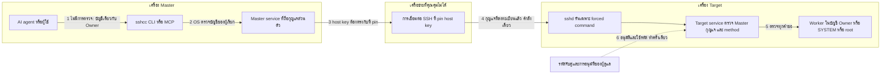

# โมเดลความปลอดภัย (Security model)

หน้านี้อธิบายด้วยภาษาง่าย ๆ ว่า SSH Control Center ทำอะไรได้บ้าง ใครสั่งงานผ่านมันได้ อะไรช่วยป้องกันคุณ และอะไร **ไม่ได้** ช่วยป้องกันคุณ ท้ายหน้ามีเช็กลิสต์สำหรับใช้งานอย่างปลอดภัย

เนื้อหานี้คือการทบทวนโค้ดใน repository นี้โดยผู้เขียนเอง ไม่ได้รวมรายงานการตรวจสอบความปลอดภัยจากบุคคลที่สาม และไม่ได้อ้างว่ามี โปรดอ่านก่อนติดตั้งเครื่องมือนี้บนเครื่องที่สำคัญ หากพบปัญหา ดูวิธีแจ้งที่ [SECURITY.md](../../SECURITY.md)

## สรุปสั้น ๆ

- **คืออะไร:** SSH Control Center ให้คุณ (หรือ AI agent) สั่งงาน แก้ไฟล์ และเปิด terminal บนคอมพิวเตอร์เครื่องอื่น
- **ทำไมสำคัญ:** นั่นคืออำนาจระดับผู้ดูแลระบบ บน Windows งานรันด้วยสิทธิ์ administrator ของเจ้าของเครื่อง (Owner) ที่ login อยู่ บน Ubuntu งานรันเป็น root ได้
- **ป้องกันอย่างไร:** ประตูภายในเครื่องปิดไม่ให้ผู้ใช้อื่นเข้า มีการปักหมุด (pin) host key ของ SSH ทุก Target รับได้แค่คำสั่งเดียวที่ล็อกไว้ และทุกคำขอถูกตรวจซ้ำที่ Target
- **สิ่งที่ไม่ทำ:** มันไม่ถามว่า "แน่ใจไหม?" ก่อนรันคำสั่ง AI agent ที่ถูกหลอกทำได้ทุกอย่างที่ Master ของมันทำได้ คนและโปรแกรมที่ใช้เครื่อง Master ได้คือเส้นแบ่งความปลอดภัยที่แท้จริงของคุณ

ลองนึกภาพ: Master คือ **พวงกุญแจ** ที่ไขได้ทุกประตูในอาคาร เครื่องมือนี้วางยามไว้ที่แต่ละประตู (การตรวจต่าง ๆ ด้านล่าง) แต่พวงกุญแจก็ยังทรงพลัง ใครถือพวงกุญแจก็ถืออาคารทั้งหลัง จึงต้องเก็บให้ดี

## คำศัพท์ที่ใช้ในหน้านี้

| คำ | ความหมายแบบง่าย |
|---|---|
| **Master** | คอมพิวเตอร์ที่ถือกุญแจและส่งคำสั่ง |
| **Target** | คอมพิวเตอร์ที่รับคำสั่ง เครื่องหนึ่งเป็นได้ทั้งสองบทบาท |
| **Owner** | บัญชีของผู้ใช้ที่ติดตั้งเครื่องมือและ login อยู่ เครื่องมือตัดสินว่าใครใช้ได้จากบัญชีนี้ |
| **SSH** | วิธีมาตรฐานที่เข้ารหัสสำหรับ login เข้าคอมพิวเตอร์เครื่องอื่น |
| **Host key** | "บัตรประจำตัว" SSH ของเครื่อง การ **pin** คือจำบัตรนั้นไว้และปฏิเสธเครื่องที่แสดงบัตรใบอื่น |
| **Forced command** | ค่า SSH ที่ให้กุญแจหนึ่งดอกรันได้แค่โปรแกรมเดียวเท่านั้น |
| **IPC** | "การคุยกันภายในเครื่องเดียว" ในที่นี้คือ named pipe ของ Windows หรือ Unix socket ของ Ubuntu |
| **SYSTEM / root** | บัญชีในตัวที่ทรงอำนาจสูงสุดบน Windows / Ubuntu |
| **MCP** | ปลั๊กที่ทำให้ AI agent เรียกใช้เครื่องมือนี้ได้ |
| **Prompt injection** | ข้อความที่ AI อ่านเจอ (หน้าเว็บ ไฟล์ บรรทัด log) แล้วถูกหลอกให้ทำตามคำสั่งของคนเขียน |
| **Atomic write** | เขียนไฟล์ลงชื่อชั่วคราวก่อน แล้วสลับเข้าที่ จึงไม่มีใครเห็นไฟล์ที่เขียนค้างครึ่งเดียว |

ภาพรวมที่ใหญ่กว่านี้อยู่ใน [วิธีทำงาน](how-it-works.md), [สถาปัตยกรรม](architecture.md) และ [การจับคู่ (Pairing)](pairing.md)

## ขอบเขตความเชื่อถือโดยย่อ

พูดให้ง่าย: ลูกศรแต่ละเส้นที่มีเลขคือการข้ามเส้นแบ่ง และแต่ละเส้นแบ่งมีการตรวจของตัวเอง เส้นแบ่งที่ 1 ไม่มีการตรวจเลย เพราะเหตุนี้เครื่อง Master และบัญชี Owner จึงสำคัญมาก

## 1. เครื่องมือนี้ทำอะไรได้

นี่คืออำนาจที่คุณส่งมอบเมื่อเชื่อม Master เข้ากับ Target

| คุณทำได้ | ไปไกลแค่ไหน |
|---|---|
| รันสคริปต์ (PowerShell บน Windows, Bash บน Ubuntu) | ทุกอย่างที่บัญชีผู้รันสั่งได้ สคริปต์ยาวได้ถึง 1 MiB ในโฟลเดอร์ที่คุณเลือก พร้อมค่า environment ที่คุณกำหนด |
| ดูรายการ อ่าน ค้นหา เขียน สร้าง และลบไฟล์ | path แบบ absolute ใดก็ได้ที่บัญชีนั้นเข้าถึงได้ ไม่มี sandbox จำกัดโฟลเดอร์ การเขียนหนึ่งครั้งจำกัด 4 MiB การลบทำได้กับไฟล์เดียวหรือโฟลเดอร์ว่างหนึ่งโฟลเดอร์ |
| เปิด terminal แบบโต้ตอบ | shell สดในบัญชีเดียวกัน |
| เริ่มจับคู่เครื่องใหม่ | แค่เริ่มขั้นตอนการอนุมัติ ดูหัวข้อ 4.3 |

บัญชีไหนเป็นผู้ทำงาน?

- **การติดตั้งใหม่ (โหมด owner-session ซึ่งเป็นค่าเริ่มต้น)** jobs, files และ terminals รันในบัญชี **Owner** บน Windows คือ administrator token แบบ elevated ของ Owner และ Owner ต้องเป็น administrator อยู่แล้ว บน Ubuntu คือผู้ใช้ปกติของ Owner หรือ **root** เมื่อคำขอระบุ `asAdmin: true`
- **การติดตั้งที่ค้างมาจาก build รุ่นก่อน (โหมด service)** งานรันเป็น SYSTEM / root จนกว่าจะสั่งให้ตัวติดตั้งสลับโหมด
- **service ของเครื่องมือเองบน Target** รันเป็น SYSTEM / root เสมอ การตรวจด้วย `doctor` จะไม่ผ่านสำหรับ Target ที่ service ไม่เป็นเช่นนั้น

สรุป: **ให้ปฏิบัติต่อสิทธิ์เข้าถึง Master เหมือนรหัสผ่าน administrator ของทุกเครื่องที่มันควบคุม** กฎของบัญชีดูได้ที่ [OWNER-SESSION.md](../OWNER-SESSION.md)

## 2. ใครสั่งงานได้ และตรวจอย่างไร

### บน Master (และบนเครื่องใดก็ตามที่รัน service)

service ของเครื่องมือ **ไม่มีพอร์ตเครือข่ายของตัวเอง** มันรับเฉพาะ pipe ภายในเครื่อง (Windows) หรือ Unix socket (Ubuntu) ส่วน SSH ซึ่งระบบปฏิบัติการเป็นผู้รัน คือประตูเครือข่ายบานเดียว ผู้เรียกทุกคนถูกระบุตัวด้วยการถามระบบปฏิบัติการว่าเป็นใคร ไม่เคยเชื่อสิ่งที่ผู้เรียกบอกเอง

| ผู้เรียก | อนุญาตหรือไม่ |
|---|---|
| บัญชี Owner | อนุญาต |
| SYSTEM / root | อนุญาต |
| บัญชี `sshcc-bridge` (เฉพาะ Target) | เฉพาะการเรียก bridge สองแบบ คือ `bridge.request` และ `bridge.stream` (สำหรับ stream ของ terminal และ relay) ซึ่งแต่ละแบบถูกตรวจซ้ำอีก (ดูหัวข้อ 3.4) |
| บัญชีในเครื่องอื่น ๆ | ไม่อนุญาต บน Ubuntu การเชื่อมต่อถูกปฏิเสธก่อนอ่านคำขอใด ๆ บน Windows รายการสิทธิ์ของ pipe ไม่มีชื่อพวกเขา และปฏิเสธ client ของ pipe ที่มาจากระยะไกล |

สองรายละเอียดที่ควรรู้:

- บน Ubuntu ไฟล์ socket เปิดให้ทุกคน (mode `0666`) โดยตั้งใจ ด่านจริงคือการตรวจ peer credential ของ kernel ไม่ใช่ mode ของไฟล์
- ฝั่ง client ก็ตรวจปลายทางอีกด้านด้วย โดยปฏิเสธ pipe หรือ socket ของ service ที่เจ้าของไม่ใช่ SYSTEM / root, กลุ่ม Administrators (Windows) หรือผู้ใช้ปัจจุบัน

**การตรวจนี้ดูที่บัญชี ไม่ได้ดูที่โปรแกรม** ทุกโปรแกรมที่รันในบัญชี Owner ผ่านด่านนี้หมด รวมถึง AI agent ของคุณ เบราว์เซอร์ของคุณ และมัลแวร์ที่คุณเผลอรัน

### บน Target (ผ่านเครือข่าย)

คำขอมาทาง SSH และต้องผ่านทุกขั้น:

1. SSH login ด้วยบัญชี bridge โดยเฉพาะ (ค่าเริ่มต้นชื่อ `sshcc-bridge`) ด้วยกุญแจ การ login ด้วยรหัสผ่านถูกปิดสำหรับบัญชีนี้
2. SSH รัน forced command ตัวเดียวคือ `sshcc bridge` ซึ่งระบุ Master ID และ fingerprint กุญแจของ Master
3. Target service ตรวจว่า Master นี้ลงทะเบียนแล้วและไม่ถูกเพิกถอน (revoke) ว่า fingerprint ของกุญแจตรงกัน และว่าคำขอนี้ตั้งใจมาที่ Target เครื่องนี้
4. Target service ตรวจว่า method อยู่ในรายการที่อนุญาต
5. จากนั้นจึงเริ่มงานในบัญชี Owner (หรือ SYSTEM / root ในโหมด service)

## 3. อะไรช่วยป้องกันคุณ

แต่ละข้อบอกว่ามันทำอะไร แล้วบอกว่าหาได้ที่ไหน path อ้างอิงจากรากของ repository

### 3.1 ประตูภายในเครื่องที่ปิดอยู่

มีเพียง Owner, SYSTEM / root และ (เฉพาะการเรียก bridge สองแบบ) บัญชี bridge เท่านั้นที่คุยกับ service ได้ ผู้ใช้อื่นและเครื่องระยะไกลทำไม่ได้ ขีดจำกัด: การเชื่อมต่อในเครื่องพร้อมกันได้ 64 รายการ และข้อความละไม่เกิน 8 MiB

*สำหรับนักพัฒนา:* `crates/core/src/ipc.rs` (`Listener::bind`, `peer`, `connect`), `crates/core/src/service.rs` (`run`, `handle`), `crates/core/src/protocol.rs`

### 3.2 ปักหมุด host key

Master จะเชื่อมต่อ Target ก็ต่อเมื่อ Target แสดง SSH host key ที่บันทึกไว้ตอนเพิ่มเครื่อง เครื่องมือเปิด OpenSSH ด้วยค่าส่วนตัวและไฟล์ known-hosts ของตัวเอง ไม่อ่านไฟล์ SSH ส่วนตัวของคุณเลย และปิด agent forwarding, port forwarding, การ login ด้วยรหัสผ่าน และ "update host keys" ถ้า host key ไม่ตรง เครื่องมือจะหยุด และ **ไม่** ลอง route ถัดไป

*สำหรับนักพัฒนา:* `crates/core/src/fleet_ssh.rs` (`session_config`, `host_mismatch`, unit test), `docs/CONTRACT.md`

### 3.3 คำสั่งเดียวที่ล็อกไว้ต่อกุญแจ Master หนึ่งดอก

ตัวติดตั้งฝั่ง Target เพิ่มกุญแจของ Master ลงไฟล์กุญแจแยกต่างหาก พร้อม `restrict` และ forced command และเพิ่มบล็อก `Match User` สำหรับ `sshcc-bridge` ที่ปิดการ login ด้วยรหัสผ่าน TCP forwarding agent forwarding terminal และ X11 บัญชี bridge เป็นบัญชีแยกต่างหากที่ไม่ใช่ administrator และไม่มีการส่งออกรหัสผ่านที่สร้างขึ้น ดังนั้นกุญแจที่ถูกขโมยจะเปิด shell ปกติไม่ได้ ทำได้แค่คุยกับ bridge ซึ่งตรวจซ้ำอีกชั้น

*สำหรับนักพัฒนา:* `installers/windows/Setup.ps1` และ `installers/ubuntu/setup.sh` (ค้นหา `restrict,command=` และ `Match User`)

### 3.4 ตรวจทุกคำขอ

Target service ตรวจซ้ำทุกคำขอ ต้องมี role เป็น target Master ID ต้องลงทะเบียนและไม่ถูก revoke โดย fingerprint กุญแจต้องตรงกับที่อยู่ใน forced command ต้องมี Target ID ที่คาดหวัง และ method ต้องอยู่ในรายการคงที่ การ revoke ถูกอ่านใหม่ทุกครั้ง ดังนั้น `masters.revoke` บล็อกคำขอใหม่ทันทีและปิด terminal ของ Master นั้น ส่วนงาน (job) ที่ Master นั้นเริ่มไปแล้วจะรันต่อจนกว่าจะถูกยกเลิก บรรทัดกุญแจเก่ายังค้างอยู่ในไฟล์กุญแจ SSH จนกว่าคุณจะลบ SSH จึงยังรับกุญแจนั้น แต่ Target service ปฏิเสธทุกคำขอจากมัน

*สำหรับนักพัฒนา:* `crates/core/src/service.rs` (`handle`, `bridge_master`), `crates/core/src/fleet.rs` (`authorized_master_key`, `revoke_master`)

### 3.5 เขียนไฟล์อย่างปลอดภัย

การเขียนไปที่ไฟล์ชั่วคราวข้างไฟล์จริงซึ่งเป็นส่วนตัวของบัญชีนั้น ข้อมูลถูกบันทึกลงดิสก์ แล้วจึงสลับไฟล์เข้าที่ เจ้าของ กลุ่ม mode (Ubuntu) และ ACL (Windows) เดิมถูกคงไว้ มีตัวป้องกันแบบ SHA-256 ที่เลือกใช้ได้ (`expectedSha256`) จะปฏิเสธการเขียนถ้าไฟล์เปลี่ยนไประหว่างนั้น การเขียนไปที่ path ที่เป็น symbolic link เอง หรือไม่ใช่ไฟล์ปกติ ถูกปฏิเสธ การเปลี่ยนแปลงไฟล์ถูกจัดคิวทีละรายการช่วงสั้น ๆ เพื่อไม่ให้ Master สองเครื่องผ่านตัวป้องกันเดียวกันพร้อมกัน

สิ่งนี้ปกป้อง **ความถูกต้องของข้อมูล** ไม่ใช่ sandbox: path แบบ absolute ใดก็ได้ถูกอนุญาต

*สำหรับนักพัฒนา:* `crates/core/src/files.rs`

### 3.6 งานไม่ถูกรันซ้ำ

งานมี ID ที่ผู้เรียกเป็นคนเลือก ส่ง ID เดิมกับคำสั่งเดิมจะได้งานเก่ากลับมา ส่ง ID เดิมกับคำสั่งอื่นจะถูกปฏิเสธ ถ้า Target service เริ่มใหม่ งานที่ยังไม่จบจะถูกทำเครื่องหมาย `interrupted` และ **ไม่** ถูกเริ่มใหม่ การที่การเชื่อมต่อ SSH หลุดไม่ทำให้งานหยุด

*สำหรับนักพัฒนา:* `crates/core/src/jobs.rs`

### 3.7 Terminal เป็นของ Master ที่เปิดมัน

เฉพาะ Master ที่สร้าง terminal เท่านั้นที่อ่านหรือเขียนได้ การ revoke Master นั้นจะปิด terminal SSH Control Center เองไม่เขียนข้อความที่พิมพ์ลงดิสก์ แต่ shell ที่คุณเปิดอาจเก็บไฟล์ประวัติ (history) ของมันเอง ผลลัพธ์เก็บในหน่วยความจำเท่านั้น ไม่เกิน 4 MiB และ terminal ที่ถูกถอดออก (detach) ทิ้งไว้ 30 นาทีจะถูกปิด

*สำหรับนักพัฒนา:* `crates/core/src/terminal.rs`, [OWNER-SESSION.md](../OWNER-SESSION.md)

### 3.8 หน้าต่าง desktop ที่มีรั้วกั้น

หน้าต่าง desktop โหลดเฉพาะไฟล์ที่แพ็กมากับแอป Content Security Policy (CSP คือชุดกฎของเบราว์เซอร์) อนุญาต script และ style จากตัวแอปเท่านั้น ไม่อนุญาต object และเชื่อมต่อได้เฉพาะสะพานภายในของแอป ไฟล์ capability ของหน้าต่างระบุชื่อเฉพาะหน้าต่างหลัก

*สำหรับนักพัฒนา:* `desktop/src-tauri/tauri.conf.json`, `desktop/src-tauri/capabilities/default.json`

### 3.9 กุญแจส่วนตัวอยู่กับที่

Master สร้างกุญแจ Ed25519 หนึ่งดอกต่อกลุ่มและเก็บไว้ในโฟลเดอร์ state ที่ป้องกันไว้ ไฟล์ enrollment bundle คำขอจับคู่ และรหัสจับคู่มีเฉพาะข้อมูล **สาธารณะ** โฟลเดอร์ state ถูกล็อก (บน Windows ใช้ ACL ที่ระบุเฉพาะ SYSTEM และ Administrators service รันเป็น SYSTEM จึงไม่ได้ระบุบัญชี Owner ส่วนบน Ubuntu ใช้ mode `0700` / `0600`)

*สำหรับนักพัฒนา:* `crates/core/src/fleet.rs` (`master_key`), `crates/core/src/security.rs` (`protect`), `crates/core/src/pairing.rs`

## 4. อะไร **ไม่ได้** ช่วยป้องกันคุณ

นี่คือช่องว่างจริง อ่านก่อนตัดสินใจว่าจะใช้เครื่องมือนี้อย่างไร

### 4.1 `asAdmin` เป็นแค่พารามิเตอร์

`asAdmin` คือช่อง ใช่/ไม่ใช่ ในคำขอ ใครส่งคำขอก็เป็นคนตั้งค่า โค้ดตรวจแค่ว่าเป็นค่า true/false แล้วทำตามที่บอก บน Ubuntu งานจะรันเป็น root บน Windows ไม่มีผลอะไรเพราะ Owner เป็น elevated อยู่แล้ว ไม่มี prompt และไม่มีการอนุมัติครั้งที่สอง ข้อความของ MCP ที่บอก agent ว่า "ปิด `asAdmin` ไว้ เว้นแต่ผู้ใช้ขอ" เป็นคำแนะนำถึง AI ไม่ใช่กุญแจล็อก

*สำหรับนักพัฒนา:* `crates/core/src/executor.rs` (`select`, `spawn`, `metadata`), `crates/core/src/mcp.rs` (`INSTRUCTIONS`), `crates/core/src/agent_tools.rs`

### 4.2 AI agent ถูกหลอกได้ (prompt injection)

agent ที่อ่านไฟล์ หน้าเว็บ หรือบรรทัด log จาก Target อาจถูกชักนำด้วยข้อความที่ซ่อนอยู่ข้างใน ถ้าเป็นเช่นนั้น agent ใช้ทุกเครื่องมือที่นี่ได้บนทุก Target ของ Master มัน: รันคำสั่ง แก้หรือลบไฟล์ เปิด terminal เครื่องมือมีป้ายอย่าง `readOnlyHint` และ `destructiveHint` แต่นั่นเป็นคำใบ้สำหรับ AI client SSH Control Center ไม่ได้บังคับใช้ และไม่มี prompt อนุมัติคำสั่งของตัวเอง ขั้นตอน "ถามฉันก่อน" ใด ๆ มาจาก AI client ที่คุณใช้

*สำหรับนักพัฒนา:* `crates/core/src/mcp.rs`, `crates/core/src/agent_tools.rs`; [AGENT.md](../AGENT.md) บอกให้ถือว่า log และซอร์สไฟล์เป็นข้อมูลที่ไม่น่าเชื่อถือ

### 4.3 การอนุมัติการจับคู่คือการมอบการเข้าถึงที่ทรงพลัง

เมื่อคุณอนุมัติตัวติดตั้งบน Target มันจะขอสิทธิ์ administrator (UAC บน Windows, `pkexec` หรือ `sudo` บน Ubuntu และต้องพิมพ์ `APPROVE` ในโหมด terminal) จากนั้นติดตั้ง service แบบ SYSTEM / root สร้างบัญชี bridge และเพิ่มกุญแจของ Master ตั้งแต่ตอนนั้น agent ของ Master ทำตามที่อธิบายในหัวข้อ 1 ได้

- ข้อความอนุมัติเป็น **ภาษาไทย** (ปุ่มยืนยันของกล่องโต้ตอบบน Ubuntu เขียนว่า "Approve — อนุญาต") บอกชื่อ Master ชื่อเครื่องใหม่ และกลุ่ม แต่ **ไม่** แสดง fingerprint ของกุญแจ Master (`sshcc pairing inspect` พิมพ์ให้ได้ในชื่อ `masterFingerprint`)
- คำขอจับคู่ไม่มีวันหมดอายุอัตโนมัติ การเลิกทำคำขอบน Master ไม่ได้ถอนสิทธิ์ที่ให้ไปแล้วบน Target
- Target จะถูกรายงานว่าพร้อมก็ต่อเมื่อ service ของมันรันเป็น SYSTEM / root และ node identity ตรงกัน

*สำหรับนักพัฒนา:* `installers/windows/PairingBootstrap.ps1`, `installers/windows/Setup.ps1`, `installers/ubuntu/setup-helper.py`, `installers/ubuntu/org.sshcc.setup.policy`, `crates/core/src/pairing.rs` และ [pairing.md](pairing.md)

### 4.4 checksum ของรหัสจับคู่ไม่ใช่ลายเซ็น

รหัสจับคู่หน้าตาแบบ `SSHCC1.<data>.<sha256>` ส่วนท้ายคือค่าแฮช SHA-256 ของข้อมูล มันจับได้ว่าพิมพ์ผิดหรือคัดลอกมาไม่ครบ แต่ **ไม่** หยุดผู้โจมตี เพราะไม่มีกุญแจลับเกี่ยวข้อง ใครแก้ข้อมูลก็คำนวณแฮชใหม่ได้

รหัสนี้พก SSH host key ของ Target และ Master จะ pin มัน Master ตรวจว่ารหัสตรงกับคำขอที่มันสร้างเอง (request ID, Master ID, bundle digest, machine ID, กลุ่ม, OS, ผู้ใช้ และ route) สำหรับเครื่องที่ Master ยังไม่เคยลงทะเบียน ไม่มี host key เก่าให้เทียบ ส่วน Target ID ที่ลงทะเบียนไว้แล้ว รหัสที่พก host key ต่างออกไปจะถูกปฏิเสธ (`HOST_KEY_MISMATCH`) รหัสที่ปลอมขึ้นจึงอาจทำให้ Master เชื่อกุญแจผิดตัวสำหรับเครื่องใหม่ได้ route ยังต้องตรงกัน ผู้โจมตีจึงต้องตอบที่ address นั้นด้วย ให้ส่งตัวติดตั้งและรหัสผ่านช่องทางที่คุณไว้ใจเท่านั้น

*สำหรับนักพัฒนา:* `crates/core/src/pairing.rs` (`decode_receipt`, `validate_binding`) และ [CONTRACT.md](../CONTRACT.md) ระบุว่า checksum "is corruption detection"

### 4.5 สคริปต์และค่า environment ของงานถูกเก็บเป็นข้อความธรรมดา

เมื่องานเริ่ม Target บันทึกคำขอทั้งก้อนลงฐานข้อมูลงาน `jobs.sqlite` ซึ่งรวมสคริปต์และค่า environment ผลลัพธ์ไปอยู่ในไฟล์ log ไฟล์เหล่านี้อยู่ในโฟลเดอร์ state ที่ป้องกันไว้ แต่ไม่ได้เข้ารหัส นอกจากนี้ 4,096 ตัวอักษรแรกของแต่ละสคริปต์ปรากฏในระเบียนงานที่ **Master ที่ลงทะเบียนทุกเครื่อง** ดูรายการได้ ส่วนค่า environment ไม่อยู่ในระเบียนนั้น

Master เก็บสำเนาไว้ด้วย `fleet.sqlite` ของ Master ยังเก็บคำขอของแต่ละงาน (สคริปต์ โฟลเดอร์ทำงาน ค่า environment และตัวเลือก) เพื่อให้จดจำได้ว่าการลองใหม่ด้วยคำขอเดิมเป็นคำขอเดียวกัน กฎห้ามใส่ความลับใช้เหมือนกัน

อย่าใส่รหัสผ่านหรือ token ในสคริปต์ command line หรือค่า environment ให้เตรียมข้อมูลรับรอง (credentials) ไว้บน Target แทน ([INSTALL.md](../INSTALL.md) อธิบายวิธี)

*สำหรับนักพัฒนา:* `crates/core/src/jobs.rs` (คอลัมน์ `payload` และ `record`, `start`, `list`) และ `crates/core/src/fleet.rs` (ตาราง `dispatches` ของ Master)

### 4.6 กุญแจส่วนตัวของ Master ไม่มี passphrase

กุญแจของกลุ่มถูกสร้างด้วย passphrase ว่าง (`ssh-keygen -N ""`) เพื่อให้ service ใช้ได้โดยไม่มีคนนั่งพิมพ์ สิทธิ์ของไฟล์คือการป้องกันเพียงอย่างเดียว ใครอ่านมันได้ เช่น administrator หรือ root บน Master หรือมัลแวร์ที่มีสิทธิ์เหล่านั้น ก็ login เข้าทุก Target ของกลุ่มนั้นได้จากคอมพิวเตอร์เครื่องใดก็ตามที่เข้าถึง Target ได้ จนกว่าคุณจะ revoke Master นั้น

*สำหรับนักพัฒนา:* `crates/core/src/fleet.rs` (`master_key`)

### 4.7 โปรแกรมใดก็ตามที่รันในบัญชี Owner ใช้ได้ทุก Target

ดังที่หัวข้อ 2 อธิบาย การตรวจในเครื่องดูที่บัญชี ไม่มีสิทธิ์รายโปรแกรมและไม่มี login เพิ่ม ทุกอย่างที่รันในบัญชี Owner บน Master สั่งงานบนทุก Target ของมันได้

### 4.8 กลุ่มคือป้ายชื่อ ไม่ใช่กำแพง

"กลุ่ม" (tenant) เลือกว่า Master ใช้กุญแจดอกไหนและช่วยจัดรายการ มันไม่ใช่ sandbox ของระบบปฏิบัติการและไม่ใช่เส้นแบ่งเครือข่าย Master ที่ลงทะเบียนทุกเครื่องมีอำนาจผู้ดูแลเหนือ Target ของมัน และไม่มีอะไรล็อกโปรเจกต์ไม่ให้ Master สองเครื่องทำงานพร้อมกัน ไฟร์วอลล์และกฎ Tailscale ของคุณเองเป็นตัวตัดสินว่าเครื่องไหนเข้าถึงเครื่องไหนได้

*สำหรับนักพัฒนา:* [AGENT.md](../AGENT.md) หัวข้อ "Concurrency and registry import"

### 4.9 การ merge Master ขยายขอบเขตการเข้าถึง

เมื่อ Master หนึ่งถูก merge เข้ากับอีกเครื่อง คำขอจะเดินทางหนึ่งช่วง (one hop) ไปยัง Master ที่ถูก merge ซึ่งส่งต่อด้วยกุญแจของตัวเอง ใครควบคุม Master ที่ merge จึงสั่งงาน Target ของ Master ที่ถูก merge ได้ด้วย Master ที่ถูก merge หยุดได้ด้วย `relays.revoke` ส่วน Master ที่ merge ลบ merge ได้ด้วย `merges.remove` ใน merge แบบสองทาง แต่ละฝั่งเพิกถอนทิศทางของตัวเองได้ และการ revoke ตัว Master เอง (`masters.revoke`) ก็หยุด relay ของมันด้วย

*สำหรับนักพัฒนา:* [AGENT.md](../AGENT.md) หัวข้อ "Merged Masters" และ `crates/core/src/service.rs` (`handle`)

### 4.10 ตัวติดตั้งไม่มีลายเซ็น (unsigned)

ตัวติดตั้งที่ build จากซอร์สนี้ไม่ได้ลงลายเซ็นโค้ด ไฟล์ `SHA256SUMS` ที่สร้างขึ้นแสดงเพียงว่าไฟล์ไม่เสียหาย และเฉพาะเมื่อคุณได้ค่าแฮชมาจากที่ที่ไว้ใจได้ มันไม่ได้บอกว่าใครสร้างไฟล์ (ตัวติดตั้ง Windows ตรวจลายเซ็นของตัวติดตั้ง WebView2 ของ Microsoft ที่มันเรียกใช้) ถ้าไม่แน่ใจ ให้ build จากซอร์ส

*สำหรับนักพัฒนา:* [BUILD-TOOLS.md](../BUILD-TOOLS.md), [INSTALL.md](../INSTALL.md), [VALIDATION.md](../VALIDATION.md), `installers/windows/Setup.ps1`

### 4.11 ไม่มีการตรวจสอบจากบุคคลที่สาม และการทดสอบยังจำกัด

repository นี้ไม่มีรายงานตรวจสอบความปลอดภัยจากบุคคลที่สาม ไม่มีไฟล์ตั้งค่า continuous integration และไม่มีไฟล์ตั้งค่าการสแกน dependency มีการทดสอบอัตโนมัติอยู่ รวมถึงการทดสอบกรณี host key ไม่ตรง กุญแจที่ถูก revoke และผู้เรียกในเครื่องที่ถูกปฏิเสธ [VALIDATION.md](../VALIDATION.md) แจกแจงว่าอะไรถูกทดสอบ และที่สำคัญไม่แพ้กันคืออะไรไม่ถูกทดสอบ เช่น ไม่มีอะไรใน tree นี้ที่รันตัวติดตั้ง Windows ตั้งแต่ต้นจนจบ

## 5. เช็กลิสต์ใช้งานอย่างปลอดภัย

1. **ลองบนเครื่องที่ทิ้งได้ก่อน** (virtual machine) ตามที่ [INSTALL.md](../INSTALL.md) แนะนำ ใช้กับคอมพิวเตอร์ที่คุณเป็นเจ้าของหรือได้รับอนุญาตให้ดูแลเท่านั้น
2. **เฝ้า Master เหมือนรหัสผ่าน administrator** ล็อกหน้าจอ เข้ารหัสดิสก์ ไม่แชร์บัญชี Owner และไม่รันซอฟต์แวร์ที่ไม่ไว้ใจในบัญชี Owner
3. **ส่งตัวติดตั้งและรหัสจับคู่ผ่านช่องทางที่ไว้ใจเท่านั้น** อย่าวางรหัสจับคู่ในแชตสาธารณะ
4. **อนุมัติเฉพาะคำขอที่คุณเริ่มเอง** บน Target อ่านชื่อ Master ชื่อเครื่อง และกลุ่มในข้อความอนุมัติ ถ้ามีอะไรดูผิดปกติ ให้ยกเลิก
5. **ปิด `asAdmin` ไว้ เว้นแต่จำเป็น และให้ AI client ถามก่อนลงมือ** เปิด prompt อนุมัติใน AI client ของคุณ อย่าชี้ agent ไปที่เครื่องที่มันไม่จำเป็นต้องใช้
6. **อย่าใส่ความลับในสคริปต์และค่า environment** มันถูกเก็บเป็นข้อความธรรมดาบน Target และอาจโผล่ใน log
7. **จำกัดว่าใครเข้าถึง SSH ได้** ใช้ไฟร์วอลล์หรือกฎ Tailscale เพราะกลุ่มไม่ใช่เส้นแบ่งเครือข่าย อัปเดตระบบปฏิบัติการและ OpenSSH ให้ทันสมัย
8. **เก็บกวาด** revoke Master ที่เลิกใช้ (`masters.revoke`) ลบบรรทัดกุญแจที่มีป้ายกำกับ (`sshcc:master:<UUID>`) ออกจากไฟล์กุญแจของ Target และลบ Target ที่ไม่ได้ดูแลแล้ว ตรวจไฟล์ที่ดาวน์โหลดกับ `SHA256SUMS` หรือ build จากซอร์ส

## อ่านเพิ่มเติม

- [วิธีทำงาน](how-it-works.md), [การจับคู่ (Pairing)](pairing.md), [สถาปัตยกรรม](architecture.md), [คำถามที่พบบ่อย](faq.md)
- [INSTALL.md](../INSTALL.md), [OWNER-SESSION.md](../OWNER-SESSION.md), [AGENT.md](../AGENT.md), [CONTRACT.md](../CONTRACT.md), [VALIDATION.md](../VALIDATION.md) (เอกสารอ้างอิงเหล่านี้เป็นภาษาอังกฤษ)
- [คู่มือเริ่มใช้งานภาษาไทย](../QUICKSTART.th.md) และ [ภาพรวมสถาปัตยกรรมและวงจรงาน](../ARCHITECTURE.th.md)
- หน้านี้ฉบับภาษาอังกฤษ: [security-model.md](../security-model.md)
- การแจ้งช่องโหว่: [SECURITY.md](../../SECURITY.md)
